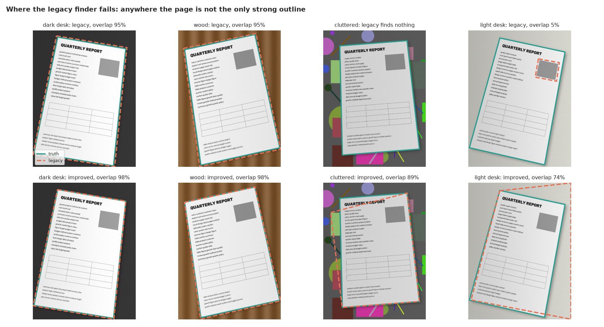
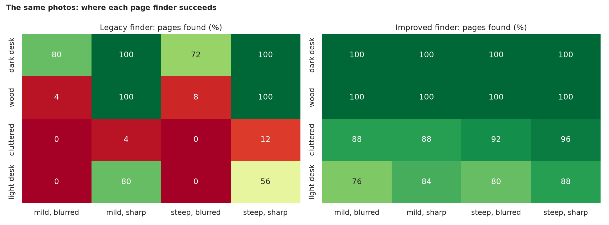
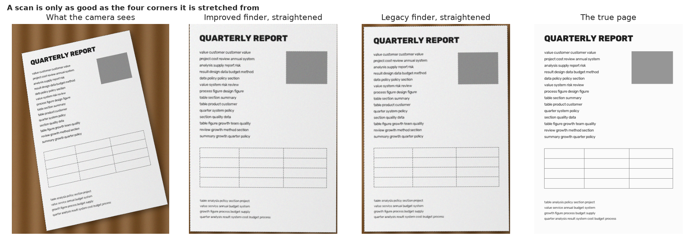

# Document Scanner: how often does "find the biggest four-cornered shape" actually find the page?

> A scanner app finds a sheet of paper in a photo, stretches it flat and gives you a clean scan. The classic OpenCV recipe is a few lines: find edges, thicken them, take the biggest four-cornered shape and warp it. How often does it work, what breaks it, and how much better can a careful recipe do? Every photo here is **synthetic with a known true outline**, so success can be counted.

## 📓 Start here

**[`document_scanner.ipynb`](document_scanner.ipynb)** is the main lesson: every step has a plain-English explanation, the code, and a "how to read this" note. Prefer a web page? Open the pre-rendered report: **[`docs/cv-document-scanner.html`](../../docs/cv-document-scanner.html)**.

## 💡 The Simple Analogy

**Cutting a sheet of paper out of a photo with scissors, following the dark lines.** On a dark desk the page is one clean outline. On a busy desk there are many outlines, and "the biggest four-cornered outline" may be a book. On a pale desk the page barely stands out. A blurry photo smears every outline. A better cutter first *colours in* the page (brighter and less colourful than most things on a desk), follows that outline, and falls back on the nearest rectangle if the corners are unclear.

## 🔬 The Hypothesis & Statistical Question

| # | Question | Method | Result |
|---|---|---|---|
| H1 | Does the legacy finder find the page reliably? | Success = at least 90% overlap with the true page; Wilson CI | **No**: 44.8% (CI 40.0% to 49.6%); in 12.5% it finds no four-corner shape and the script would crash; 88% (dark desk), 53% (wood), 34% (pale desk), 4% (cluttered) |
| H2 | Does a sturdier finder do better on the same photos? | Exact McNemar on 400 paired photos | **Yes**: 93.2% (CI 90.4% to 95.3%); fixes 196 photos, loses 2 (p = 1e-55) |
| H3 | What drives the failures? | Chi-square, Cramér's V, Mann-Whitney on contrast | **Legacy: surface (V = 0.61) and blur (69% sharp vs 20% blurred); the tilt of the page does not matter** (p = 0.69). **Improved: only contrast**: the 27 failures have a median paper-to-surface contrast of 25 grey levels |
| H4 | Is the scan itself better? | Corner error and PSNR vs the true page; Wilcoxon on 177 photos both solved | **Yes**: corner error 0.39% vs 1.05% of the diagonal; +4.1 dB PSNR, higher in 99% of photos |

## 📊 Key Data Insights & Annotated Visualizations


Where the legacy finder fails: anywhere the page is not the only strong outline.


The same 400 photos: where each page finder succeeds.


A scan is only as good as the four corners it is stretched from.

## ⚙️ How it Works (Under the Hood)

The notebook is fully self-contained: no helper modules, just top-to-bottom cells.

1. **Data:** a generator draws an A4 page and "photographs" it: 4 surfaces (dark desk, wood, cluttered, pale) x 2 viewing angles x 2 blur settings x 25 photos = 400 photos with known true corners. No camera, no download.
2. **Legacy finder:** blur, Canny (200, 200), several dilations and an erosion, then the biggest four-corner contour.
3. **Improved finder:** three outlines (auto-tuned edges joined by closing; Otsu bright region; bright low-colour region), each fitted to a convex four-corner shape (rotated rectangle as a last resort), best page-like candidate wins. Written before seeing results; not tuned on these photos.
4. **Metrics:** overlap with the true page (IoU), corner error, and PSNR of the straightened page against the true page.
5. **Statistics:** Wilson intervals, exact McNemar, chi-square with Cramér's V, Mann-Whitney, Wilcoxon.

**What changed from the legacy script:** it was a webcam-only demo that was never measured, with hard-coded edge thresholds, heavy thickening of the outline, and a crash when no four-corner shape was found.

## 🚀 How to Run (One-liner command)

```bash
uv sync --extra cv && uv run jupyter lab CV/document-scanner/document_scanner.ipynb
```

No data and no camera needed; it takes about 1 minute on a CPU. Standalone alternative: `pip install -r requirements.txt` and open the notebook in any Jupyter. To rebuild the web report:

```bash
uv run jupyter nbconvert --to html --execute CV/document-scanner/document_scanner.ipynb \
    --output-dir docs --output cv-document-scanner
```

## ⚠️ Limitations & Edge Cases

- **Synthetic photos:** real ones have glare, curled paper, fingers and folds; the ranking of the finders and the causes of failure transfer, absolute rates will not.
- **One page layout** (pale-margined A4 text and table).
- **The improved finder is not a learned model;** a production scanner would use a learned corner detector.
- **Rotation up to 18 degrees only,** and pages fully inside the frame.
- **The 90% overlap threshold is a choice.**
- **The legacy webcam code was re-implemented in a few lines, not run.**
