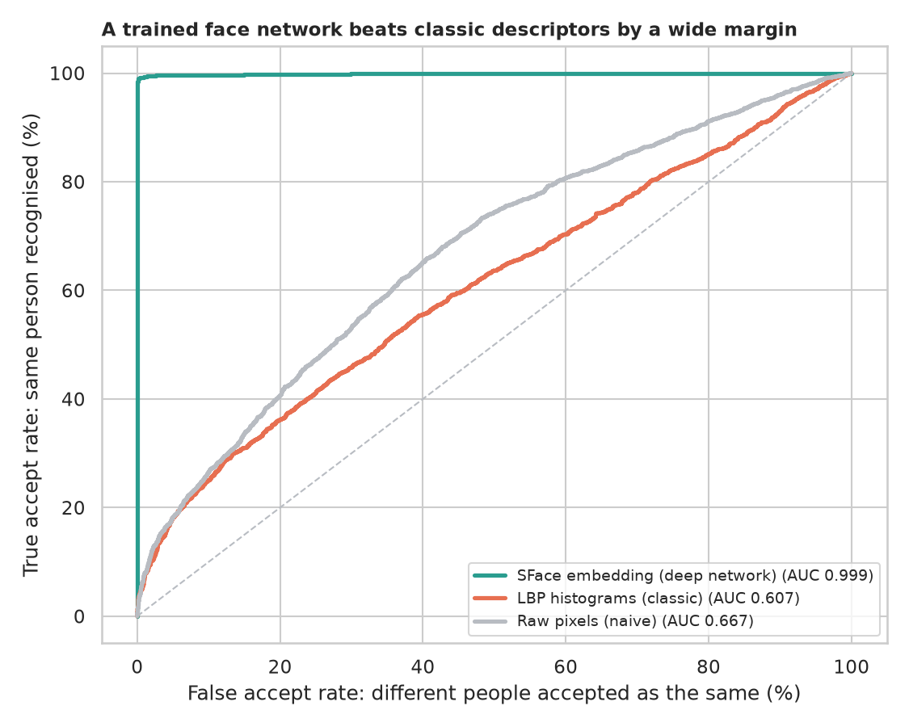
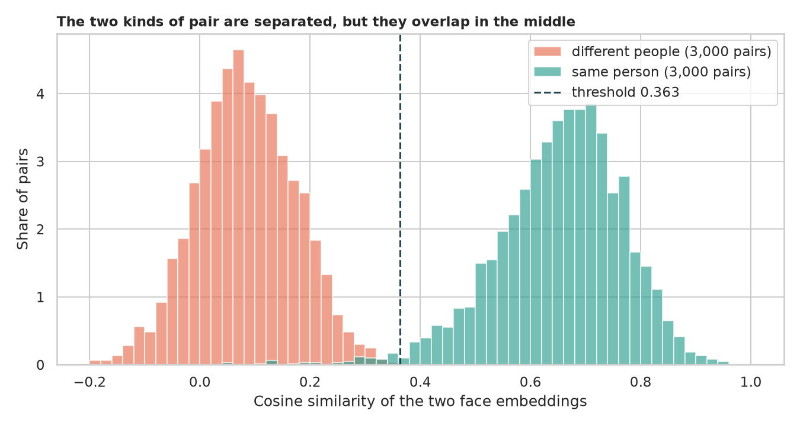
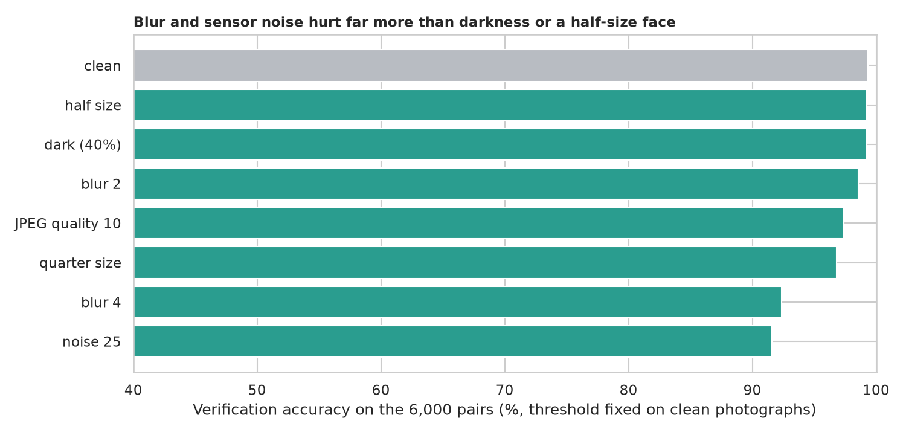
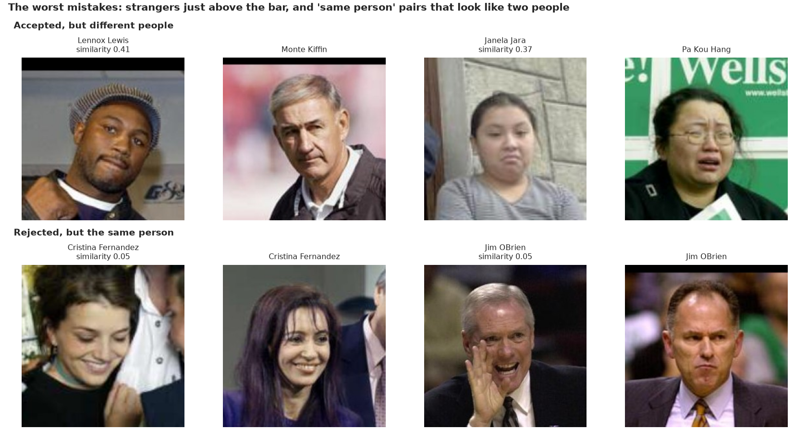

# Face Recognition: are these two photographs the same person?

> The legacy notebook was a Google Colab script: it encoded a folder of "known" photographs with the `face_recognition` library, compared "unknown" ones and printed the matches, without ever counting how often a match was right. How accurate is modern face verification on a standard benchmark, how much does a deep network add over classic descriptors, where should the threshold sit, what causes the rare mistakes, and how fragile is it? Tested on the 6,000 standard LFW pairs.

## 📓 Start here

**[`face_recognition.ipynb`](face_recognition.ipynb)** is the main lesson: every step has a plain-English explanation, the code, and a "how to read this" note. Prefer a web page? Open the pre-rendered report: **[`docs/cv-face-recognition.html`](../../docs/cv-face-recognition.html)**.

## 💡 The Simple Analogy

A **border guard comparing a passport photograph with the person in front of him**. A naive guard compares the pictures dot by dot; a trained guard has learnt a short description of a face that survives changes of light, angle and expression, and decides "same person" if the two descriptions are close enough. The **threshold** is how close is close enough. Bad conditions (blur, noise, a tiny face) make an honest traveller look like a stranger.

## 🔬 The Hypothesis & Statistical Question

Labeled Faces in the Wild, standard protocol: 6,000 pairs (3,000 same person, 3,000 different) in 10 folds with disjoint people; the threshold is chosen on nine folds and tested on the tenth. Faces: OpenCV YuNet detector, SFace embeddings.

| # | Question | Method | Result |
|---|---|---|---|
| H1 | Does a deep network beat classic descriptors? | 10-fold accuracy; paired Wilcoxon; AUC, EER, TAR at fixed FAR | **Yes**: SFace 99.35% (SE 0.12%), AUC 0.9988, 98.8% accepted at 0.1% false accepts; LBP histograms 57.4%, raw pixels 61.9%; better in 10 of 10 folds |
| H2 | Does a tuned threshold beat the recommended 0.363? | Paired Wilcoxon | **No**: 99.35% vs 99.20% (p = 0.062); tuned thresholds 0.308 to 0.332 across folds |
| H3 | Are mistakes related to photo quality? | Mann-Whitney, Cliff's δ | **Not clearly**: 39 wrong pairs; face size and blur do not separate them (p = 0.25, 0.60); detector confidence slightly (p = 0.001, δ = -0.30) |
| H4 | Is it robust to degradation? | Exact McNemar vs the clean run | **Blur (σ=4) and noise: 92.4% and 91.6%** (about 14% to 16% of same-person pairs rejected); quarter size 96.8%; JPEG q10 97.4%; darkness and half size: no change |
| H5 | The worst mistakes | Examples | False accepts barely clear the bar (0.41, 0.37); the worst false rejects look like two different people (probable LFW label errors) |

## 📊 Key Data Insights & Annotated Visualizations


A trained face network beats classic descriptors by a wide margin.


The two kinds of pair are well separated, with a small overlap near 0.3.


Blur and sensor noise hurt far more than darkness or a half-size face.


The worst mistakes: strangers just above the bar, and "same person" pairs that look like two people.

## ⚙️ How it Works (Under the Hood)

1. **Data:** LFW photographs and the standard pairs file (downloaded on first run).
2. **Pipeline:** YuNet finds the most central face, `alignCrop` aligns it to 112 x 112, then three descriptions: SFace (128 numbers), LBP histograms (7 x 7 grid) and raw pixels; similarity is the cosine.
3. **Protocol:** 10 folds; threshold picked on nine folds; accuracy, AUC, equal error rate, true accept rate at fixed false accept rates.
4. **Degradations:** blur, shrinking, darkness, noise and JPEG applied to both photographs of every pair; exact McNemar tests against the clean run.

**What changed from the legacy notebook:** Colab and Google Drive dependencies, the width/height swap in the resize, an unchecked `face_encodings(img)[0]` and no ground truth, replaced by a benchmark with a protocol, tests and robustness checks.

## 🚀 How to Run (One-liner command)

```bash
uv sync --extra cv && uv run jupyter lab CV/face-recognition/face_recognition.ipynb
```

LFW (about 180 MB) and two small models (about 40 MB) download into `data/` on the first run; it takes about 35 minutes on a CPU. Standalone alternative: `pip install -r requirements.txt`.

## ⚠️ Limitations & Edge Cases

- **LFW is an easy benchmark:** sharp, well-lit, frontal news photographs of public figures.
- **Only 6,000 pairs and 39 mistakes,** so subgroup tests have little power.
- **The classic baselines are simple and untuned.**
- **No demographic analysis;** LFW is unbalanced and has no group labels.
- **Degradations are synthetic** and the threshold was not re-tuned for them.
- **One detector and one recogniser.**
- **Verification only,** not open-set identification (see the virtual-attendance project).
- **Face recognition raises privacy and consent issues** that no benchmark measures.
