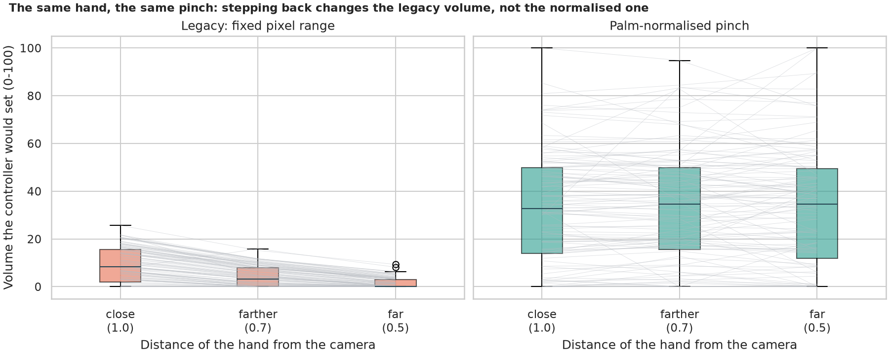
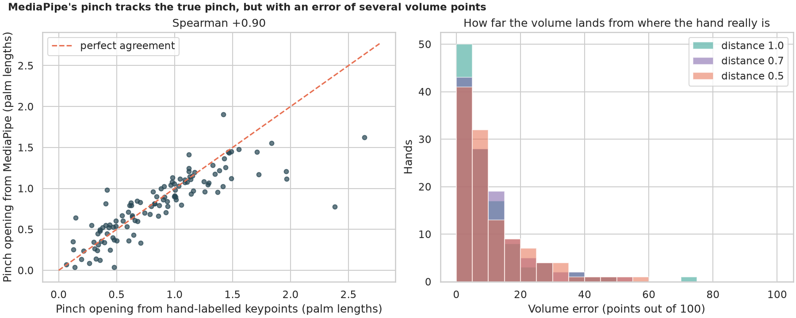
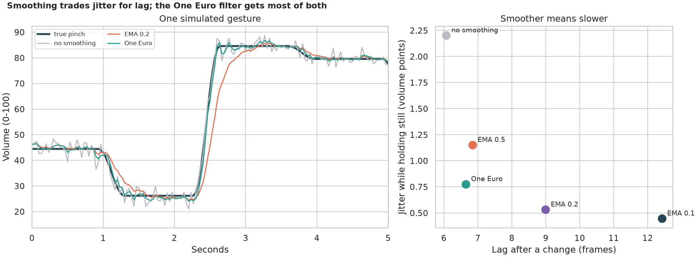

# Gesture Volume Controller: turning a pinch into a trustworthy knob

> Pinch your thumb and index finger in front of a webcam to turn the volume up or down. The legacy script measures the fingertip distance in pixels and maps 17 to 200 pixels to the volume. Does that mean the same thing when you sit further back, how accurately does the tracker read a pinch, and what does smoothing the jitter cost?

## 📓 Start here

**[`gesture_volume_controller.ipynb`](gesture_volume_controller.ipynb)** is the main lesson: every step has a plain-English explanation, the code, and a "how to read this" note. Prefer a web page? Open the pre-rendered report: **[`docs/cv-gesture-volume-controller.html`](../../docs/cv-gesture-volume-controller.html)**.

## 💡 The Simple Analogy

A **volume knob turned by holding two fingers apart**, measured with a ruler against a window. Sit further back and your fingers look smaller, so the same gap reads smaller on the ruler. A better knob measures the gap **in hand-widths**, which does not change when you move your chair. And a still hand still wobbles: smoothing calms it, but heavy smoothing makes the knob slow to follow, like sluggish steering.

## 🔬 The Hypothesis & Statistical Question

Ground truth: the CMU hand-keypoint test set (hand-labelled fingertips). Pinch opening = thumb-tip to index-tip distance divided by palm length.

| # | Question | Method | Result |
|---|---|---|---|
| H1 | Does the pinch reading depend on distance from the camera? | Same hands at 3 distances; Wilcoxon, Friedman | **Pixels: yes** (0.50x at half the distance, p = 2e-19); **palm lengths: no** (0.98x, p = 0.69). Legacy volume 9.0 to 1.4; normalised stays at 33 |
| H2 | Does the tracked pinch agree with the labelled one? | Spearman, Bland-Altman, volume error | **Yes, but loosely**: Spearman +0.90; median error 6.8 volume points, 68% within 10; limits of agreement -0.59 to +0.47 palm lengths |
| H3 | What does smoothing buy and cost? | 60 simulated gestures, jitter measured from real noisy frames; paired Wilcoxon | EMA 0.5: jitter -48% for +0.8 frames; EMA 0.1: -80% but +6.4 frames and RMSE 8.8; **One Euro: -65% for +0.6 frames, lowest RMSE (1.7)** |

## 📊 Key Data Insights & Annotated Visualizations


The same hand, the same pinch: stepping back changes the legacy volume, not the normalised one.


MediaPipe's pinch follows the true pinch, with an error of several volume points.


Smoothing trades jitter for lag; the One Euro filter gets most of both.

## ⚙️ How it Works (Under the Hood)

1. **Data:** 315 labelled hands that fill at least 10% of the frame, split by photograph into a calibration half (learns the volume range) and an evaluation half.
2. **Distance:** the scene is shrunk to 70% or 50% on a grey 640-pixel canvas, like leaning back from a fixed webcam.
3. **Signals:** the legacy pixel rule, and the pinch divided by the palm length mapped from the calibration half's 5th to 95th percentile (0.32 to 1.85 palm lengths).
4. **Filters:** none, exponential moving averages (0.5, 0.2, 0.1) and the One Euro filter, tested on simulated gestures with jitter and dropouts measured from noisy copies of real frames.

**What changed from the legacy scripts:** the hard-coded 17 to 200 pixel range, an audio call that only works on Windows, `mp.solutions.hands` (removed from current MediaPipe), a model created on every call, no smoothing, and no measurement. The volume is computed here, not set.

## 🚀 How to Run (One-liner command)

```bash
uv sync --extra cv && uv run jupyter lab CV/gesture-volume-controller/gesture_volume_controller.ipynb
```

The photographs (about 180 MB) and the hand model download into `data/` on the first run; it takes about 12 minutes on a CPU. MediaPipe needs the system library `libgles2` (`sudo apt install libgles2`). Standalone alternative: `pip install -r requirements.txt`.

## ⚠️ Limitations & Edge Cases

- **Photographs, not webcam video;** the hands are not in a deliberate pinch pose.
- **Distance is simulated** by shrinking the scene.
- **Only hands found at all three distances** are compared (77%).
- **Simulated gestures use independent noise;** real tracking errors are correlated in time.
- **The volume range comes from this dataset;** a real user would calibrate to their own hand.
- **Filter settings were picked once.**
- **The pinch is measured in 2D;** a turned hand changes the ratio.
- **The audio call is not tested.**
