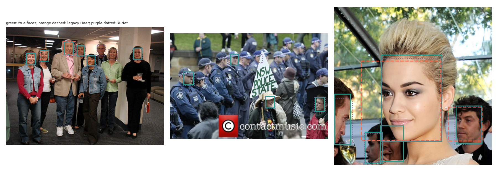
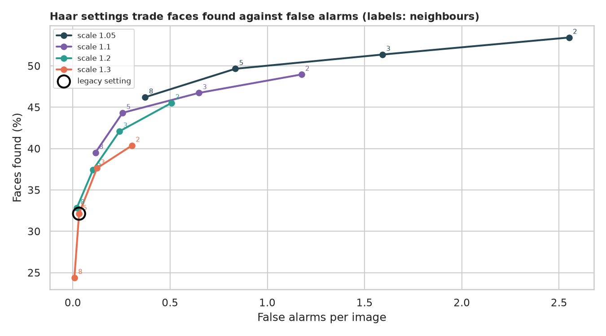
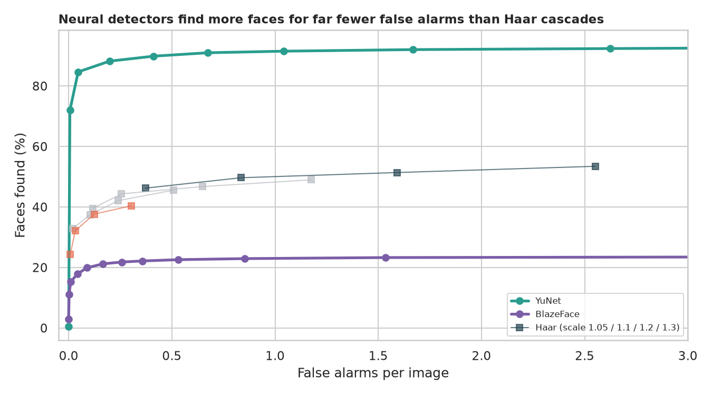
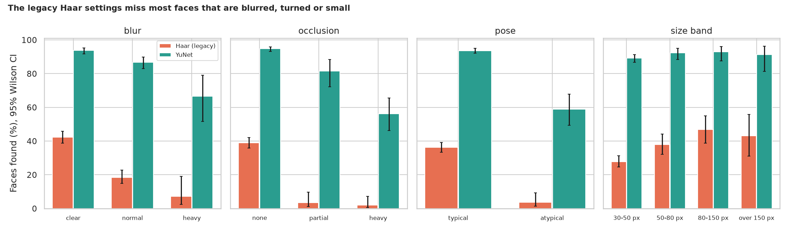

# Haar Face Detection: how good is the classic cascade, really?

> A few lines of OpenCV find faces in a webcam feed, and the demo looks great on a clear, front-facing face. How many faces in everyday photographs does the tutorial setting actually find, can two settings fix that, how do modern detectors compare, and which faces does it miss? Tested on 500 WIDER FACE photographs with hand-drawn ground truth.

## 📓 Start here

**[`haar_face_eye_detection.ipynb`](haar_face_eye_detection.ipynb)** is the main lesson: every step has a plain-English explanation, the code, and a "how to read this" note. Prefer a web page? Open the pre-rendered report: **[`docs/cv-haar-face-eye-detection.html`](../../docs/cv-haar-face-eye-detection.html)**.

## 💡 The Simple Analogy

A **guard at a door who knows one trick:** "a face has a dark band across the eyes, a bright nose bridge and a dark mouth." At the tutorial setting he is strict and skips most sizes, so he rarely cries wolf but misses most people, especially small, turned, blurred or half-hidden ones. A modern detector is a guard who has seen millions of faces in all kinds of situations.

## 🔬 The Hypothesis & Statistical Question

A face counts as found when a detection overlaps it by IoU ≥ 0.5. 1,152 scored faces (at least 30 px tall) in 500 images shrunk to 640 px.

| # | Question | Method | Result |
|---|---|---|---|
| H1 | Does the legacy setting find most faces? | Wilson interval | **No**: 33.2% (CI 30.5% to 35.9%), precision 95.5% |
| H2 | Can two settings be tuned to find more? | 16 settings, picked on one half and scored on the other; exact McNemar | **Yes, at a price**: holdout recall 49.5% vs 34.2%, with 10x the false alarms (0.49 vs 0.05 per image) |
| H3 | Do modern detectors find more? | Exact McNemar | **YuNet 90.5%** (660 faces gained, 0 lost, p = 4e-199); **BlazeFace 21.8%**, worse than legacy Haar |
| H4 | Is recall equal across kinds of faces? | Chi-square, Cramér's V | **No** for blur, occlusion, pose and size; illumination does not matter (p = 0.22) |
| H5 | What does it cost in time? | Bootstrap CI on median | Legacy Haar 14.6 ms, tuned Haar 60.5 ms, YuNet 31.6 ms, BlazeFace 11.2 ms per image |

## 📊 Key Data Insights & Annotated Visualizations


What each detector finds in the same photographs.


Haar's trade-off: more sensitive settings find more faces and many more false alarms.


Neural detectors find more faces for far fewer false alarms than any Haar setting.


Blur, occlusion, odd poses and small size cut the cascade's recall to a few percent.

## ⚙️ How it Works (Under the Hood)

1. **Data:** 500 random WIDER FACE validation images from the Hugging Face parquet branch, shrunk to 640 px, with blur, occlusion, pose and illumination labels. Faces under 30 px are ignored.
2. **Detectors:** OpenCV's Haar frontal-face cascade (legacy 1.3 / 5 and tuned), OpenCV YuNet and MediaPipe BlazeFace.
3. **Statistics:** Wilson intervals, exact McNemar tests on the same faces, chi-square with Cramér's V, bootstrap timing intervals. The Haar setting is chosen on one half of the images and judged on the other.

**What changed from the legacy script:** it drew boxes on whatever local images or webcam frames were at hand, used the tutorial defaults without a reason (its comment said `minNeighbors = 3` while the code used 5) and measured nothing. Eyes are not evaluated, as WIDER FACE has no eye annotations.

## 🚀 How to Run (One-liner command)

```bash
uv sync --extra cv && uv run jupyter lab CV/haar-face-eye-detection/haar_face_eye_detection.ipynb
```

The photographs and the small detector models download into `data/` on the first run; it takes about 10 minutes on a CPU. MediaPipe needs the system library `libgles2` (`sudo apt install libgles2`). Standalone alternative: `pip install -r requirements.txt`.

## ⚠️ Limitations & Edge Cases

- **500 images shrunk to 640 px;** shrinking hurts every detector.
- **Faces under 30 px are ignored;** counting them would lower every score.
- **Eyes are not tested** (no eye boxes in WIDER FACE).
- **IoU 0.5 and the thresholds (0.6, 0.5) are choices;** the curves show how results move with them.
- **Tuned-Haar numbers over all 500 images are partly in-sample;** the holdout numbers are the fair ones.
- **Attribute groups overlap** (blurry faces are often small and occluded too).
- **Speed is one CPU process;** other machines will differ.
- **Detectors used as shipped,** with no check across skin tones, ages or genders.
