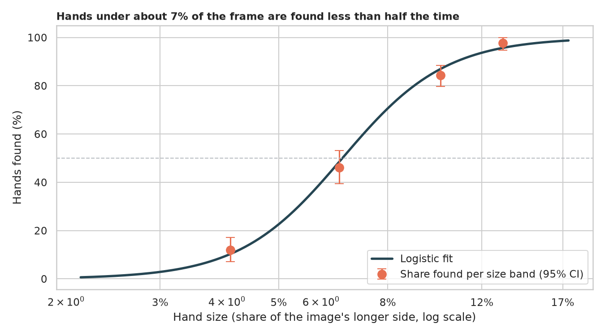
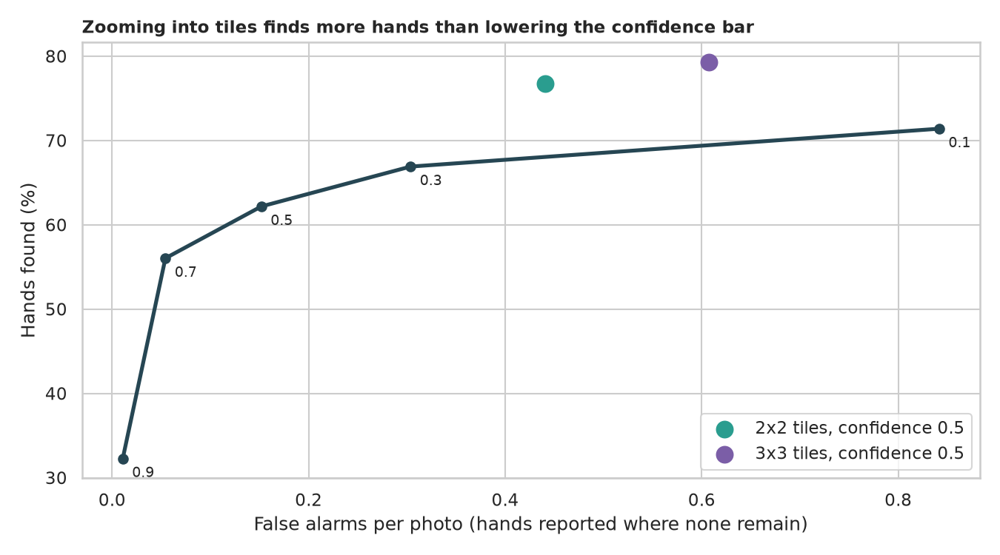
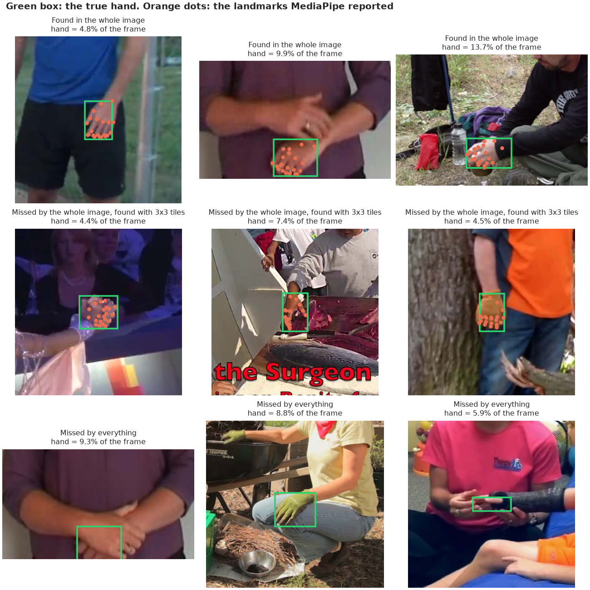
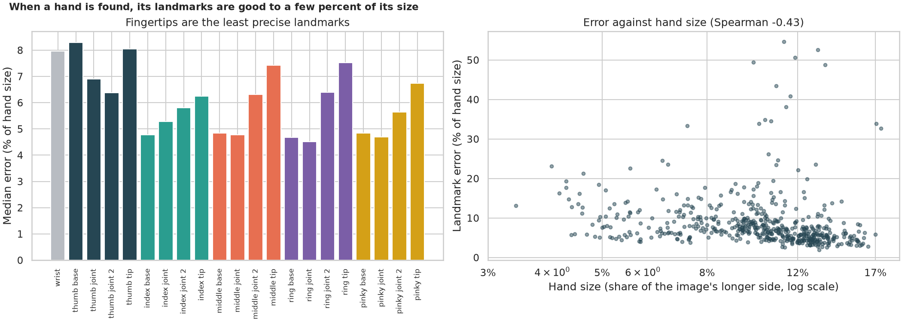

# Hand Detection: how many hands does MediaPipe really find?

> MediaPipe Hands draws 21 landmarks on a hand with three lines of code, and the demo looks magical when the hand is held up to the camera. How many real hands in ordinary photographs does it find, what decides it, can a simple trick find the missed ones, and how accurate are the landmarks? Tested on 846 hand-labelled hands in 461 photographs.

## 📓 Start here

**[`hand_detection.ipynb`](hand_detection.ipynb)** is the main lesson: every step has a plain-English explanation, the code, and a "how to read this" note. Prefer a web page? Open the pre-rendered report: **[`docs/cv-hand-detection.html`](../../docs/cv-hand-detection.html)**.

## 💡 The Simple Analogy

Looking for a friend's hand in a crowd photo through a small square window. If the hand fills the window you spot it at once. If it is a tiny smudge you must **step closer and look at one part of the picture at a time**. You can also lower your standards ("anything that might be a hand") and find more, but you will also point at gloves and shadows.

## 🔬 The Hypothesis & Statistical Question

A hand is found when the box around its landmarks overlaps the hand-labelled box by IoU ≥ 0.5. Intervals resample photographs, because hands from one photograph are not independent.

| # | Question | Method | Result |
|---|---|---|---|
| H1 | Does it find at least 90% of hands? | Cluster bootstrap | **No**: 62.2% (CI 58.4% to 66.3%) |
| H2 | Does hand size decide? | Logistic regression, clustered errors | **Yes**: each doubling of size multiplies the odds by 22 (CI 15 to 33); found half the time at 6.6% of the frame |
| H3 | Does zooming into tiles find more? | Exact McNemar | **Yes**: 2x2 tiles 76.7%, 3x3 tiles 79.3% (123 and 145 hands gained, p < 1e-36) |
| H4 | Lower the bar or zoom in? | Recall vs false alarms on hand-erased photos | **Zoom**: 2x2 tiles find 76.7% at 0.44 false alarms per photo; confidence 0.1 finds 71.4% at 0.84 |
| H5 | Are all landmarks equally accurate? | Paired Wilcoxon, Spearman | **No**: median error 7% of hand size; fingertips 8.1% vs finger bases 5.7% (p = 2e-29) |

## 📊 Key Data Insights & Annotated Visualizations


Hands under about 7% of the frame are found less than half the time.


Zooming into tiles finds more hands than lowering the confidence bar, for fewer false alarms.


Hands found, hands rescued by tiles, and hands missed by everything.


Fingertips are the least precise landmarks; small hands have larger relative errors.

## ⚙️ How it Works (Under the Hood)

1. **Data:** the CMU hand-keypoint test set (846 hands, 21 manual keypoints each) from the Hugging Face hub, downloaded on first run.
2. **Detector:** MediaPipe's current HandLandmarker (Tasks API) at confidence 0.5, run on the whole photograph, or on a 2x2 or 3x3 grid of overlapping zoomed-in tiles with duplicates merged.
3. **False alarms:** every labelled hand is painted out with OpenCV inpainting; any hand reported afterwards counts.
4. **Statistics:** photograph-level bootstrap, logistic regression with clustered errors, exact McNemar, paired Wilcoxon, Spearman.

**What changed from the legacy script:** it used `mp.solutions.hands`, which no longer exists in current MediaPipe, needed a live webcam, printed one landmark and measured nothing.

## 🚀 How to Run (One-liner command)

```bash
uv sync --extra cv && uv run jupyter lab CV/hand-detection/hand_detection.ipynb
```

The photographs (about 180 MB) and the hand model download into `data/` on the first run; it takes about 10 minutes on a CPU. MediaPipe needs the system library `libgles2` (`sudo apt install libgles2`). Standalone alternative: `pip install -r requirements.txt`.

## ⚠️ Limitations & Edge Cases

- **Photographs, not webcam video;** the tracker's video mode follows a hand between frames.
- **Unlabelled hands count as false alarms;** inpainted negatives are artificial, so compare settings with each other.
- **Tile settings were picked once and not tuned.**
- **Speed is one CPU process.**
- **One model** (the default float16 hand model).
- **No fairness check** across skin tones, ages or hand sizes.
- **Handedness** agrees with the labels here, but a mirrored camera image may flip it (not tested).
