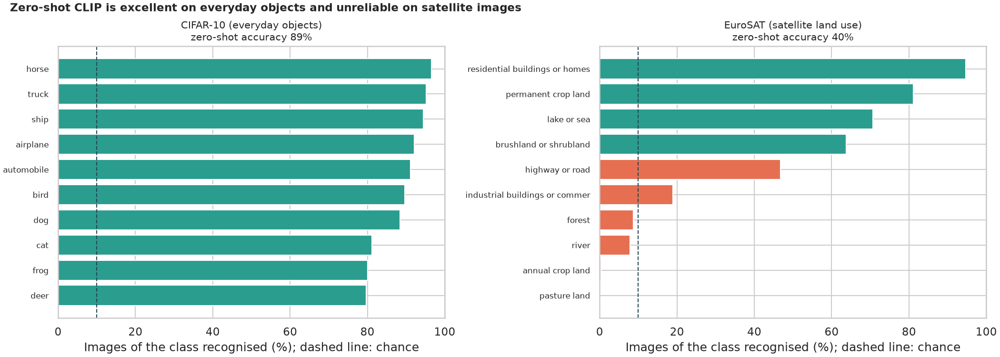
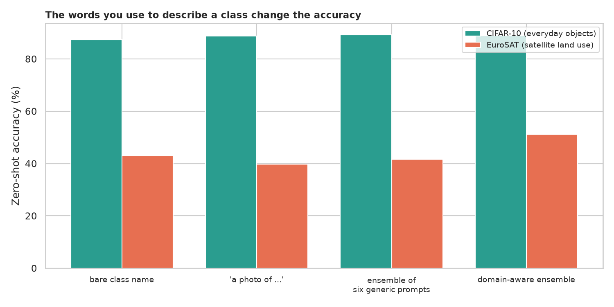
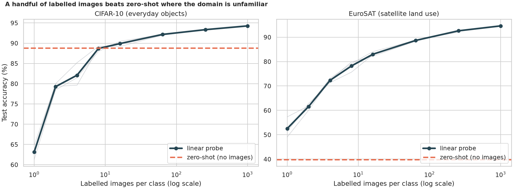
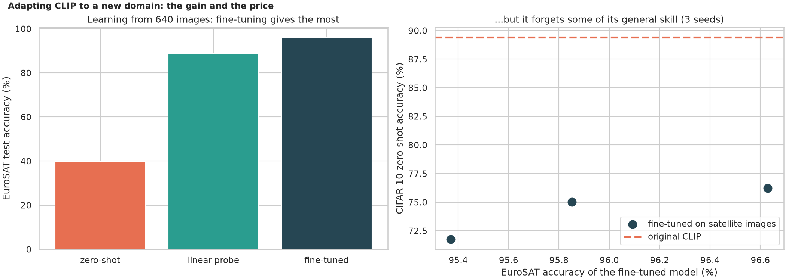
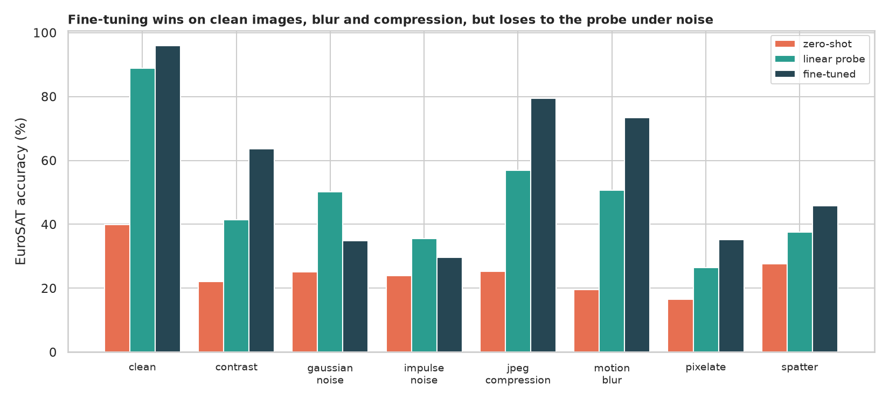
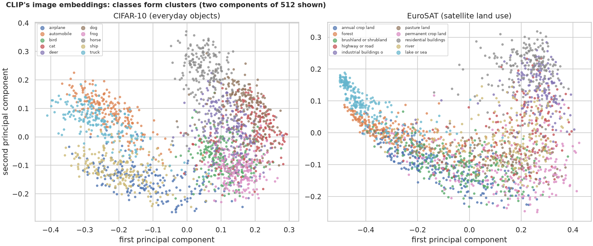

# CLIP: classifying images it was never trained to classify

> An ordinary classifier knows a fixed list of classes. CLIP, trained on 400 million image-caption pairs, places a picture and a sentence close together in one shared space, so you classify by writing the class names as sentences: zero-shot classification. How good is it, does it work on satellite images, does the wording matter, how many labelled images beat it, and what do fine-tuning and image corruptions do? Tested on CIFAR-10 (everyday objects) and EuroSAT (satellite land use).

## 📓 Start here

**[`multimodal_clip_zero_shot.ipynb`](multimodal_clip_zero_shot.ipynb)** is the main lesson: every step has a plain-English explanation, the code, and a "how to read this" note. Prefer a web page? Open the pre-rendered report: **[`docs/cv-multimodal-clip-zero-shot.html`](../../docs/cv-multimodal-clip-zero-shot.html)**.

## 💡 The Simple Analogy

A **museum guide who has read millions of picture captions** but never your quiz. Hand her ten cards with sentences and a photograph and she picks the best matching card. Show her a satellite photo and her experience runs out, and her answer depends on how you word the card. Show her a few labelled examples (a linear probe) and she learns your classes; send her back to school (fine-tuning) and she becomes a specialist, but forgets some everyday knowledge and can be thrown by smudges she never practised on.

## 🔬 The Hypothesis & Statistical Question

Model: CLIP ViT-B/32. Test sets: CIFAR-10 (10,000 images) and EuroSAT (2,700 images, plus 7 corrupted copies).

| # | Question | Method | Result |
|---|---|---|---|
| H1 | Is zero-shot equally accurate on objects and on satellite images? | Wilson CIs, chi-square, recall by class | **No**: CIFAR-10 **88.8%** vs EuroSAT **39.9%** (-49 points); two EuroSAT classes at 0% recall |
| H2 | Does the wording change the accuracy? | Four wordings, exact McNemar | **On EuroSAT yes**: satellite-aware prompts 51.2% vs 39.9% (+11.3, p = 2e-21); **on CIFAR-10 no** (+0.0) |
| H3 | How many labelled images beat zero-shot? | Linear probe learning curve, 3 seeds | **EuroSAT: 1 per class** (52.5% vs 39.9%); **CIFAR-10: about 16**; 1,000 per class gives 94.3% and 94.6% |
| H4 | Does fine-tuning beat a probe, and what does it cost? | Exact McNemar per seed; CIFAR-10 zero-shot before and after | **96.0% vs 88.7%** on the same 640 images (p < 1e-30), but CIFAR-10 zero-shot falls **89.4% to 74.3%** |
| H5 | Is each approach robust to corruptions? | Accuracy on 7 corrupted copies | **All collapse** (probe -46 points, fine-tuned -44, zero-shot -17); fine-tuning leads on blur and compression, **loses to the probe under noise** |

## 📊 Key Data Insights & Annotated Visualizations


Zero-shot CLIP is excellent on everyday objects and unreliable on satellite images.


The words you use to describe a class change the accuracy.


A handful of labelled images beats zero-shot where the domain is unfamiliar.


Adapting CLIP to a new domain: the gain and the price.


Fine-tuning wins on clean images, blur and compression, but loses to the probe under noise.


CLIP's image embeddings: classes form clusters.

## ⚙️ How it Works (Under the Hood)

1. **Embeddings:** CLIP's image and text towers each give 512 unit-length numbers; similarity is a dot product.
2. **Zero-shot:** one sentence per class (optionally an average over several prompts); the class with the highest similarity wins.
3. **Linear probe:** logistic regression on frozen image embeddings with 1 to 1,000 labelled images per class.
4. **Fine-tuning:** the image tower and a classifier initialised from the text embeddings, AdamW, learning rate 1e-5, 5 epochs on 640 images; the text tower is untouched. Forgetting is measured on CIFAR-10 zero-shot.
5. **Statistics:** Wilson intervals, chi-square, exact McNemar tests, three seeds.

## 🚀 How to Run (One-liner command)

```bash
uv sync --extra cv && uv run jupyter lab CV/multimodal-clip-zero-shot/multimodal_clip_zero_shot.ipynb
```

The image sets (about 350 MB) and CLIP (about 600 MB) download on the first run. It uses a GPU if present and takes about 15 minutes on one. Standalone alternative: `pip install -r requirements.txt`.

## ⚠️ Limitations & Edge Cases

- **One small CLIP model;** larger ones are better and may be more robust.
- **Tiny, enlarged images** (32 and 64 pixels) hurt every method.
- **Prompts were written by hand** and not tuned on validation images.
- **One probe regularisation setting and one fine-tuning recipe.**
- **Robustness uses the seed-0 models and clean training images.**
- **No fairness or safety review;** CLIP inherits the biases of its training data.
- **EuroSAT's class names are awkward,** so some failures reflect the labelling scheme.
