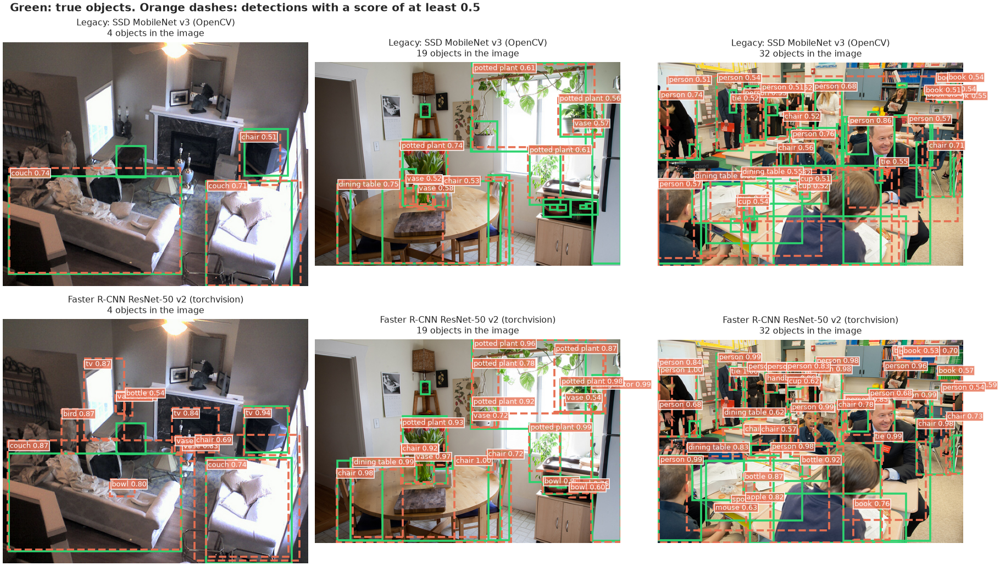
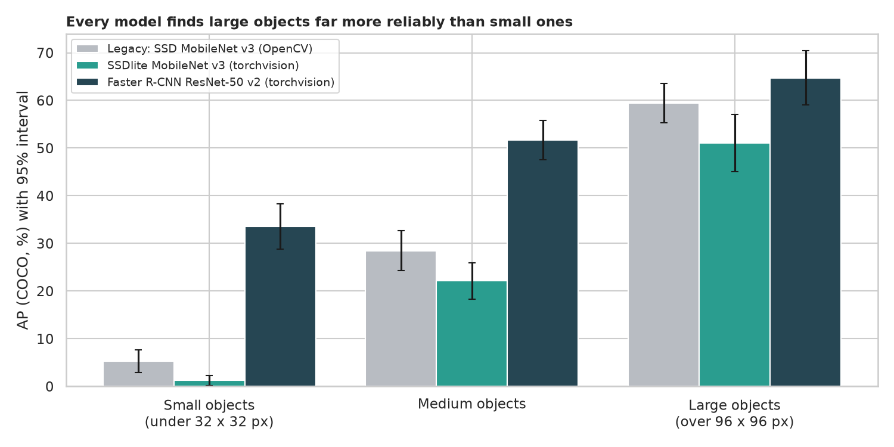
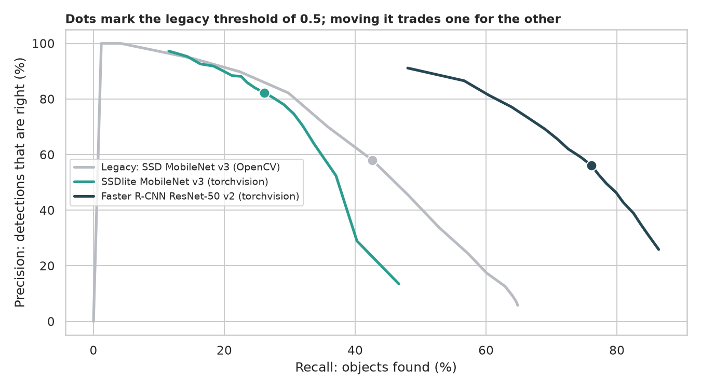
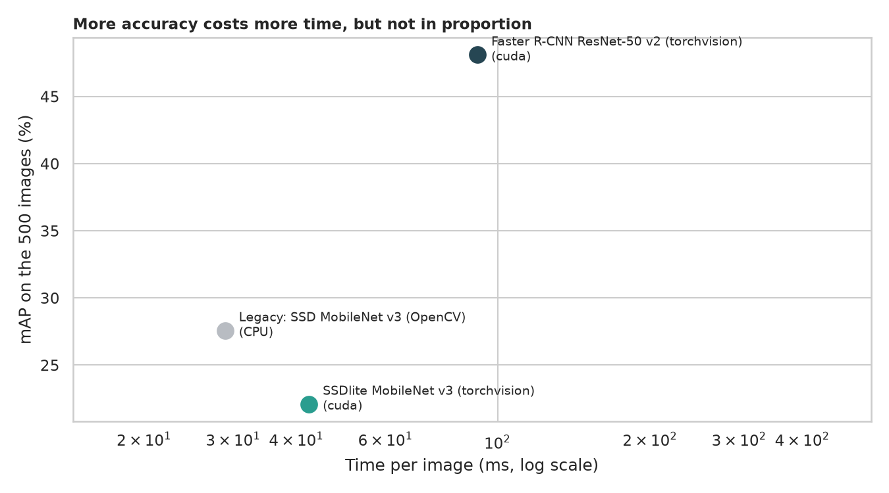

# Object Detection: what does "it found 80 kinds of object" really mean?

> The legacy script runs SSD MobileNet v3 on webcam frames through OpenCV and draws a box and a name for every object it is at least 50% sure about. How good is it in numbers, how does its accuracy depend on object size, crowding and the confidence threshold, how does it compare with an equivalent network and a much bigger one, and what does extra accuracy cost in time? Tested on 500 COCO validation images with 3,671 labelled objects, with the official COCO mAP.

## 📓 Start here

**[`object_detection.ipynb`](object_detection.ipynb)** is the main lesson: every step has a plain-English explanation, the code, and a "how to read this" note. Prefer a web page? Open the pre-rendered report: **[`docs/cv-object-detection.html`](../../docs/cv-object-detection.html)**. The folder `SSD_MobileNet_v3/` keeps the legacy model's OpenCV graph definition (`.pbtxt`) and class list; the weights are downloaded by the notebook.

## 💡 The Simple Analogy

A **lifeguard scanning a crowded beach**. A big, close swimmer is easy to spot and a tiny, far one is easy to miss; on a packed beach people overlap and some go unreported; "I only report what I am 50% sure of" is a choice that trades false alarms against misses; and a second lifeguard with binoculars sees more but takes longer.

## 🔬 The Hypothesis & Statistical Question

Detectors: the legacy SSD MobileNet v3 (TensorFlow weights, OpenCV), SSDlite MobileNet v3 and Faster R-CNN ResNet-50 v2 (torchvision). Uncertainty for mAP comes from a delete-one-fold jackknife.

| # | Question | Method | Result |
|---|---|---|---|
| H1 | Does a bigger detector beat the legacy one; does the "same" network match it? | COCO mAP, jackknife z-score | Legacy **27.6** mAP; Faster R-CNN **48.1** (+20.5, z = 13); SSDlite **22.1** (-5.5, z = -7.5) |
| H2 | Does object size decide? | AP small / medium / large | **Yes**: legacy 5.3 / 28.5 / 59.4 (an 11-fold gap); the big detector's advantage is mostly on small and medium objects |
| H3 | Is the 0.5 threshold a good operating point? | Precision/recall/F1, tuned on one half and judged on the other | Best for the legacy model (F1 0.491) but **not** for SSDlite (best 0.25) or Faster R-CNN (best 0.75) |
| H4 | Do crowds and some categories hurt? | Spearman, Kruskal-Wallis, AP by category | **Yes**: 82% of objects found with 1-2 objects per image, 32% with more than 10 (rho = -0.61); scissors, knife, hair drier at AP 0 |
| H5 | What does accuracy cost? | Median time with bootstrap CI | Legacy 28.9 ms (CPU), SSDlite 42.4 ms and Faster R-CNN 91.3 ms (GPU): three times the time for 20 more mAP points |

## 📊 Key Data Insights & Annotated Visualizations


Green: true objects. Orange dashes: detections with a score of at least 0.5.


Every model finds large objects far more reliably than small ones.


Dots mark the legacy threshold of 0.5; moving it trades precision for recall differently in each model.


More accuracy costs more time, but not in proportion.

## ⚙️ How it Works (Under the Hood)

1. **Data:** 500 random COCO val2017 images and the official annotations, downloaded on first run.
2. **Detectors:** the legacy graph through `cv2.dnn_DetectionModel` (320 x 320, scale 1/127.5, mean 127.5, BGR to RGB) and two torchvision COCO detectors; every detector keeps detections down to a score of 0.01 so mAP has a full curve.
3. **Scoring:** `pycocotools` COCOeval (mAP over IoU 0.5 to 0.95, AP50, AP75, small/medium/large); greedy matching at IoU 0.5 for precision, recall and F1.
4. **Uncertainty:** delete-one-fold jackknife (10 folds of 50 images).

**What changed from the legacy script:** it needed a live webcam, drew the label text at `box[0] + 30` vertically, froze the picture when nothing was detected and measured nothing.

## 🚀 How to Run (One-liner command)

```bash
uv sync --extra cv && uv run jupyter lab CV/object-detection/object_detection.ipynb
```

COCO annotations (about 250 MB), 500 images (about 80 MB) and the models (about 230 MB) download into `data/` on the first run. It uses a GPU if present and takes about 10 minutes on one. Standalone alternative: `pip install -r requirements.txt`.

## ⚠️ Limitations & Edge Cases

- **500 images from one dataset;** the jackknife errors (1 to 2 mAP points) describe this sample.
- **The legacy mAP is higher than the published figure** for this model; we did not find the cause.
- **IoU 0.5 and greedy matching are conventions.**
- **The three detectors differ in many ways,** so this compares whole systems.
- **Time is one machine,** CPU for the legacy model and GPU for the others.
- **Rare categories have a handful of examples.**
- **The crowd effect is confounded** with size and overlap.
