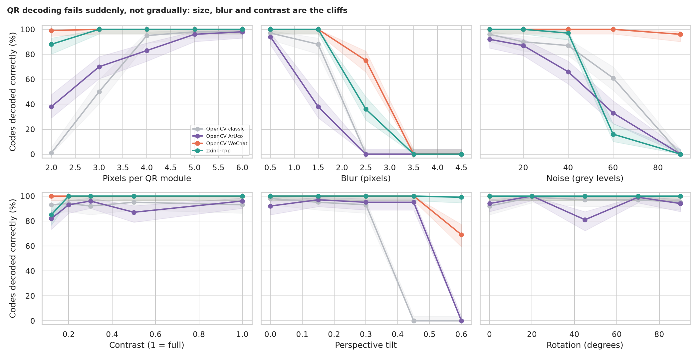
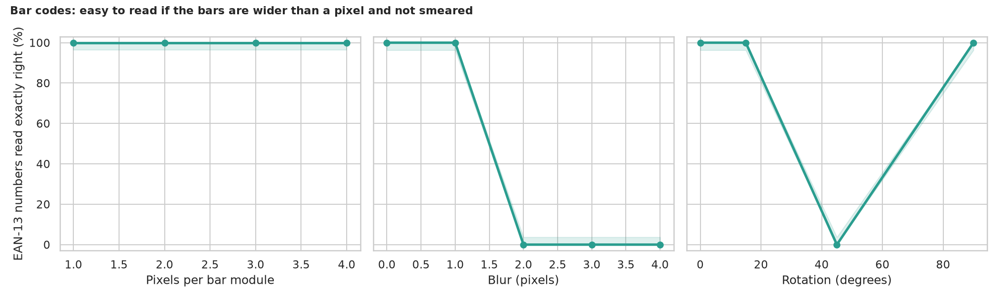

# QR and Bar Code Scanner: when does decoding fail, and is a QR code a password?

> A few lines of OpenCV can read a QR code from a photo. The legacy notebook used that for a door-pass demo: read the code, look the name up in a list, say "Authorized". It worked on nine tidy samples. How well does it work on blurry, tilted, noisy photos, which decoder should you use, does shrinking the image first matter, and is "the name is on the list" a safe way to let people in? Every code here is generated, so the right answer is always known.

## 📓 Start here

**[`qr_barcode_scanner.ipynb`](qr_barcode_scanner.ipynb)** is the main lesson: every step has a plain-English explanation, the code, and a "how to read this" note. Prefer a web page? Open the pre-rendered report: **[`docs/cv-qr-barcode-scanner.html`](../../docs/cv-qr-barcode-scanner.html)**.

## 💡 The Simple Analogy

A **crossword grid of black and white squares** read from across a room. Big sharp squares are easy; tiny or smeared squares merge and the message is lost, however clever the reader. Three corner "targets" tell the reader where the grid is and which way up, so rotation hardly matters, but a steep angle squashes the grid. And a label that says "Alice" is not a key: anyone can print their own. A *signed* label carries a stamp only the issuer can make.

## 🔬 The Hypothesis & Statistical Question

| # | Question | Method | Result |
|---|---|---|---|
| H1 | What degrades QR decoding? | 6 factors x 5 levels x 100 codes x 4 decoders, Wilson CIs | **Cliffs**: 2 px modules (classic 1%), blur from 2.5 px (0% to 36%, nothing at 3.5 px), heavy noise, steep tilt (classic 0% at 0.45); contrast and rotation barely matter |
| H2 | Which decoder is best on mixed damage? | 1,000 codes, exact McNemar vs OpenCV classic | **WeChat 48.7% and zxing-cpp 43.2% vs classic 27.2%** (p < 1e-28); ArUco 27.4% is no better (p = 0.94); 44% of codes are read by none |
| H3 | Does the legacy resize (proportions flipped) hurt? | 300 paired scenes, McNemar | **Fatal for the classic reader**: 99.7% (no resize) → **0.0%** (legacy) vs 84.0% (proper resize); zxing-cpp unaffected (100%) |
| H4 | How robust are EAN-13 bar codes? | Sweeps over bar width, blur, rotation | **Tolerant of size** (1 px bars: 100%), **blur cliff** (0% from 2 px), horizontal/vertical or mild tilt only (0% at 45°) |
| H5 | Is a name in a QR code a credential? | 1,000 forged badges, legacy rule vs signed (HMAC) rule | **No**: legacy accepts **100%** of forgeries, signed accepts **0%** (0.0% to 0.4%); the legacy rule also crashes on 4 of 6 ordinary payloads |

## 📊 Key Data Insights & Annotated Visualizations


QR decoding fails suddenly, not gradually: size, blur and contrast are the cliffs.


Bar codes are easy to read if the bars are wider than a pixel and not smeared.

## ⚙️ How it Works (Under the Hood)

The notebook is fully self-contained: no helper modules, just top-to-bottom cells.

1. **Data:** random badge texts are encoded with OpenCV's QR encoder and placed in a 480 x 360 textured scene with controlled size, rotation, blur, noise, contrast and tilt. EAN-13 bar codes are encoded by a short function (with the check digit). No camera, no download.
2. **Decoders:** OpenCV classic, OpenCV ArUco, OpenCV WeChat and `zxing-cpp` (a pip-installable replacement for `zbar`).
3. **Experiments:** one-factor sweeps; a mixed-damage test; the legacy resize bug; bar-code sweeps; a forgery test against a name-list rule and an HMAC-signed rule.
4. **Statistics:** Wilson intervals and exact McNemar tests (the truth is known because we generated the codes).

**What changed from the legacy notebook:** it needed `pyzbar` and Colab, flipped the image proportions in its resize, crashed on QR codes without `://`, granted access to anyone whose code contained a registered name, and was tested on nine images.

## 🚀 How to Run (One-liner command)

```bash
uv sync --extra cv && uv run jupyter lab CV/qr-barcode-scanner/qr_barcode_scanner.ipynb
```

No data and no camera needed; it takes about 5 minutes on a CPU. Standalone alternative: `pip install -r requirements.txt` and open the notebook in any Jupyter. To rebuild the web report:

```bash
uv run jupyter nbconvert --to html --execute CV/qr-barcode-scanner/qr_barcode_scanner.ipynb \
    --output-dir docs --output cv-qr-barcode-scanner
```

## ⚠️ Limitations & Edge Cases

- **Synthetic photos:** real ones add glare, curved labels, reflections and motion blur.
- **Default decoder settings:** tuning, sharpening or super-resolution could move every number.
- **The damage ranges are our choice,** so read the mixed test as a comparison, not a forecast.
- **One bar-code type (EAN-13) and one reader (zxing-cpp);** OpenCV's own bar-code detector found nothing in these clean synthetic bars and is not compared.
- **The signing demo is illustrative:** real systems need key management, expiry and replay protection.
- **The legacy code was not run as written;** its resize and name check were re-implemented in a few lines.
