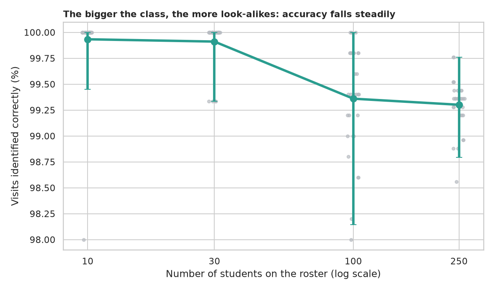
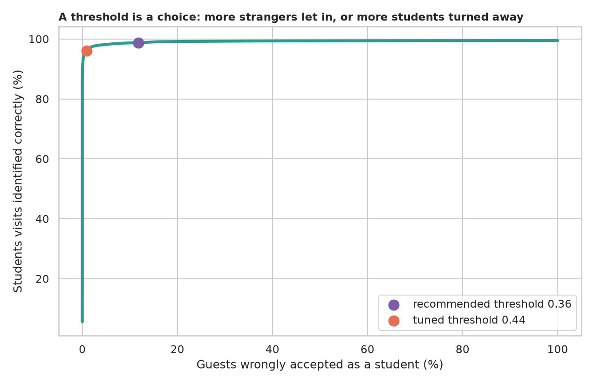
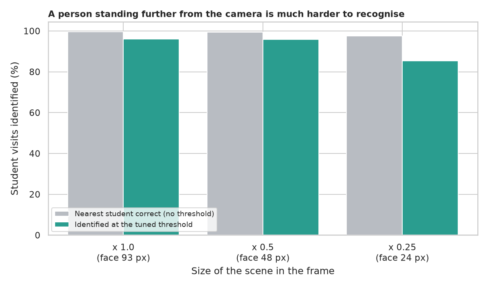
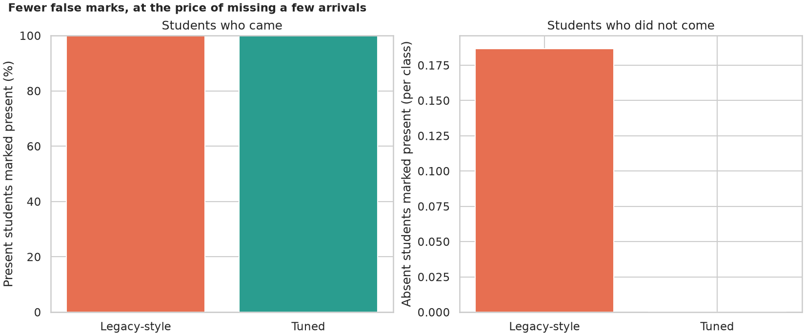

# Virtual Attendance: taking the register with a face

> The legacy script turns a webcam into a class register: it shrinks each frame to a quarter, finds faces, writes the nearest student's name into a CSV if the match is within a default tolerance, and never marks anyone twice. It looks fine with five people on a desk. How does it behave in a real class: does accuracy fall as the roster grows, do more enrolment photos help, what happens when a stranger walks in, and what does the quarter-size shrink cost? A simulation on 13,233 real photographs (LFW) measures the register itself.

## 📓 Start here

**[`virtual_attendance.ipynb`](virtual_attendance.ipynb)** is the main lesson: every step has a plain-English explanation, the code, and a "how to read this" note. Prefer a web page? Open the pre-rendered report: **[`docs/cv-virtual-attendance.html`](../../docs/cv-virtual-attendance.html)**.

## 💡 The Simple Analogy

A **teacher taking the register by recognising faces**. With 10 students it is easy; with 250 there are more look-alikes. A **stranger** walks in: a teacher who must name someone picks the student who looks most like the stranger, while a better one says "I don't know you" when nobody is close enough. At the back of the room every face is small. A careful teacher looks twice and marks a student present only if recognised in two of three glances.

## 🔬 The Hypothesis & Statistical Question

Students are drawn from the 311 LFW people with at least 6 photographs; everybody else can be a guest. Faces: OpenCV YuNet detector + SFace embeddings, cosine similarity.

| # | Question | Method | Result |
|---|---|---|---|
| H1 | Does the class size matter? | 30 rosters at 10, 30, 100, 250 students; Kruskal-Wallis, regression | **A little**: 99.9% to 99.3% nearest-student accuracy; -0.5 points per tenfold (CI -0.7 to -0.4) |
| H2 | Do more enrolment photos help? | Paired Wilcoxon over 30 rosters | **Up to three**: 99.36% to 99.89% (+0.5, 25 of 30 rosters); a fifth adds nothing (p = 0.53) |
| H3 | Are strangers let in? | Identification vs false accepts; threshold tuned on separate rosters | **Yes, unless thresholded**: no threshold accepts 100% of guests; the recommended 0.363 still accepts **11.8%** against 100 students; tuned 0.44 accepts **0.9%** and identifies 96.1% |
| H4 | Does standing further back cost? | Same rosters at 3 distances; Wilcoxon | **Quarter size: -10.7 points** (identified 85.3%, 30 of 30 rosters, p = 2e-6); half size costs nothing |
| H5 | Does a careful rule give a better register? | 300 simulated classes | **Yes**: legacy-style rule writes 0.19 wrong entries per class (16% of classes); tuned threshold with 2 of 3 frames: **0**, with every present student still marked (p = 4e-11) |

## 📊 Key Data Insights & Annotated Visualizations


The bigger the class, the more look-alikes: accuracy falls steadily but gently.


A threshold is a choice: more strangers let in, or more students turned away.


A person standing further from the camera is much harder to recognise.


Fewer false marks, with no student who came being missed.

## ⚙️ How it Works (Under the Hood)

1. **Data:** LFW (13,233 photographs of 5,749 people); students need an enrolment photo and later visits, guests are anyone not on the roster.
2. **Faces:** YuNet finds the face closest to the centre; SFace gives a 128-number embedding; a student's template is the mean embedding of their enrolment photos. Scenes are also shrunk to a half and a quarter.
3. **Decisions:** nearest template by cosine similarity, optionally accepted only above a threshold; a student is marked after any 1 accepted frame (legacy-style) or 2 of 3 agreeing frames (tuned).
4. **Statistics:** random rosters with fixed seeds, Kruskal-Wallis, regression on log roster size, paired Wilcoxon, a threshold tuned on separate calibration rosters.

**What changed from the legacy script:** no live webcam or hand-named photo folder is needed; the shrink by 4, the unbounded acceptance of the nearest face and the one-frame register rule are measured instead of assumed.

## 🚀 How to Run (One-liner command)

```bash
uv sync --extra cv && uv run jupyter lab CV/virtual-attendance/virtual_attendance.ipynb
```

LFW (about 180 MB) and the two models (about 40 MB) download into `data/` on the first run; it takes about 10 minutes on a CPU. Standalone alternative: `pip install -r requirements.txt`.

## ⚠️ Limitations & Edge Cases

- **LFW is public figures photographed by news agencies,** not students on a webcam.
- **The roster is drawn from the 311 most photographed people.**
- **Guests are random strangers,** not look-alikes or impostors.
- **Distance is simulated by shrinking the photograph.**
- **The 3 frames per visitor are 3 different photographs,** not consecutive video frames.
- **No spoofing protection** (a printed photo would pass).
- **No demographic analysis.**
- **Thresholds were tuned for one setting** and used in another.
- **Face-based attendance needs consent and secure storage.**
