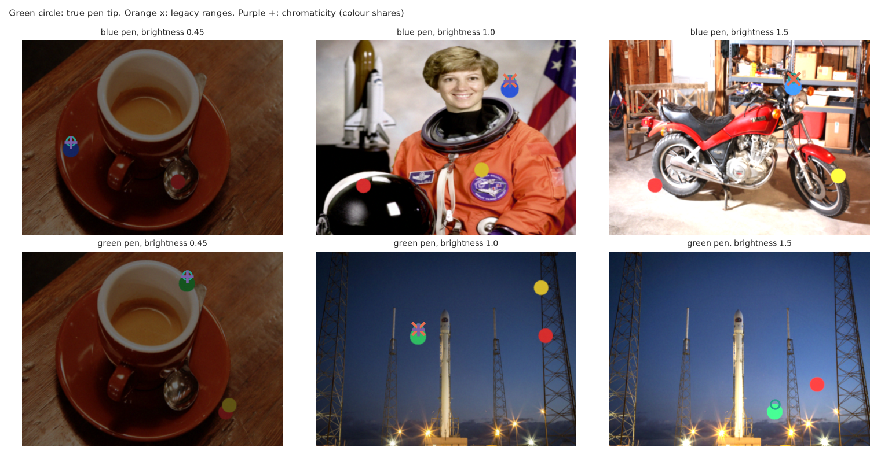
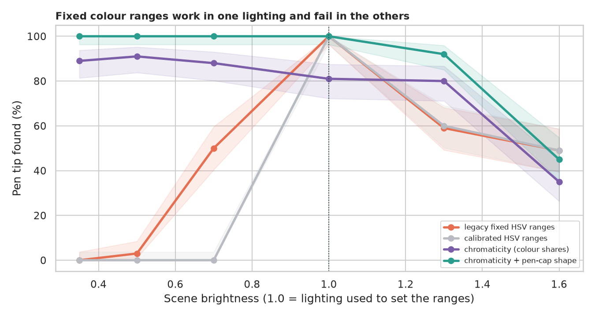
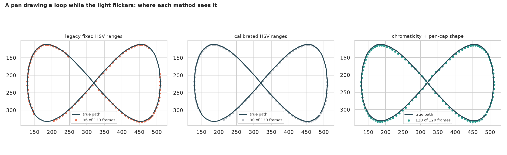

# Virtual Painter: tracking a coloured pen when the light changes

> Draw in the air with a coloured pen and a webcam. The legacy script found the pen with three hand-tuned colour ranges. How badly does that break when the light dims, when a big object has the pen's colour, or when the lamp flickers, and what small changes make it robust?

## 📓 Start here

**[`virtual_painter.ipynb`](virtual_painter.ipynb)** is the main lesson: every step has a plain-English explanation, the code, and a "how to read this" note. Prefer a web page? Open the pre-rendered report: **[`docs/cv-virtual-painter.html`](../../docs/cv-virtual-painter.html)**.

## 💡 The Simple Analogy

Telling a friend **"find the blue pen"** by describing the exact shade you see in your room right now. Dim the light and the friend walks past it; put a blue book next to it and they point at the book. A smarter friend describes the pen by **how its colour is made** (the share of red, green and blue, which stays put when light gets dimmer) and by its **shape and size** ("a small round cap").

## 🔬 The Hypothesis & Statistical Question

Every scene is synthetic (a pen cap drawn over real photographs) so the true pen tip is known; "found" means within 12 pixels.

| # | Question | Method | Result |
|---|---|---|---|
| H1 | Does brightness change success of fixed colour ranges? | Wilson CIs at 6 brightness levels | **Yes**: legacy 100% at the calibration light, 50% at 0.7x, 3% at 0.5x, 0% at 0.35x |
| H2 | Are the four methods equally robust overall? | 720 photos; exact McNemar | **No**: legacy 44.3%, calibrated HSV 34.4%, chromaticity 61.3%, chromaticity + shape **73.5%** (p = 2e-28 vs legacy) |
| H3 | Does a big same-colour object fool the finder? | 100 photos; exact McNemar | **Yes**: legacy 47%; chromaticity + shape **100%** (53 vs 0, p = 2e-16) |
| H4 | Can each method follow a stroke under flicker? | 20 sequences x 120 frames; paired Wilcoxon | Legacy 77% of frames; chromaticity + shape **100% in all 20** (p = 8e-5) |

## 📊 Key Data Insights & Annotated Visualizations


Real photographs, a synthetic pen, and what each method picks.


Fixed HSV ranges work in one lighting; colour shares survive dimming; everything fails once the pen's channels clip.


One flickering sequence: the legacy path is dotted with gaps, the shape-filtered path follows the whole stroke.

## ⚙️ How it Works (Under the Hood)

1. **Scenes:** five scikit-image sample photographs (shipped with the library, no download) plus a pen cap, two distractor discs, a brightness multiplier, a colour cast, noise and blur.
2. **Four finders**, all ending with the top centre of a blob: the legacy fixed HSV ranges (last blob over 500 px); HSV ranges calibrated from one clean photo; **rg chromaticity** (red and green as a share of total light, unchanged when brightness scales); chromaticity plus a **pen-cap size and roundness** filter.
3. **Statistics:** Wilson intervals for rates, exact McNemar tests on the same photos, Wilcoxon signed-rank tests paired by sequence.

**What changed from the legacy scripts:** they needed a live webcam, hard-coded colour ranges tuned in one room, returned the last blob rather than the biggest, drew a stray dot at (0, 0) when nothing was found, and measured nothing.

## 🚀 How to Run (One-liner command)

```bash
uv sync --extra cv && uv run jupyter lab CV/virtual-painter/virtual_painter.ipynb
```

No camera or download needed; it takes about 3 minutes on a CPU. Standalone alternative: `pip install -r requirements.txt`.

## ⚠️ Limitations & Edge Cases

- **Synthetic pens on real photos:** a real cap has highlights, shadows and a hand, and a webcam auto-exposes.
- **Two pen colours, five backgrounds;** red, orange or skin-toned pens would be much harder.
- **Brightness is a simple multiplier;** real light also moves shadows and adds glare.
- **No white balance:** colour casts shift chromaticity (67% to 83% under casts).
- **Clipping is physical:** at 1.6x brightness every method falls to 35% to 49%.
- **The "calibrated HSV" recipe is one choice;** a wider margin would behave more like the legacy ranges.
