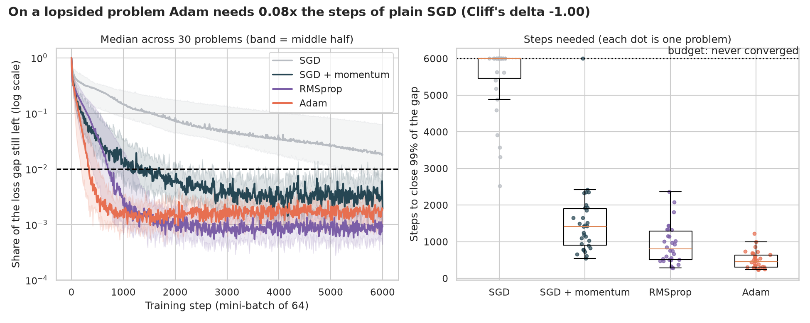
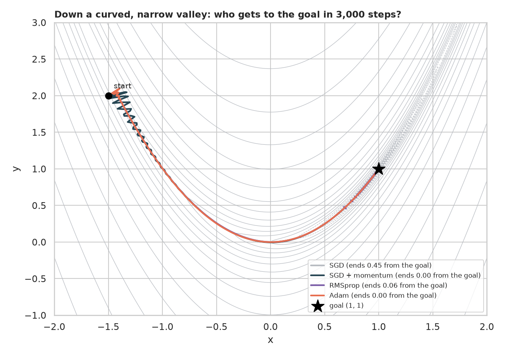
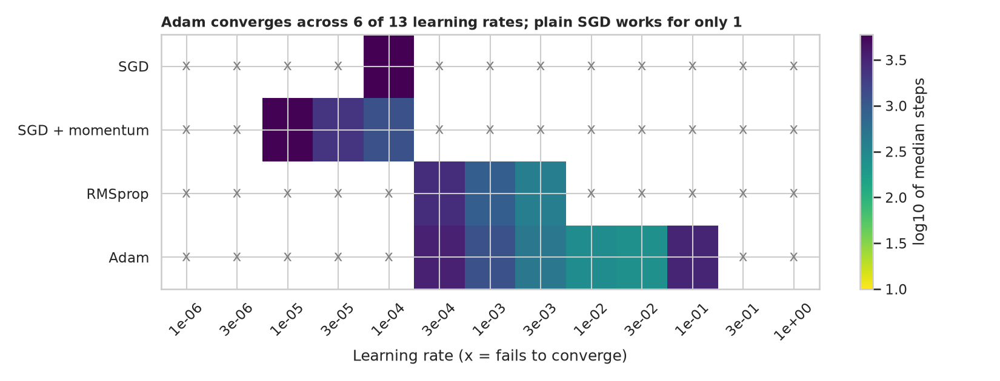
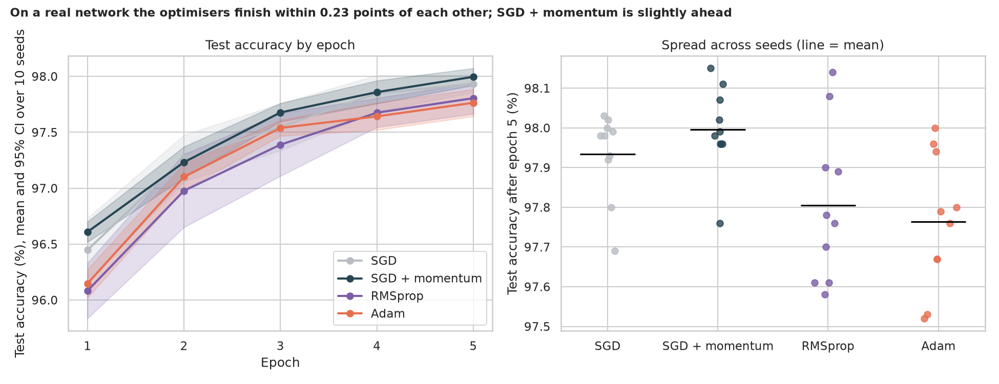

# Adam Optimizer: why the "default" way to train neural networks works

> Every neural network is trained by an optimiser. The most popular one is **Adam**. What does it actually do, does it really get to the answer faster than the older rules, and when does that advantage vanish?

## 📓 Start here

**[`adam_optimizer.ipynb`](adam_optimizer.ipynb)** is the main lesson: every step has a plain-English explanation, the code, and a "how to read this" note. Prefer a web page? Open the pre-rendered report: **[`docs/dl-adam-optimizer.html`](../../docs/dl-adam-optimizer.html)**.

## 💡 The Simple Analogy

**Hikers walking down a foggy valley.** Plain SGD feels the slope under its feet and steps downhill, zig-zagging across steep walls in a long narrow valley. SGD with **momentum** is a **rolling ball** that keeps its speed so the zig-zags cancel. **RMSprop and Adam** also wear **different shoes for different directions**: small careful steps where the ground has been steep and bumpy, big confident ones where it has been flat. Adam combines the rolling ball *and* the adaptive shoes.

## 🔬 The Hypothesis & Statistical Question

| # | Question | Method | Result |
|---|---|---|---|
| H1 | Does a from-scratch Adam equal PyTorch's? | Step-by-step comparison over 300 steps | **Yes**: largest difference **2e-16** (enforced by an `assert`) |
| H2 | On a lopsided problem, does Adam need fewer steps? | 30 problems per optimiser, fair tuning on separate problems; Mann-Whitney, Cliff's δ, bootstrap CI | **Yes, against all three**: **0.08x** the steps of SGD (δ = −1.00), **0.32x** SGD + momentum (δ = −0.89), **0.57x** RMSprop (δ = −0.54); all p < 0.001 |
| H3 | Is Adam less fussy about its learning rate? | 13 learning rates × 10 problems; Wilson CIs | **Yes**: works for **6 of 13** rates (3-decade window) vs 1 for SGD, 3 for momentum and RMSprop |
| H4 | On MNIST, is Adam more accurate early? | 10 paired seeds; Wilcoxon, bootstrap CI | **No, the opposite**: Adam was 0.30 points *behind* SGD (p = 0.049) and 0.46 behind SGD + momentum (p = 0.002) after epoch 1 |
| H5 | Does the gap survive five epochs? | Same | Adam still slightly behind: 97.76% vs SGD + momentum **98.00%** (difference −0.23 points, p = 0.004) |

"Fail to reject" means the sample can't see an effect, not that none exists.

## 📊 Key Data Insights & Annotated Visualizations


On a lopsided problem plain SGD converges in only 33% of runs; Adam converges in every run, in a median of 455 steps.


Down a curved narrow valley, Adam and SGD + momentum reach the goal; RMSprop ends close; plain SGD is still crawling.


Adam converges across 6 of 13 learning rates, twice the window of momentum or RMSprop and six times plain SGD's.


On a real, well-scaled network the optimisers finish within a quarter of a percentage point of each other, and tuned SGD with momentum is slightly ahead.

**An honest lesson built into the notebook.** An early version counted a run as converged the *first time* it touched the finish line. RMSprop at an aggressive learning rate touched it first, then bounced around and never settled, yet looked like the winner. The final test requires the gap's **average over 200 steps** to stay under the line, and tunes each optimiser's learning rate among those that converge reliably.

## ⚙️ How it Works (Under the Hood)

The notebook is fully self-contained: no helper modules, just top-to-bottom cells.

1. **Adam in a few lines of NumPy,** with the bias-corrected moment estimates, unit-tested against `torch.optim.Adam`.
2. **A lopsided test bed:** a linear regression whose ten features span a 100x range of scales (a long thin loss valley), trained with mini-batches of 64. Each optimiser's learning rate is tuned on 5 separate problems and judged on 30 fresh ones. Runs that never converge are censored at the 6,000-step budget.
3. **A real network:** a 784-256-10 MLP on MNIST for 5 epochs, with learning rates tuned on a validation split and a **paired** design (the same starting weights and batch order for every optimiser).
4. **Statistics:** Mann-Whitney U with Cliff's δ and bootstrap CIs on the ratio of medians; Wilson CIs on learning-rate coverage; paired Wilcoxon tests with bootstrap CIs on accuracy differences.

**What changed from the legacy notebook:** it never defined its data, looped 15,000 pure-Python epochs, compared one untuned optimiser against another and checked nothing against a reference implementation.

## 🚀 How to Run (One-liner command)

```bash
uv sync --extra dl && uv run jupyter lab DL/adam-optimizer/adam_optimizer.ipynb
```

MNIST (about 12 MB) downloads into `data/` on the first run. It uses a GPU if one is present and takes about 4 minutes on one (a few more on a CPU). Standalone alternative: `pip install -r requirements.txt` and open the notebook in any Jupyter. To rebuild the web report:

```bash
uv run jupyter nbconvert --to html --execute DL/adam-optimizer/adam_optimizer.ipynb \
    --output-dir docs --output dl-adam-optimizer
```

## ⚠️ Limitations & Edge Cases

- **Tiny test beds.** The lopsided regression and the MNIST MLP are small next to real deep learning, where architecture, normalisation and schedules change the picture.
- **Small tuning grids.** Learning rates came from 13-point and 4-point grids; tuning momentum and the betas too could change rankings.
- **Censored runs** are recorded at the budget, understating the slowest optimiser.
- **Ten seeds** on the real network leave wide uncertainty on differences of a quarter of a point.
- **Defaults only:** no AdamW, learning-rate schedules or weight decay, which matter a great deal in practice.
- **Accuracy is not the only goal;** speed, memory and robustness also matter.
