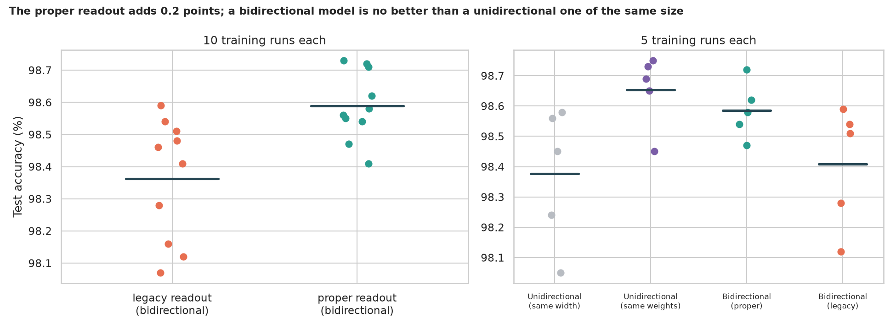
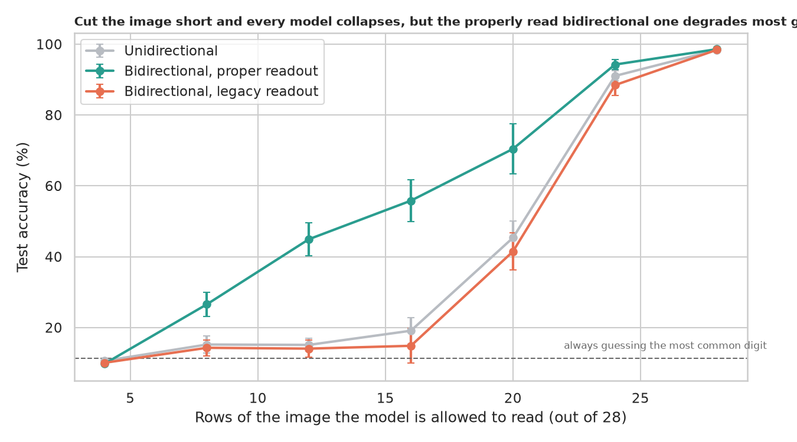
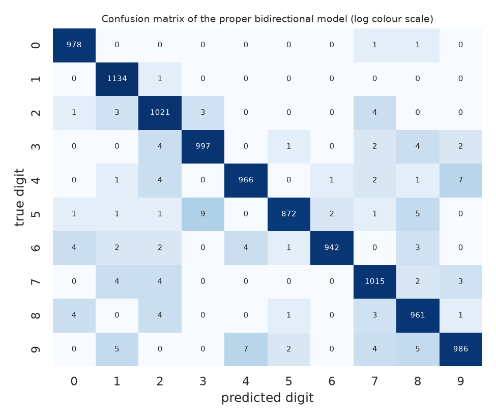

# Bidirectional LSTM on MNIST: reading an image like a sentence, and what that does and doesn't buy

> An LSTM reads a sequence one step at a time. A digit image is not obviously a sequence, but it can be read one row at a time, top to bottom, and a bidirectional LSTM also reads it bottom to top. Is the legacy code reading the model's answer correctly, does reading both ways really help, does the model use the order of the rows, and how much of the image does it need?

## 📓 Start here

**[`bidirectional_lstm.ipynb`](bidirectional_lstm.ipynb)** is the main lesson: every step has a plain-English explanation, the code, and a "how to read this" note. Prefer a web page? Open the pre-rendered report: **[`docs/dl-bidirectional-lstm.html`](../../docs/dl-bidirectional-lstm.html)**.

## 💡 The Simple Analogy

A digit being **slowly revealed through a slot, one thin strip at a time**. A *unidirectional* reader watches the strips go by from the top and says the digit at the end. A *bidirectional* model adds a second reader who looks at the strips in reverse, bottom up, and the two compare notes. The legacy code made a subtle mistake: it asked the bottom-up reader for their note right after they had read *only the first strip they saw*: the bottom one, which is blank.

## 🔬 The Hypothesis & Statistical Question

| # | Question | Method | Result |
|---|---|---|---|
| H1 | Does the true final state beat the legacy readout? | 10 paired seeds, Wilcoxon; exact McNemar | **Yes, a little**: 98.59% vs 98.36% (+0.23 points, CI +0.09 to +0.38), better in 7 of 10 seeds (p = 0.025); McNemar p = 0.0005 |
| H2 | Does reading both ways help? | 5 seeds, Mann-Whitney, Cliff's δ; width- and weight-matched one-way models | **Not once size is matched**: bidirectional 98.59% vs a one-way model with the same weights 98.65% (p = 0.31); the legacy readout is 0.25 points below it |
| H3 | Does the model rely on the order of the rows? | Shuffled and reversed test rows; retrain on shuffled rows | **On the order it was trained on**: shuffled at test time 21.2%, upside-down 38.6%; but trained on a shuffled order it reaches 97.1% |
| H4 | How much of the image does it need? | Accuracy with only the first k rows visible | **Most of it**; the proper bidirectional model degrades most gracefully (55.8% at 16 rows vs 19.1% one-way and 14.8% legacy) |

## 📊 Key Data Insights & Annotated Visualizations


The proper readout adds 0.2 points, and a bidirectional model is no better than a unidirectional one of the same size.


Cut the image short and every model collapses, but the properly read bidirectional one degrades most gracefully.


The few mistakes are the usual look-alikes, such as 5 and 3, and 4 and 9.

## ⚙️ How it Works (Under the Hood)

The notebook is fully self-contained: no helper modules, just top-to-bottom cells.

1. **Data:** downloads MNIST into `data/` on first run and keeps it on the GPU; each image is a sequence of 28 rows of 28 pixels.
2. **Model:** a 2-layer LSTM with 128 hidden units per direction and a linear head. Two readouts: the legacy `outputs[:, -1, :]` and each direction's true final state `h_n`. Trained 6 epochs with Adam; the final-epoch accuracy is reported and the test set never chooses anything.
3. **Fair comparisons:** paired seeds for the readout; one-way models at the same width and at the same number of weights; deterministic GPU mode.
4. **Statistics:** Wilcoxon and bootstrap CIs over paired seeds; exact McNemar on shared test images; Mann-Whitney with Cliff's δ.

**What changed from the legacy scripts:** they read the backward direction at the wrong time step, reported one run (98.94% test) with no baselines or uncertainty, and had no way to say whether reading both ways helped.

## 🚀 How to Run (One-liner command)

```bash
uv sync --extra dl && uv run jupyter lab DL/bidirectional-lstm/bidirectional_lstm.ipynb
```

MNIST downloads into `data/` on the first run. It uses a GPU if present and takes about 7 minutes on one (considerably longer on a CPU). Standalone alternative: `pip install -r requirements.txt` and open the notebook in any Jupyter. To rebuild the web report:

```bash
uv run jupyter nbconvert --to html --execute DL/bidirectional-lstm/bidirectional_lstm.ipynb \
    --output-dir docs --output dl-bidirectional-lstm
```

## ⚠️ Limitations & Edge Cases

- **Few seeds** (10 and 5), so several p-values are near their minimum and some effects are too uncertain to call.
- **Short fixed training** (6 epochs); longer training could change the gaps.
- **One architecture family and one dataset;** on real sequences such as text or sensor data, a backward reading often matters far more.
- **The truncation test also shifts the data,** since models were not trained on shorter inputs.
- **A one-layer legacy readout was not tested,** where the flaw would probably bite much harder.
- **The legacy scripts were not run as written;** their readout was reproduced in our own training loop, so their 98.94% is not directly comparable.
