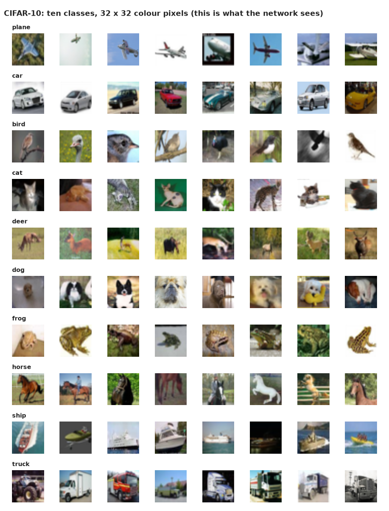
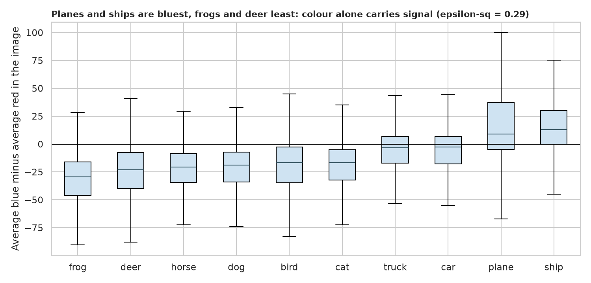
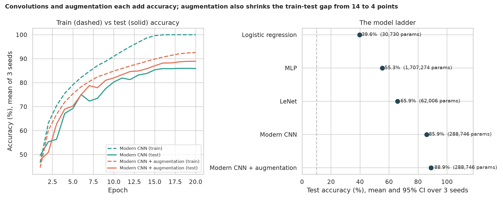
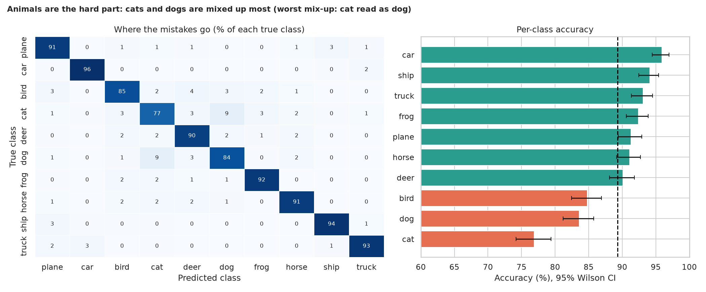

# CIFAR-10 Image Classification: what do convolutions actually buy you?

> 60,000 tiny colour photos (32 x 32 pixels) of planes, cars, birds, cats, deer, dogs, frogs, horses, ships and trucks. Why are convolutional networks so much better at this than simpler models, how much comes from architecture versus tricks like augmentation, and where do good models still go wrong?

## 📓 Start here

**[`cifar10_cnn.ipynb`](cifar10_cnn.ipynb)** is the main lesson: every step has a plain-English explanation, the code, and a "how to read this" note. Prefer a web page? Open the pre-rendered report: **[`docs/dl-cifar10-cnn.html`](../../docs/dl-cifar10-cnn.html)**.

## 💡 The Simple Analogy

Telling a cat from a dog by sliding a **magnifying glass** across a tiny photo. A simple model reads a list of 3,072 pixel numbers with no idea which sit next to which, so a cat nudged two pixels to the right looks like a different picture. A **convolutional network** slides the *same small filter* over the whole image looking for the same pattern everywhere (an edge, a patch of fur), so it needs far fewer weights and doesn't care exactly where things are. **Augmentation** shows the learner the same photo flipped and nudged: a horse is still a horse facing left.

## 🔬 The Hypothesis & Statistical Question

| # | Question | Method | Result |
|---|---|---|---|
| H1 | Does a crude colour summary differ between classes? | Kruskal-Wallis, ε² | **Yes, large**: ε² = 0.29; ships and planes are bluest, frogs and deer least |
| H2 | Does a CNN beat a fully connected network? | Exact McNemar on the same 10,000 test images; bootstrap CI | **Yes**: LeNet (62k weights) beats the MLP (1.7M weights) by **10.5 points** (p ≈ 8e-78) |
| H3 | Does a modern CNN beat the legacy LeNet? | McNemar | **Yes**: +**20.2 points** (CI +19.2 to +21.1) |
| H4 | Does augmentation help? | McNemar; train-test gap | **Yes**: +**3.6 points** (p ≈ 6e-30); the train-test gap shrinks from 14 to 4 points |
| H5 | Is accuracy equal across classes? | Chi-square, Cramér's V, Wilson CIs | **No**: V = 0.18; cats 76.9% vs cars 95.9%; 9.1% of cats are read as dogs |

The ladder (mean of 3 seeds): logistic regression **39.6%**, MLP **55.3%**, LeNet **65.9%**, modern CNN **85.9%**, modern CNN + augmentation **88.9%**. A guess scores 10%.

## 📊 Key Data Insights & Annotated Visualizations


What the network actually sees: very small, blurry photos.


Colour alone carries signal: planes and ships are the bluest, frogs and deer the least blue.


Each rung adds accuracy; without augmentation the modern CNN reaches 100% training accuracy (memorisation), with it the gap shrinks.


Animals are the hard part: cats are the weakest class and the cat-to-dog mix-up is the most common error.

## ⚙️ How it Works (Under the Hood)

The notebook is fully self-contained: no helper modules, just top-to-bottom cells.

1. **Data:** downloads CIFAR-10 (about 170 MB) into `data/` on first run and keeps it on the GPU as normalised tensors. Augmentation (a per-image random flip and shift of up to 4 pixels) is done on the GPU with an affine grid.
2. **The ladder:** logistic regression, an MLP, the legacy LeNet and a modern CNN (three blocks of two 3x3 convolutions with batch norm, global average pooling). All use the same recipe (AdamW, one-cycle schedule, 20 epochs, batches of 256) and the **final-epoch** accuracy, never the best epoch on the test set. Three seeds each, with deterministic GPU mode for reproducibility.
3. **Statistics:** Kruskal-Wallis with ε²; **exact McNemar tests** on the shared test images (only the images where two models disagree carry information) with bootstrap CIs; chi-square with Wilson CIs per class.

**What changed from the legacy notebook:** it used the removed `iterator.next()`, displayed only the red channel in black and white, trained a tiny LeNet for 80 epochs with batches of 8, and reported one accuracy from one run with no baselines or tests.

## 🚀 How to Run (One-liner command)

```bash
uv sync --extra dl && uv run jupyter lab DL/cifar10-cnn/cifar10_cnn.ipynb
```

CIFAR-10 downloads into `data/` on the first run. It uses a GPU if present and takes about 10 minutes on one (considerably longer on a CPU). Standalone alternative: `pip install -r requirements.txt` and open the notebook in any Jupyter. To rebuild the web report:

```bash
uv run jupyter nbconvert --to html --execute DL/cifar10-cnn/cifar10_cnn.ipynb \
    --output-dir docs --output dl-cifar10-cnn
```

## ⚠️ Limitations & Edge Cases

- **Three seeds**, and the McNemar tests use one seed's predictions on 10,000 test images.
- **One recipe for every model;** a per-model search could narrow some gaps, though not a 20-point one.
- **Short training (20 epochs).** Deeper networks with more tricks reach 93 to 95%.
- **Test accuracy is plotted by epoch** for illustration but was never used to choose the epoch, learning rate or architecture.
- **Tiny 32 x 32 images** cap accuracy, especially on animals.
- **Ten tidy classes, one dataset;** real photos are messier and performance would drop.
- **Pattern matching, not understanding:** the network can be fooled by backgrounds and small perturbations.
