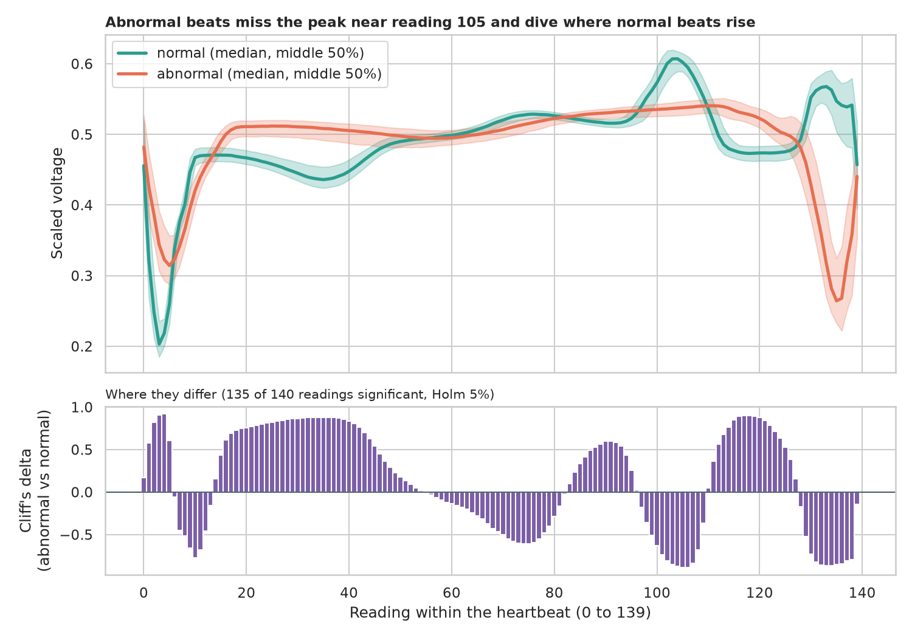
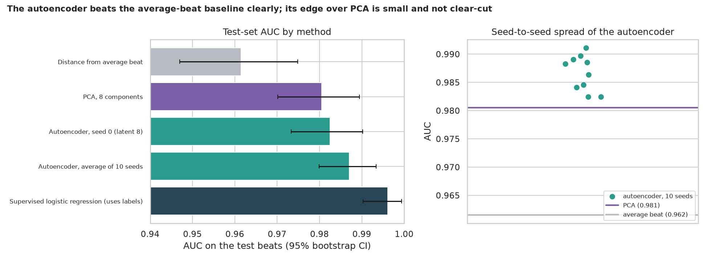
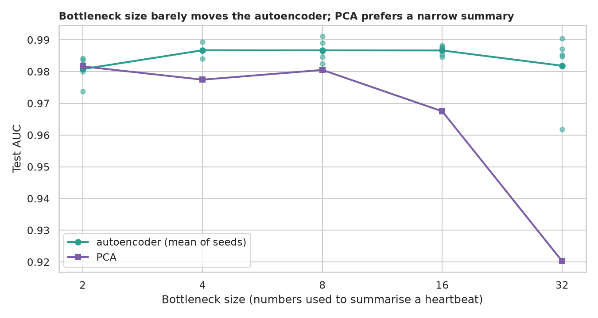
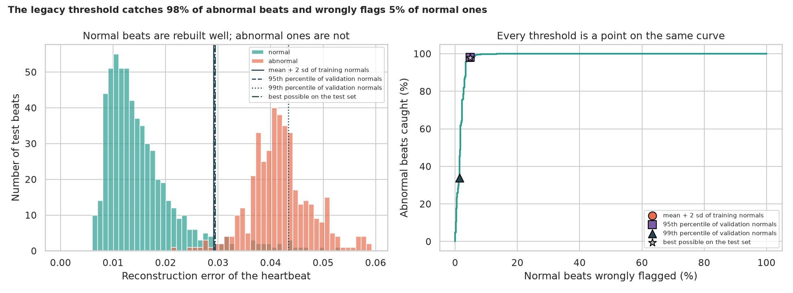
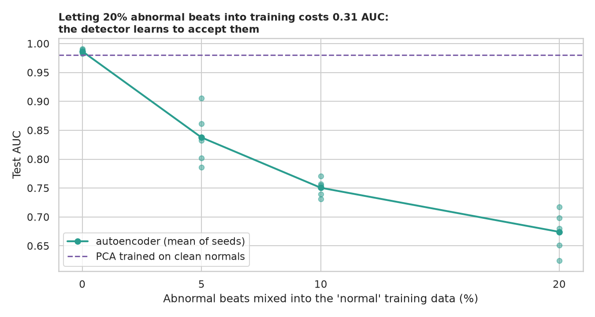
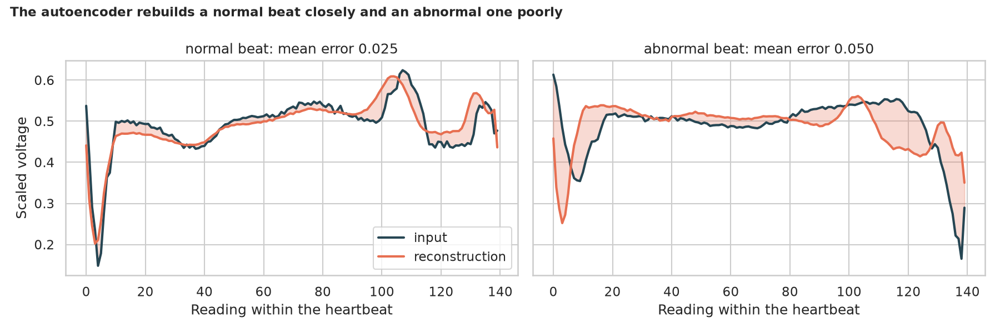

# ECG Anomaly Detection with an Autoencoder: spotting the unusual heartbeat

> A monitor sees thousands of heartbeats; the abnormal ones are rare and come in many shapes. An autoencoder learns what a *normal* beat looks like and flags whatever it cannot rebuild. Does it beat simpler tricks, how sure can we be, where should the alarm go, and what if the "normal" training data is dirty?

## 📓 Start here

**[`ecg_anomaly_detection.ipynb`](ecg_anomaly_detection.ipynb)** is the main lesson: every step has a plain-English explanation, the code, and a "how to read this" note. Prefer a web page? Open the pre-rendered report: **[`docs/dl-ecg-anomaly-detection.html`](../../docs/dl-ecg-anomaly-detection.html)**.

## 💡 The Simple Analogy

A **sketch artist who has only ever drawn healthy hearts**. Show them a heartbeat, hide it, and ask them to redraw it from a tiny note (8 numbers). For a normal beat the redraw is nearly perfect; for an abnormal one it looks wrong because they only know healthy shapes. The **reconstruction error** is the alarm signal, and the **threshold** is how wrong is "wrong enough": too low and the nurse drowns in false alarms, too high and real problems slip through.

## 🔬 The Hypothesis & Statistical Question

| # | Question | Method | Result |
|---|---|---|---|
| H1 | Do abnormal beats differ in shape? | Mann-Whitney U at 140 readings, Holm, Cliff's δ | **Yes**: 135 of 140 readings differ; median \|δ\| 0.60, max 0.92; average-beat distance alone gives AUC 0.962 |
| H2 | Does the autoencoder beat simpler detectors? | AUC + bootstrap CI; 10 seeds, Wilcoxon; paired bootstrap | **Partly**: AUC 0.987 (ensemble), better than PCA in 10 of 10 seeds (p = 0.002), but the gap on the test beats (+0.0065, CI -0.0030 to +0.0161) includes 0; supervised logistic regression gets 0.996 |
| H3 | Does the bottleneck size matter? | Kruskal-Wallis, ε², 5 seeds per size | **Little between 4 and 16**: AUC 0.987 each; p = 0.069, ε² = 0.24 (not significant); PCA drops to 0.920 at 32 components |
| H4 | Does the legacy "mean + 2 sd" threshold behave as hoped? | Rates with Wilson CIs | **Yes**: flags 4.4% of training and 5.1% of validation normals, 4.8% on test; catches 98.1% of abnormal beats; the 99th percentile rule catches only 33.9% |
| H5 | Does dirty "normal" training data hurt? | 5 paired seeds at 0, 5, 10, 20% contamination | **Severely**: AUC 0.987 → 0.838 → 0.751 → 0.674 (worse in 5 of 5 seeds; minimum possible p with 5 seeds is 0.0625) |

## 📊 Key Data Insights & Annotated Visualizations


Abnormal beats miss the peak near reading 105 and dive where normal beats rise.


The autoencoder beats the average-beat baseline clearly; its edge over PCA is small and not clear-cut.


Bottleneck size barely moves the autoencoder; PCA prefers a narrow summary.


The legacy threshold catches 98% of abnormal beats and wrongly flags 5% of normal ones.


Letting abnormal beats into the "normal" training data teaches the detector to accept them.


A normal beat is rebuilt closely; an abnormal one poorly.

## ⚙️ How it Works (Under the Hood)

The notebook is fully self-contained: no helper modules, just top-to-bottom cells.

1. **Data:** downloads the ECG5000 heartbeats (4,998 beats, 140 readings each) into `data/` on first run, splits 60/20/20 stratified, and fits the 0-to-1 scaling on the training part only.
2. **Autoencoder:** 140 → 32 → 16 → 8 → 16 → 32 → 140, trained on normal beats only with mean squared error (Adam, 100 epochs). The alarm score is the mean absolute reconstruction error.
3. **Baselines:** distance from the average normal beat, PCA with the same number of components, and supervised logistic regression as a labelled ceiling.
4. **Statistics:** Mann-Whitney with Holm correction and Cliff's δ; AUC with stratified bootstrap CIs; Wilcoxon over seeds; paired bootstrap on test beats; Kruskal-Wallis with ε²; Wilson intervals for alarm rates.

**What changed from the legacy notebook:** it used the removed `tf.enable_eager_execution()`, trained with `categorical_crossentropy` on continuous signals for 1,024 epochs, used test beats as validation data, and reported one run with no baselines or uncertainty.

## 🚀 How to Run (One-liner command)

```bash
uv sync --extra dl && uv run jupyter lab DL/ecg-anomaly-detection/ecg_anomaly_detection.ipynb
```

The data downloads into `data/` on the first run. It uses a GPU if present and takes about 10 minutes on one (longer on a CPU). Standalone alternative: `pip install -r requirements.txt` and open the notebook in any Jupyter. To rebuild the web report:

```bash
uv run jupyter nbconvert --to html --execute DL/ecg-anomaly-detection/ecg_anomaly_detection.ipynb \
    --output-dir docs --output dl-ecg-anomaly-detection
```

## ⚠️ Limitations & Edge Cases

- **One benchmark, one split:** ECG5000 is tidy and balanced, with abnormal beats that look alike; real monitors face rare, varied arrhythmias, noise and patient differences.
- **Beats are treated as independent,** though several may come from the same patient, so intervals may be slightly too narrow.
- **The binary label hides the arrhythmia type,** so we cannot say which abnormal beats are missed.
- **Few seeds** (10 and 5), so some p-values sit at their minimum possible value.
- **One reference model in the threshold section;** the "best possible" threshold peeks at test labels and is only an upper bound.
- **No cost model:** the real threshold should come from the relative cost of a missed event versus a false alarm.
- **Not a medical device:** a teaching example, not a clinical tool.
