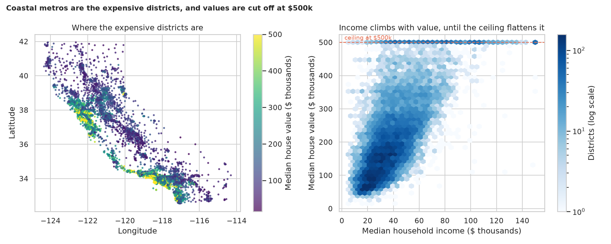
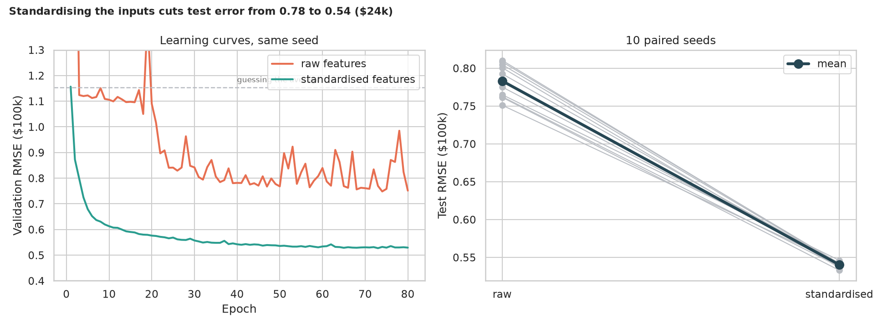
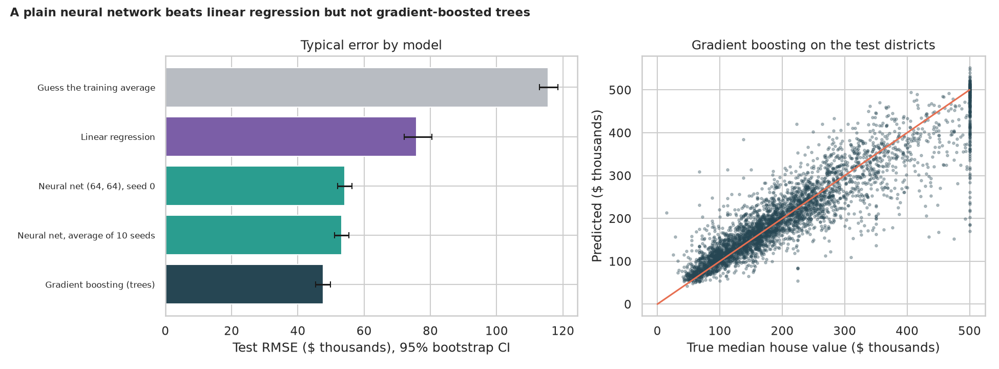
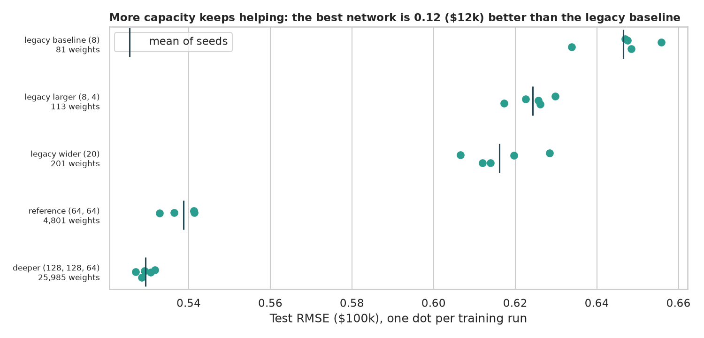
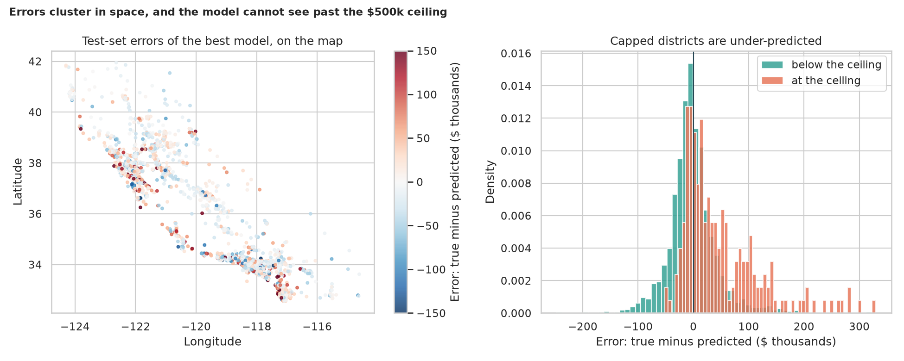

# Neural-Network House Price Regression: what the network needs, and where it still loses

> Predict the typical house price in a California neighbourhood from eight facts about it. What does the network need before it can learn anything, how much does its size matter, does it beat simpler tools, and where on the map does it go wrong?

## 📓 Start here

**[`housing_regression_nn.ipynb`](housing_regression_nn.ipynb)** is the main lesson: every step has a plain-English explanation, the code, and a "how to read this" note. Prefer a web page? Open the pre-rendered report: **[`docs/dl-housing-regression-nn.html`](../../docs/dl-housing-regression-nn.html)**.

## 💡 The Simple Analogy

A **real-estate agent in training**. A *linear model* is an agent with a simple rule of thumb: add so much per dollar of income, subtract so much for age. A *neural network* builds her own combinations ("high income **and** near the coast **and** small households means very expensive"), and a bigger network holds more of them. **Standardising** puts every fact in comparable units so she listens to the quiet numbers as well as the loud ones. The **$500k price ceiling** is a sign on the data: any neighbourhood worth more is recorded as $500k, so an agent trained on it never learns that some are worth far more.

## 🔬 The Hypothesis & Statistical Question

| # | Question | Method | Result |
|---|---|---|---|
| H1 | What drives house value? | Spearman ρ with bootstrap CI; Mann-Whitney west vs east | **Income** (ρ = 0.677), then rooms (+0.263) and household size (-0.257); west $224k vs east $168k (δ = 0.22); population unrelated (ρ = 0.004) |
| H2 | Does standardising the inputs help? | 10 paired seeds, Wilcoxon, bootstrap CI | **Yes, hugely**: test RMSE 0.783 → 0.540 (CI of the gain 0.230 to 0.256), better in 10 of 10 seeds |
| H3 | Does the network beat simpler models? | Paired bootstrap of RMSE differences | **Beats linear regression** (+0.226 RMSE, CI +0.195 to +0.271) **but loses to gradient-boosted trees** (-0.055, CI -0.068 to -0.042) |
| H4 | Does network size matter? | Kruskal-Wallis, ε², paired seeds | **Yes**: RMSE 0.647 (81 weights) → 0.539 (4,801); H = 22.3, p = 0.0002, ε² = 0.92; the legacy "larger" vs "wider" contest is a draw |
| H5 | Are the errors random? | Neighbour-correlation permutation test; Mann-Whitney at the ceiling | **No**: neighbours share errors (0.249 to 0.435 vs about 0.09 by chance); ceiling districts under-predicted by $50k on average |

## 📊 Key Data Insights & Annotated Visualizations


Coastal metros are the expensive districts, and values are cut off at $500k.


Standardising the inputs cuts test error from 0.78 to 0.54 (about $24k).


A plain neural network beats linear regression but not gradient-boosted trees.


More capacity keeps helping, with diminishing returns.


Errors cluster in space, and the model cannot see past the $500k ceiling.

## ⚙️ How it Works (Under the Hood)

The notebook is fully self-contained: no helper modules, just top-to-bottom cells.

1. **Data:** downloads California housing (20,640 districts) into `data/` on first run, splits 60/20/20, and standardises with statistics from the training rows only.
2. **Network:** fully connected ReLU layers (`8 → 64 → 64 → 1`), Adam, up to 80 epochs, keeping the weights from the best *validation* epoch so the test rows never influence training.
3. **Comparisons:** paired seeds for raw vs standardised inputs; linear regression and gradient boosting as baselines; five architectures including the legacy three; all scored on the same test districts.
4. **Statistics:** Spearman and Mann-Whitney with Cliff's δ; Wilcoxon on paired seeds; paired bootstrap on RMSE differences; Kruskal-Wallis with ε²; a permutation test on the spatial correlation of errors.

**What changed from the legacy notebook:** it used the removed `load_boston` and Keras wrapper, built a "standardised" pipeline but evaluated the unstandardised estimator in every experiment, and compared three architectures with one run each and no baseline.

## 🚀 How to Run (One-liner command)

```bash
uv sync --extra dl && uv run jupyter lab DL/housing-regression-nn/housing_regression_nn.ipynb
```

The data downloads into `data/` on the first run. It uses a GPU if present and takes about 6 minutes on one (longer on a CPU). Standalone alternative: `pip install -r requirements.txt` and open the notebook in any Jupyter. To rebuild the web report:

```bash
uv run jupyter nbconvert --to html --execute DL/housing-regression-nn/housing_regression_nn.ipynb \
    --output-dir docs --output dl-housing-regression-nn
```

## ⚠️ Limitations & Edge Cases

- **A random split flatters the models:** neighbouring districts straddle the split, so scores are optimistic compared with predicting an unseen region.
- **One split and one dataset;** seed counts are small (10 and 5), so some p-values sit at their minimum possible value.
- **1990 census data:** absolute prices are out of date; the patterns are the lesson.
- **District averages, not houses.**
- **Fixed training budget and no tuning:** the reference network was still improving at epoch 73, so tuning could narrow the gap to gradient boosting.
- **The price ceiling is kept as recorded;** handling it as censored data is a topic of its own.
