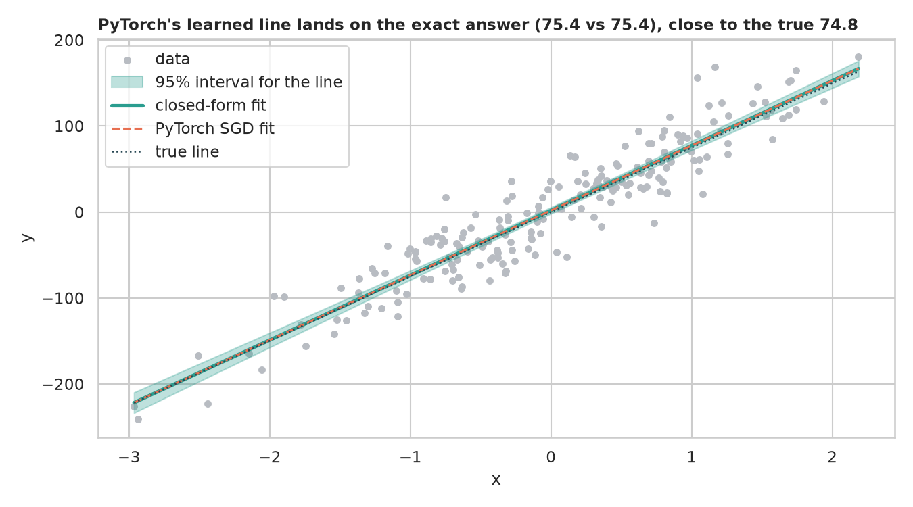
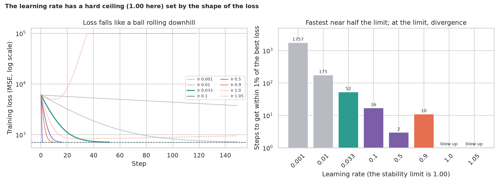
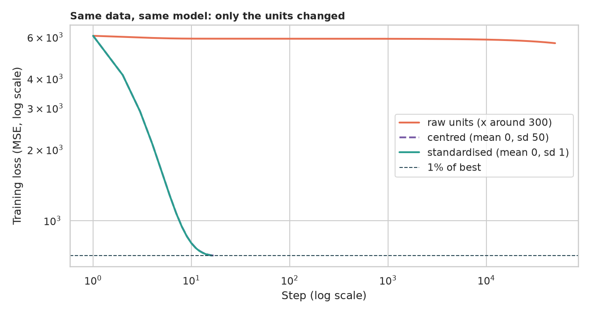
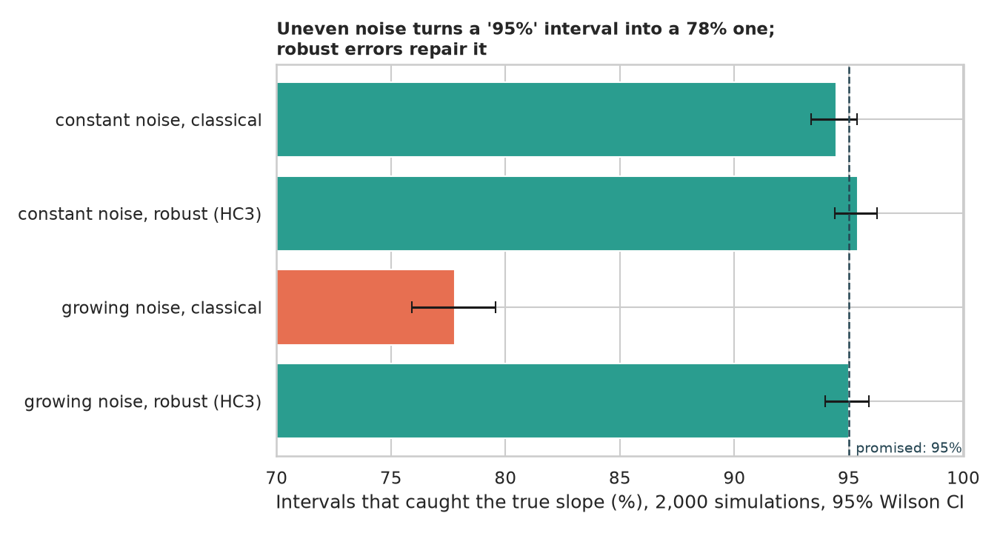
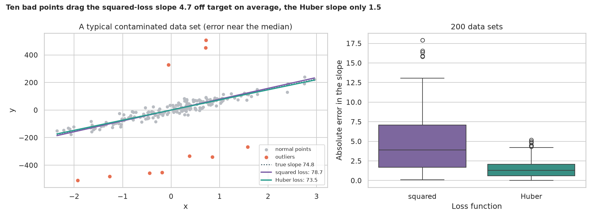

# Linear Regression in PyTorch: how a machine learns a straight line, and when to trust it

> Fitting a line through dots is the simplest model in machine learning, and the one that teaches the most. Does gradient descent find the right answer, how fast, what can break it, and how sure should we be of what it learned?

## 📓 Start here

**[`linear_regression_pytorch.ipynb`](linear_regression_pytorch.ipynb)** is the main lesson: every step has a plain-English explanation, the code, and a "how to read this" note. Prefer a web page? Open the pre-rendered report: **[`docs/dl-linear-regression-pytorch.html`](../../docs/dl-linear-regression-pytorch.html)**.

## 💡 The Simple Analogy

A **ball rolling down a hill**. The line has two knobs (slope and intercept); the hill is how badly the line misses the dots; **gradient descent** feels which way is downhill and rolls a little that way. The **learning rate** is the size of each roll: tiny rolls take forever, huge rolls overshoot the valley and fly off the map. A few **outliers** are dots someone put in the wrong place: a line that cares a lot about big misses (squared loss) gets yanked towards them, while one with a gentler rule (Huber loss) mostly ignores them.

## 🔬 The Hypothesis & Statistical Question

| # | Question | Method | Result |
|---|---|---|---|
| H1 | Is there a real slope, and does PyTorch's SGD recover it? | t-test, t and bootstrap intervals, 5-fold CV | **Yes**: t = 38.9, p = 1e-94; SGD slope 75.393 vs exact 75.402 (true 74.81); held-out RMSE 26.6 (CI 24.1 to 29.2) vs noise floor 25 |
| H2 | Is there a learning-rate ceiling, and can we predict it? | Sweep vs 2 / (largest curvature) | **Yes**: predicted 0.999; 0.9 converges in 10 steps, 1.0 and 1.05 blow up |
| H3 | Does the scale of the input matter? | Condition number, steps to converge | **Yes**: raw units (condition number 3.6 million) never converged in 50,000 steps; centred 16 steps, standardised 15 |
| H4 | Does a "95%" interval catch the truth 95% of the time? | 2,000 simulations, Wilson CIs | **Only with even noise**: 94.4% with constant noise, **77.8%** with growing noise; robust (HC3) errors restore 95.0% |
| H5 | Is squared loss as accurate as Huber loss when 5% of targets are wrong? | 200 paired data sets, Wilcoxon, bootstrap CI | **No**: slope error 4.71 vs 1.53; Huber closer in 162 of 200 (p = 2e-25) |

## 📊 Key Data Insights & Annotated Visualizations


PyTorch's learned line lands on the exact answer, close to the true slope.


The learning rate has a hard ceiling (1.00 here) set by the shape of the loss.


Same data, same model: only the units changed, and raw units never converged.


When the noise grows with x, a "95%" interval is really a 78% one; robust errors repair it.


Ten bad points drag the squared-loss slope 4.7 off target on average, the Huber slope only 1.5.

## ⚙️ How it Works (Under the Hood)

The notebook is fully self-contained: no helper modules, just top-to-bottom cells.

1. **By hand first:** the gradient of the squared error is derived on paper, written in NumPy and asserted against PyTorch autograd.
2. **Data:** 200 points generated with a *known* true slope, so every method can be checked against the truth. Nothing to download.
3. **The original model:** `nn.Linear(1, 1)`, plain SGD, compared with the closed-form least-squares solution.
4. **Experiments:** a learning-rate sweep checked against the curvature limit; the same data in three units; a coverage simulation; and 200 contaminated data sets fitted at once in a single batched `backward()` with squared and Huber loss.
5. **Statistics:** t-test with t and bootstrap intervals, Shapiro-Wilk, Breusch-Pagan, Wilson intervals for coverage, Wilcoxon signed-rank on paired errors.

**What changed from the legacy notebook:** it trained one model once with a hand-picked learning rate and epoch count, never compared with the exact answer, and reported no uncertainty or diagnostics.

## 🚀 How to Run (One-liner command)

```bash
uv sync --extra dl && uv run jupyter lab DL/linear-regression-pytorch/linear_regression_pytorch.ipynb
```

Runs in about a minute on a CPU. Standalone alternative: `pip install -r requirements.txt` and open the notebook in any Jupyter. To rebuild the web report:

```bash
uv run jupyter nbconvert --to html --execute DL/linear-regression-pytorch/linear_regression_pytorch.ipynb \
    --output-dir docs --output dl-linear-regression-pytorch
```

## ⚠️ Limitations & Edge Cases

- **Synthetic data with one input.** Chosen so the truth is known; with many inputs the same ideas apply but need more care.
- **H1 to H3 use a single 200-point sample;** H4 and H5 repeat over many data sets.
- **"Converged" means within 1% of the best loss;** a stricter rule needs more steps.
- **Full-batch gradient descent only;** mini-batch SGD adds noise and changes the learning-rate ceiling.
- **Huber's threshold (50) was fixed in advance** and the outliers are one specific type; the cost of Huber on clean data was not measured.
- **A straight line is an assumption;** the residual checks support it here only because the data came from a line.
