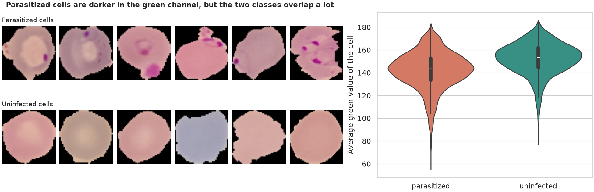
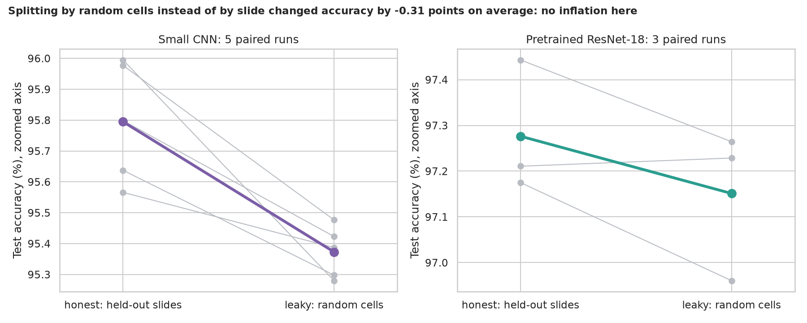
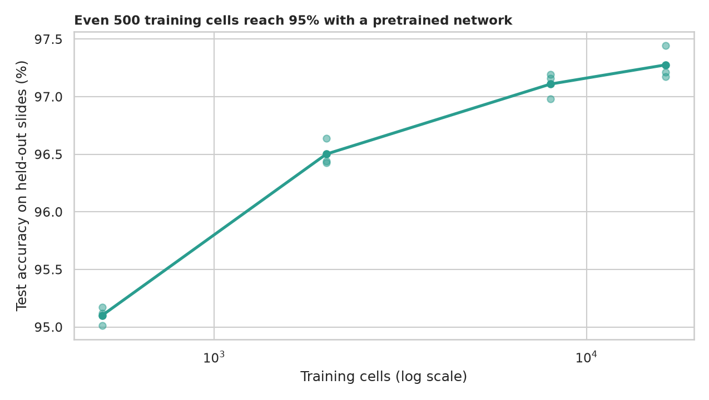
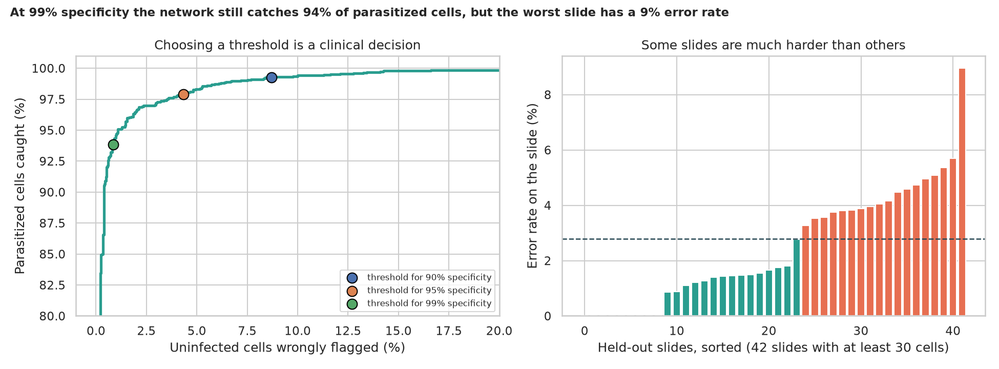

# Malaria Cell Classification: can a network spot the parasite, and can we trust the score?

> A technician has to find the few red blood cells that hide a malaria parasite. A network that looks at one cell and says "infected" or "not" scores about 97% here, but what does it really see, do simple colour statistics already do most of the job, does a random split flatter the score, how much data is enough, and where does it fail?

## 📓 Start here

**[`malaria_cell_classification.ipynb`](malaria_cell_classification.ipynb)** is the main lesson: every step has a plain-English explanation, the code, and a "how to read this" note. Prefer a web page? Open the pre-rendered report: **[`docs/dl-malaria-cell-classification.html`](../../docs/dl-malaria-cell-classification.html)**.

## 💡 The Simple Analogy

A lab technician looking for **a tiny purple speck inside a pink disc**. A *colour-summary model* only looks at how dark and purple the whole disc is. A *convolutional network* is a technician with a magnifying glass who learns to recognise the speck itself. *Pretraining* hires a technician who has already looked at a million everyday photos. A *leaky split* quizzes the technician on cells from the same slide they trained on (they might recognise the slide's lighting); an *honest split* uses slides they have never seen.

## 🔬 The Hypothesis & Statistical Question

| # | Question | Method | Result |
|---|---|---|---|
| H1 | Do infected cells differ in colour or size? | Mann-Whitney per feature, Holm, Cliff's δ | **In green**: median 143 vs 154 (δ = -0.38, AUC 0.69); no picture-size shortcut (area AUC 0.535) |
| H2 | Do simple colour statistics beat guessing? | Gradient boosting on 21 colour statistics | **Yes, by a lot**: AUC 0.978, 93.2% accuracy on held-out slides vs 51.1% guessing |
| H3 | Do networks beat that baseline? | 3 to 5 seeds, Mann-Whitney; exact McNemar | **Yes**: small CNN 95.79%, pretrained ResNet-18 97.28%; ResNet right where the CNN is wrong on 128 cells vs 60 (p = 8e-7) |
| H4 | Does a random cell split inflate the score? | 8 paired runs, Wilcoxon | **No inflation here**: random split read 0.31 points *lower* on average (the two splits use different test cells) |
| H5 | Does more data keep helping? | 500 to 16,319 training cells, 3 seeds | **Diminishing returns**: 95.1% (500) → 96.5% (2,000) → 97.1% (8,000) → 97.3% (all) |
| H6 | Is the error rate the same on every slide? | Chi-square across 42 held-out slides | **No**: median 1.7%, worst 9.0% (p = 3e-4); at 99% specificity the network catches 93.8% of parasitized cells |

## 📊 Key Data Insights & Annotated Visualizations


Parasitized cells are darker in the green channel, but the two classes overlap a lot.


Splitting by random cells instead of by slide did not inflate accuracy here.


Even 500 training cells reach 95% with a pretrained network.


The threshold is a clinical decision, and some slides are much harder than others.

## ⚙️ How it Works (Under the Hood)

The notebook is fully self-contained: no helper modules, just top-to-bottom cells.

1. **Data:** downloads the NIH malaria cell images (27,558 cells, about 350 MB) into `data/` on first run, resizes them to 96 x 96 and caches them. The slide each cell came from is read from the file name.
2. **Splits:** by **slide** (no slide appears in two parts: 60/20/20 of the cells) and, for comparison, by random cell.
3. **Models:** a colour-statistics gradient-boosting baseline; a small three-block CNN; and ImageNet-pretrained ResNet-18, all with flip augmentation, AdamW, a one-cycle schedule and final-epoch scoring. The test cells never choose anything.
4. **Statistics:** Mann-Whitney with Holm and Cliff's δ; exact McNemar; Wilcoxon over paired runs; Wilson intervals for sensitivity at fixed specificity; chi-square across slides.

**What changed from the legacy project:** the notebook was Colab-only with a random cell split and one accuracy; the Flask app (a VGG19 from a tutorial) reported "Infected With Pneumonia" for a malaria model, and both relied on `.h5` files that were not in the repository. They are replaced by a download script and PyTorch.

## 🚀 How to Run (One-liner command)

```bash
uv sync --extra dl && uv run jupyter lab DL/malaria-cell-classification/malaria_cell_classification.ipynb
```

The images download into `data/` on the first run. It uses a GPU if present and takes about 40 minutes on one (many hours on a CPU). Standalone alternative: `pip install -r requirements.txt` and open the notebook in any Jupyter. To rebuild the web report:

```bash
uv run jupyter nbconvert --to html --execute DL/malaria-cell-classification/malaria_cell_classification.ipynb \
    --output-dir docs --output dl-malaria-cell-classification
```

## ⚠️ Limitations & Edge Cases

- **One dataset from one study:** a single hospital in Bangladesh with one microscope setup; other stains, cameras or parasite species could lower every score.
- **Slides stand in for patients,** and a patient can contribute more than one slide.
- **Few seeds** (5 and 3), so some p-values sit at their minimum possible value.
- **The leakage comparison uses two different test sets,** so differences of a few tenths of a point are within the noise.
- **Images shrunk to 96 x 96 and a short training budget;** larger images and longer training would raise the scores.
- **Cells are already segmented;** a real screening tool also has to find the cells in a full slide image.
- **Not a diagnostic device.**
