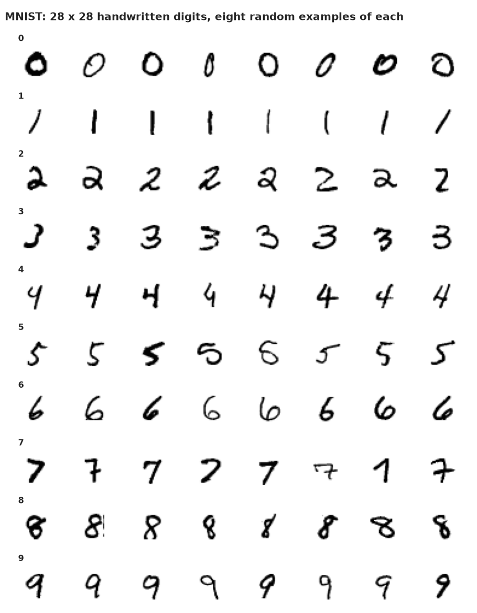
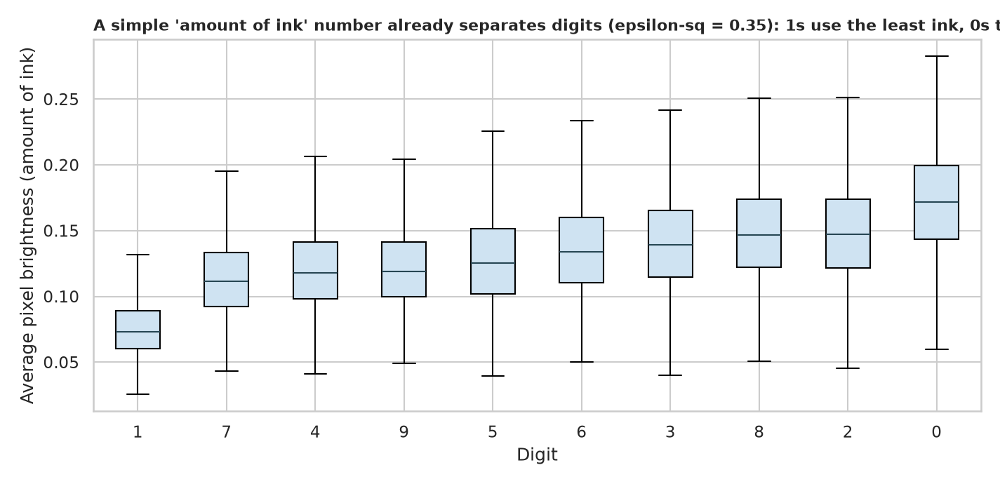
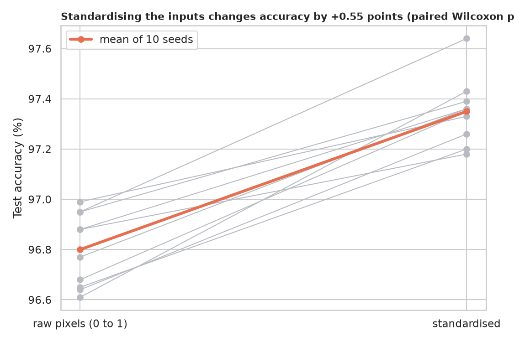
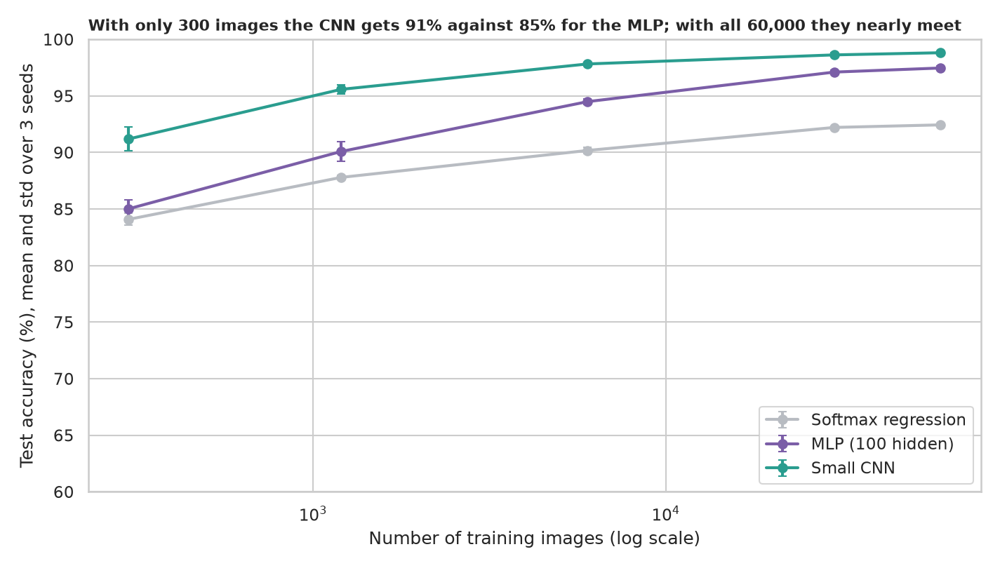
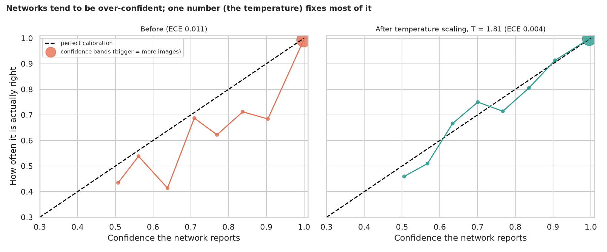
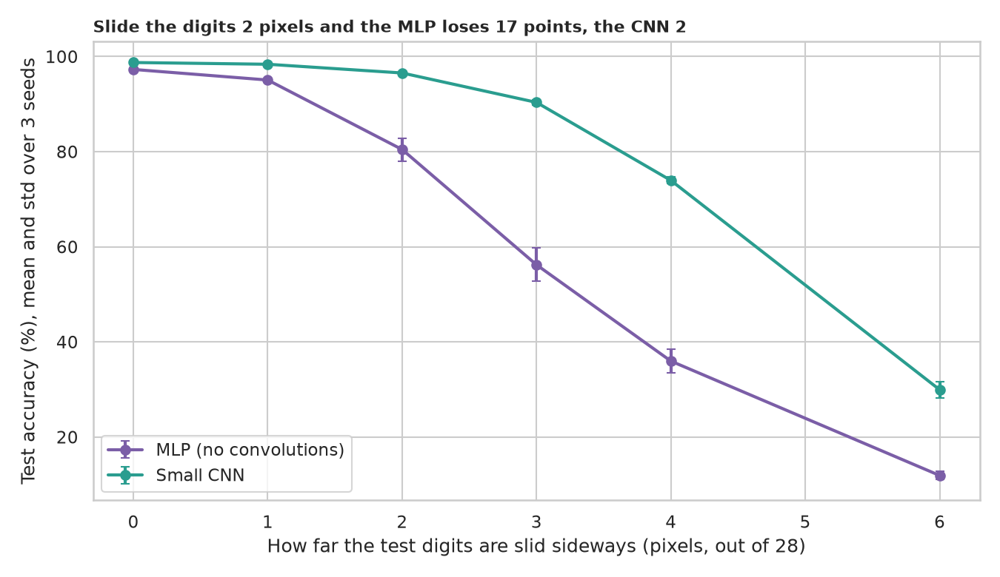
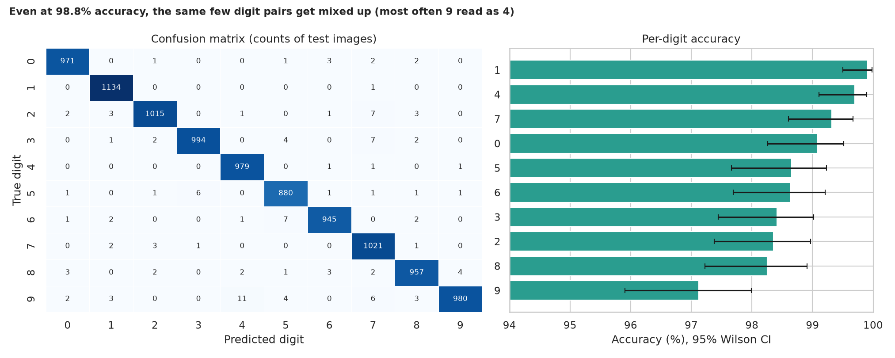

# MNIST Handwritten Digits: softmax, cross-entropy, and what a CNN really buys you

> 70,000 tiny grayscale pictures (28 x 28 pixels) of handwritten digits 0 to 9. How does a network turn pixels into a confident answer, which design choices matter, how far can you trust its confidence, and what breaks it?

## 📓 Start here

**[`mnist_multiclass.ipynb`](mnist_multiclass.ipynb)** is the main lesson: every step has a plain-English explanation, the code, and a "how to read this" note. Prefer a web page? Open the pre-rendered report: **[`docs/dl-mnist-multiclass.html`](../../docs/dl-mnist-multiclass.html)**.

## 💡 The Simple Analogy

Ten judges each shout a score for a digit. **Softmax** turns the ten raw scores into percentages that add up to 100%, so the loudest judge wins but the others still get a say. **Cross-entropy** is the penalty for the judges: it is small when the right judge was confident and large when the right judge was nearly ignored. Training is the judges slowly learning to shout the right score. A **CNN** is a judge who slides a small magnifying glass over the picture, so a digit nudged sideways still looks familiar; a plain network memorised *where* each pixel sits.

## 🔬 The Hypothesis & Statistical Question

| # | Question | Method | Result |
|---|---|---|---|
| H1 | Does the amount of ink differ between digits? | Kruskal-Wallis, ε² | **Yes, large**: ε² = 0.35; 1s use the least ink, 0s the most |
| H2 | Does standardising the inputs help an MLP? | 10 paired seeds, Wilcoxon, bootstrap CI | **Yes, a little**: +0.55 points (CI 0.45 to 0.64), better in 10 of 10 seeds, p = 0.002 |
| H3 | Does a wider hidden layer help? | Exact McNemar on the same test images | **Yes, with diminishing returns**: 10, 100, 1000 units give 92.5%, 97.3%, 98.0% |
| H4 | Does a CNN beat an MLP, and when does it matter most? | Learning curve, McNemar | **Yes at every size**: 300 images 91.2% vs 85.0%; 60,000 images 98.8% vs 97.5% |
| H5 | Is the network's confidence honest? | Calibration, ECE, temperature scaling | **Over-confident**: T = 1.81 cuts ECE from 0.0109 to 0.0038 (CI of the drop 0.0033 to 0.0092); 30 errors were made at over 99% confidence |
| H6 | Is it robust to shifted digits? | Accuracy under 0 to 6 pixel shifts, McNemar | **No, and the MLP is far worse**: a 2 pixel shift costs the MLP 17 points, the CNN 2 |
| H7 | Is accuracy equal across digits? | Chi-square, Cramér's V, Wilson CIs | **Slightly unequal**: V = 0.07; 9s are hardest (97.1%), 1s easiest (99.9%); 9 read as 4 is the most common mix-up |

The CNN reaches **98.76%** on the 10,000 test images. A guess of the most common digit scores 11.2%.

## 📊 Key Data Insights & Annotated Visualizations


What the network sees: clean, centred, very small digits; 81% of pixels are exactly zero.


A crude feature already separates digits: 1s use the least ink, 0s the most.


Standardising the inputs wins in every one of ten paired seeds, though by a modest margin.


With only 300 images the CNN is 91% against 85% for the MLP; with all 60,000 they nearly meet.


Networks tend to be over-confident; one number (the temperature) fixes most of it.


Slide the digits 2 pixels and the MLP loses 17 points, the CNN 2.


Errors concentrate in look-alike pairs such as 9 and 4.

## ⚙️ How it Works (Under the Hood)

The notebook is fully self-contained: no helper modules, just top-to-bottom cells.

1. **From scratch first:** softmax and cross-entropy are written in NumPy and asserted against PyTorch (difference 1.4e-17).
2. **Data:** downloads MNIST into `data/` on first run and keeps it on the GPU as normalised tensors.
3. **Models:** softmax regression, an MLP (10, 100 or 1000 hidden units) and a small CNN, all trained with the same recipe and judged on the **final epoch**, never the best epoch on the test set. Paired seeds and deterministic GPU mode make comparisons fair.
4. **Statistics:** Kruskal-Wallis with ε²; Wilcoxon and bootstrap CIs over paired seeds; **exact McNemar tests** on shared test images; expected calibration error with a bootstrap CI; chi-square with Wilson CIs per digit.
5. **Shift test:** test digits are slid sideways by 0 to 6 pixels without retraining.

**What changed from the legacy notebook:** it fit a single model once and reported one accuracy, with no baselines, no uncertainty and no tests.

## 🚀 How to Run (One-liner command)

```bash
uv sync --extra dl && uv run jupyter lab DL/mnist-multiclass/mnist_multiclass.ipynb
```

MNIST downloads into `data/` on the first run. It uses a GPU if present (a few minutes) and runs on a CPU, only slower. Standalone alternative: `pip install -r requirements.txt` and open the notebook in any Jupyter. To rebuild the web report:

```bash
uv run jupyter nbconvert --to html --execute DL/mnist-multiclass/mnist_multiclass.ipynb \
    --output-dir docs --output dl-mnist-multiclass
```

## ⚠️ Limitations & Edge Cases

- **Three seeds** for the learning-curve and shift experiments (ten for the standardising test); McNemar tests use one seed's predictions.
- **One recipe for every model;** per-model tuning could shift small gaps.
- **MNIST is easy and tidy:** centred, clean and single-digit. Real handwriting is messier, and published models already sit near 99.7%.
- **Shift robustness was tested without augmentation;** training with shifted digits would narrow the gap.
- **Calibration measured on the test set** with one temperature fit on held-out data; the bins at low confidence hold few images.
- **Pattern matching, not understanding:** small perturbations can still fool the network.
