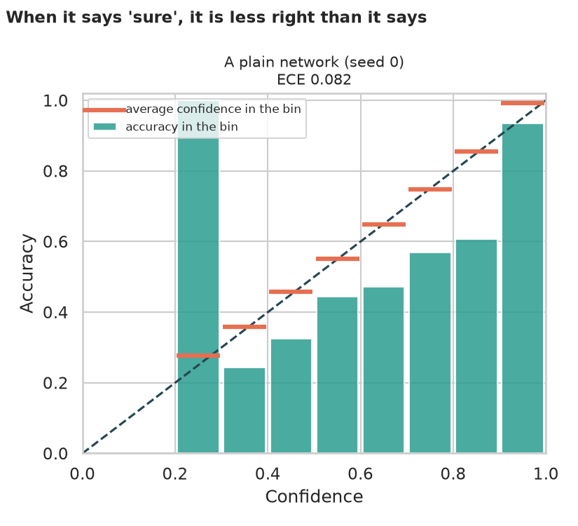
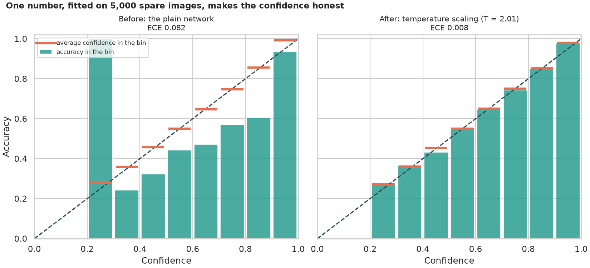
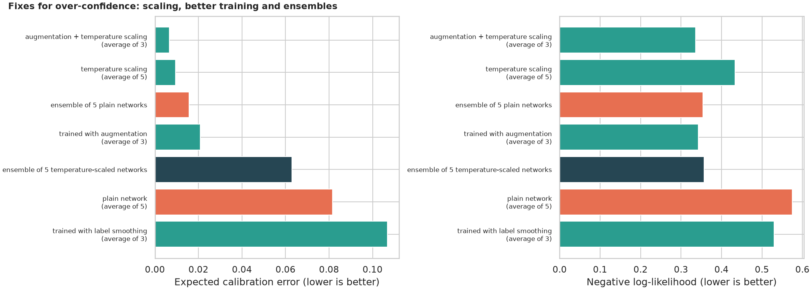
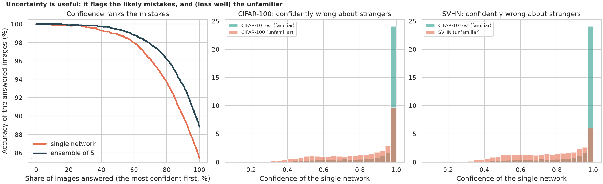
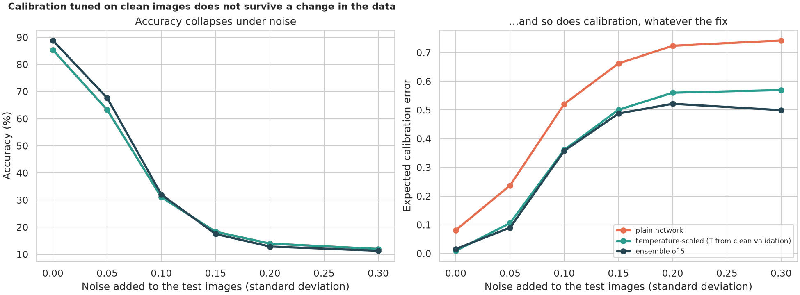

# Model Calibration and Uncertainty: can you trust a "90% sure"?

> A classifier says "cat, 97% sure", and that number decides whether to trust the answer or send it to a human. Is it honest? Modern networks are famously over-confident. How over-confident is a CIFAR-10 network, does one "temperature" fix it, how do augmentation, label smoothing and ensembles compare, does the confidence find mistakes and strangers, and does the fix survive noisy images? 11 trained networks, with seeds and honest tests.

## 📓 Start here

**[`model_calibration_uncertainty.ipynb`](model_calibration_uncertainty.ipynb)** is the main lesson: every step has a plain-English explanation, the code, and a "how to read this" note. Prefer a web page? Open the pre-rendered report: **[`docs/dl-model-calibration-uncertainty.html`](../../docs/dl-model-calibration-uncertainty.html)**.

## 💡 The Simple Analogy

A **weather forecaster**. A well-calibrated one who says "70% rain" on 100 days sees rain on about 70; an over-confident one says "99%" and is right on 90. A **reliability diagram** is the report card for every announced percentage. **Temperature scaling** tells the forecaster to turn the volume down by one fixed amount: it does not change which day he thinks is wettest, only how loudly he says it. An **ensemble** is a panel of forecasters: when they disagree, you hear the doubt.

## 🔬 The Hypothesis & Statistical Question

CIFAR-10 split 45,000 train / 5,000 validation (used only to calibrate) / 10,000 test; unfamiliar images from CIFAR-100 and SVHN; Gaussian noise for dataset shift. Networks: 5 plain, 3 augmented, 3 with label smoothing.

| # | Question | Method | Result |
|---|---|---|---|
| H1 | Are the networks over-confident? | ECE with bootstrap CI; t-test of confidence - accuracy | **Yes**: confidence 93.5% vs accuracy 85.3% (gap 8.1 points, p = 7e-7); ECE 0.082; "99% sure" is right 97% of the time |
| H2 | Does temperature scaling fix it, with no prediction changed? | Paired t-tests over 5 networks | **Yes**: T about 2.0; ECE 0.082 to 0.010, NLL 0.575 to 0.433 (p = 2e-6); **0 of 50,000** predictions changed |
| H3 | How do the other remedies compare? | ECE, NLL, Brier, accuracy; McNemar | Label smoothing **worse** (ECE 0.107); augmentation 88.5% and ECE 0.021; ensemble of 5: 88.8%, NLL 0.354 (right alone on 540 vs 202 images, p = 2e-36); augmentation + scaling best ECE 0.007; scaling each ensemble member **breaks** it (ECE 0.063) |
| H4 | Does confidence find mistakes and strangers? | AUROC, selective accuracy | **Mistakes yes** (AUROC 0.88 to 0.90; answering the top 80% gives 96.2% accuracy); **strangers weakly** (AUROC 0.79 to 0.84; still 77% to 81% confident on them) |
| H5 | Does calibration survive noise? | ECE at 6 noise levels | **No**: accuracy collapses to chance while confidence stays near 85%; ECE 0.082 to 0.742; scaling fitted on clean data loses most of its value |

## 📊 Key Data Insights & Annotated Visualizations


When it says "sure", it is less right than it says.


One number, fitted on 5,000 spare images, makes the confidence honest.


Fixes for over-confidence: scaling, better training and ensembles.


Uncertainty flags the likely mistakes and, less well, the unfamiliar.


Calibration tuned on clean images does not survive a change in the data.

## ⚙️ How it Works (Under the Hood)

1. **Networks:** three blocks of two 3x3 convolutions with batch norm (about 290,000 weights); AdamW, one-cycle learning rate, 20 epochs; logits are stored for every evaluation set.
2. **Tools:** ECE (15 equal-width bins, checked on known cases), NLL, Brier score, temperature scaling fitted by L-BFGS on the validation logits.
3. **Remedies:** temperature scaling, augmentation, label smoothing, a deep ensemble (averaged probabilities) and their combinations.
4. **Uncertainty:** AUROC for right vs wrong and for CIFAR-10 vs CIFAR-100 / SVHN; ensemble mutual information; selective prediction.
5. **Statistics:** bootstrap CIs over test images, paired t-tests over seeds, exact McNemar.

## 🚀 How to Run (One-liner command)

```bash
uv sync --extra dl && uv run jupyter lab DL/model-calibration-uncertainty/model_calibration_uncertainty.ipynb
```

CIFAR-10, CIFAR-100 and SVHN (about 400 MB) download on the first run. It uses a GPU if present and takes about 12 minutes on one. Standalone alternative: `pip install -r requirements.txt`.

## ⚠️ Limitations & Edge Cases

- **One dataset, one small network, one recipe;** larger or pretrained networks behave differently.
- **Eleven networks:** the 5-network tests have low power, so paired t-tests were used.
- **ECE depends on binning;** NLL and Brier do not.
- **Only temperature scaling was tried** (not vector scaling or isotonic regression).
- **Noise is one kind of shift,** and the networks were never trained against it.
- **Ensembles cost five times as much.**
- **Simple out-of-distribution scores;** dedicated detectors do better.
- **Calibration on average can hide poor calibration for a class or subgroup.**
