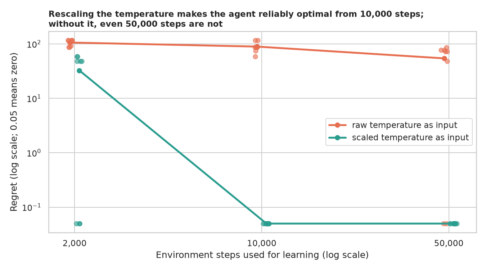
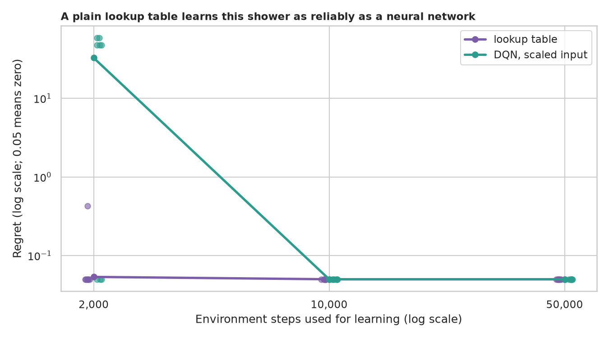
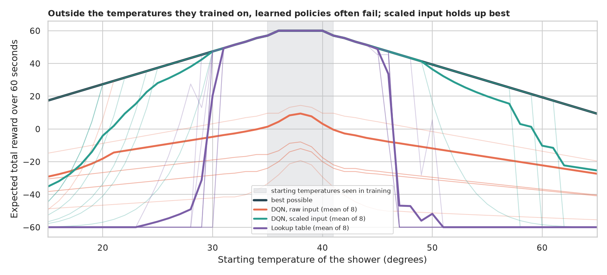
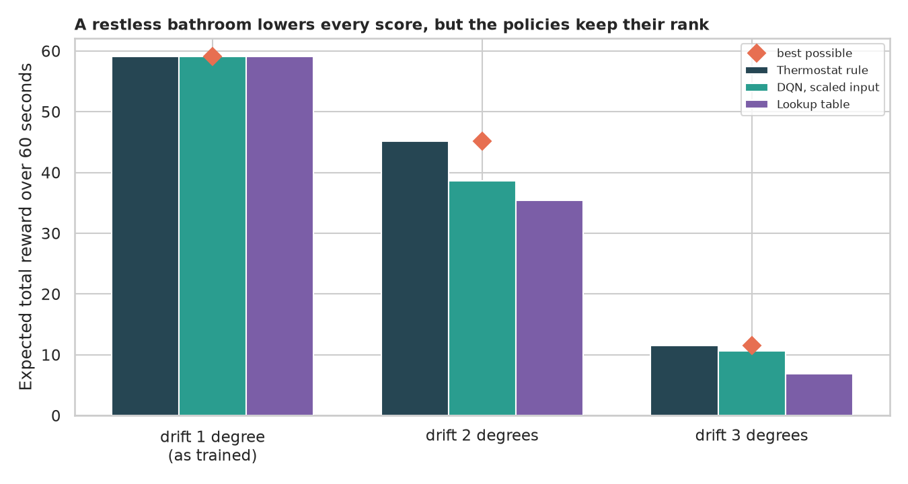

# Reinforcement Learning on a Shower: when is a neural network the right tool?

> A shower's temperature drifts, and your knob has three moves: a little colder, stay, a little hotter. Can an agent learn to hold the water in the sweet spot of 37 to 39 degrees? This problem is small enough to solve **exactly**, which lets us ask better questions than "did it learn?": is learning even necessary, what makes it fail, and how far does what it learned carry?

## 📓 Start here

**[`rl_shower_temperature.ipynb`](rl_shower_temperature.ipynb)** is the main lesson: every step has a plain-English explanation, the code, and a "how to read this" note. Prefer a web page? Open the pre-rendered report: **[`docs/dl-rl-shower-temperature.html`](../../docs/dl-rl-shower-temperature.html)**.

## 💡 The Simple Analogy

Standing under a **shower that wanders on its own**, with one hand on the knob, trying to stay comfortable for a minute. The *agent* is you, the *action* is a nudge of the knob, the *reward* is +1 when the water feels right and -1 when it does not. A *policy* is the rule "at this temperature, nudge this way"; a *thermostat rule* nudges towards the middle. *Regret* is how much comfort the agent loses compared with the best possible rule.

## 🔬 The Hypothesis & Statistical Question

| # | Question | Method | Result |
|---|---|---|---|
| (exact) | What do fixed rules score? | Dynamic programming, checked by simulation | Random knob **-35.27**, never touching it **-28.32**, a one-line **thermostat rule 59.14 = the best possible** |
| H1 | Does showing the agent a rescaled temperature help? | 8 paired seeds at 3 budgets, Wilcoxon, exact regret | **Yes, hugely**: at 10,000 steps rescaled is optimal in 8 of 8 seeds, raw in 0 of 8 (p = 0.008); at 50,000 steps raw is still optimal in only 2 of 8 |
| H2 | Does a neural network beat a plain lookup table? | 8 seeds, Mann-Whitney | **No**: at 2,000 steps the table's regret is 0.05 vs 32.67 for the DQN (p = 0.029); both perfect from 10,000 steps |
| H3 | Does the learned rule work from unseen starting temperatures? | Exact value from every start | **Mostly not**: within 1 point of optimal from only 21% (table) to 60% (rescaled DQN) of starts; the thermostat rule is optimal everywhere |
| H4 | Does it survive a more restless shower? | Exact value at drift 1, 2, 3 | **No**: at drift 2 regret is 6.6 (DQN) and 9.7 (table) out of an optimum of 45.2; the thermostat loses nothing |

## 📊 Key Data Insights & Annotated Visualizations


Rescaling the temperature makes the agent reliably optimal from 10,000 steps; without it, even 50,000 steps are not.


A plain lookup table learns this shower as reliably as a neural network.


Outside the temperatures they trained on, learned policies often fail; scaled input holds up best.


A restless bathroom lowers every score, but the policies keep their rank.

## ⚙️ How it Works (Under the Hood)

The notebook is fully self-contained: no helper modules, just top-to-bottom cells.

1. **Environment:** a Gymnasium `Env` (seeded, clipped to 0 to 100, time-limit truncation). Each second: nudge colder, keep or hotter; reward +1 inside 37 to 39, else -1; then random drift.
2. **Exact scoring:** the rules as tables, so any policy's expected return, and the best possible return (dynamic programming), are computed without sampling noise; 2,000 simulated showers confirm the tables.
3. **Learners:** a Stable-Baselines3 DQN (two layers of 64) with raw or rescaled input, and tabular Q-learning, at 2,000, 10,000 and 50,000 steps, 8 seeds each. A trained agent is read out as a rule (its chosen action at every temperature) and scored exactly.
4. **Statistics:** exact regret; Wilcoxon on paired seeds; Mann-Whitney between learners; exact value curves for unseen starts and higher drift.

**What changed from the legacy notebook:** it was Colab-only (`tensorflow==2.3.0`, `keras-rl2`, `.h5f` weights), used the old `gym` API with unseeded randomness and an unbounded temperature, trained a five-layer network for 500,000 steps on the raw temperature and reported one score with no baseline.

## 🚀 How to Run (One-liner command)

```bash
uv sync --extra dl && uv run jupyter lab DL/rl-shower-temperature/rl_shower_temperature.ipynb
```

Nothing is downloaded; it runs on a CPU in about 10 minutes. Standalone alternative: `pip install -r requirements.txt` and open the notebook in any Jupyter. To rebuild the web report:

```bash
uv run jupyter nbconvert --to html --execute DL/rl-shower-temperature/rl_shower_temperature.ipynb \
    --output-dir docs --output dl-rl-shower-temperature
```

## ⚠️ Limitations & Edge Cases

- **A tiny, fully known problem:** chosen so the learners can be seen clearly; real control problems are larger, partly hidden and not exactly solvable.
- **Untuned agents:** one recipe each; a tuned raw-input DQN might recover some of the gap in H1.
- **Few seeds** (8 per setting), so p-values sit at or near their minimum possible value.
- **Discount of 0.9 while scoring the undiscounted 60-second return:** the best rule is the same under both for this problem.
- **Learning budgets stop at 50,000 steps,** so we cannot say whether the raw-input agent would eventually become reliable.
- **Whole-degree temperatures with uniform drift,** unlike a real shower.
