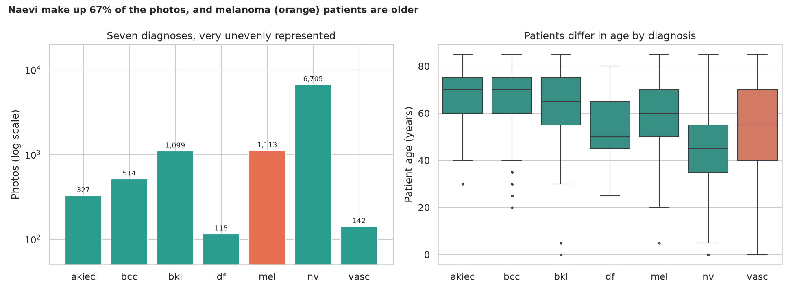
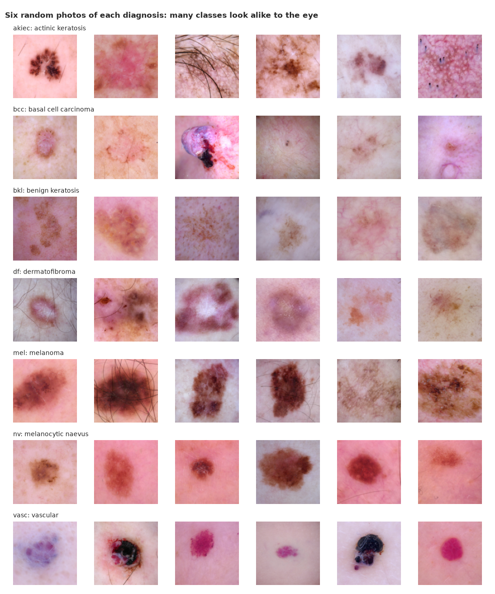
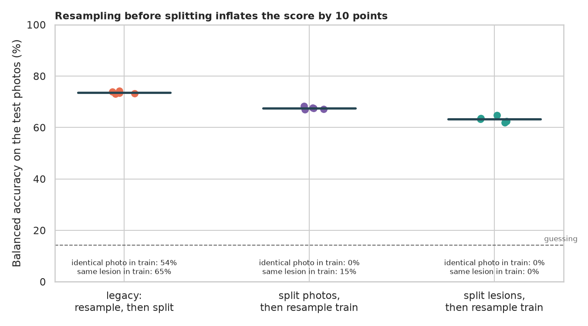
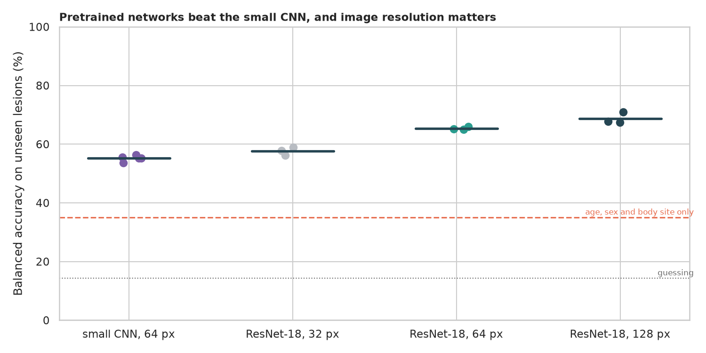
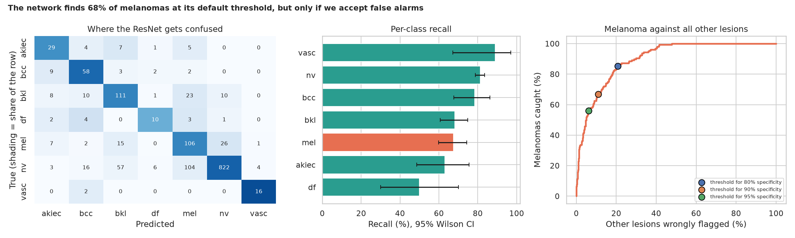

# Skin Lesion Classification (HAM10000): how much of the score is real?

> Can a network tell seven kinds of skin lesion apart, including melanoma? The legacy notebook reported 75% accuracy, but it copied rare photos *before* splitting into train and test, so the test set was full of photos the network had already seen. How much does that inflate the score, what is the honest number, and what does the network do about melanoma? *(Teaching example, not a diagnostic tool.)*

## 📓 Start here

**[`ham10000.ipynb`](ham10000.ipynb)** is the main lesson: every step has a plain-English explanation, the code, and a "how to read this" note. Prefer a web page? Open the pre-rendered report: **[`docs/dl-skin-cancer-lesion-classification.html`](../../docs/dl-skin-cancer-lesion-classification.html)**.

## 💡 The Simple Analogy

A **student preparing with a practice test**. If the exam contains the same questions, a high score proves only memorisation: the legacy code photocopied rare photos before splitting, so many exam photos were copies of practice photos. Even without copies, one lesion is often photographed several times, so a fair exam uses lesions the student has never met. **Pretraining** is a student who has studied a million everyday photos first. **Balanced accuracy** averages the score on each kind of lesion, so ignoring the rare ones cannot hide.

## 🔬 The Hypothesis & Statistical Question

| # | Question | Method | Result |
|---|---|---|---|
| H1 | Do patients differ by diagnosis? | Kruskal-Wallis, chi-square, ε², Cramér's V | **Yes**: age ε² = 0.23 (naevi 45, melanoma 60, carcinoma and keratosis 70); body site V = 0.22; "how confirmed" (V = 0.39) is a shortcut to avoid |
| H2 | Does "resample, then split" inflate the score? | 5 seeds per split design, Mann-Whitney | **Yes, by 10 points**: balanced accuracy 73.6% (legacy) vs 67.5% (photos split first) vs 63.2% (lesions split); 53.6% of legacy test photos have an identical copy in training |
| H3 | Pretrained vs small network, and resolution? | 3 to 5 seeds, Mann-Whitney, Kruskal-Wallis | **Pretraining +10.2 points** at 64 px (p = 0.036); ResNet-18 57.6% (32 px) → 65.4% (64 px) → 68.7% (128 px); age, sex and site alone give 35.0% |
| H4 | How well does it find melanoma? | Wilson CIs, ROC | **AUC 0.900**: 85.4% of melanomas caught at ~79% specificity, 56.1% at ~94%; 104 naevi called melanoma, 26 melanomas called naevi |

## 📊 Key Data Insights & Annotated Visualizations


Naevi make up 67% of the photos, and melanoma patients are older.


Six random photos of each diagnosis: many classes look alike to the eye.


Resampling before splitting inflates the score by 10 points.


Pretrained networks beat the small CNN, and image resolution matters.


The main confusion is naevus versus melanoma; melanoma is found only at the price of false alarms.

## ⚙️ How it Works (Under the Hood)

The notebook is fully self-contained: no helper modules, just top-to-bottom cells.

1. **Data:** downloads HAM10000 (about 2.8 GB, Harvard Dataverse, CC BY-NC 4.0) into `data/` on first run, crops each photo to its central square and caches it at 128 x 128 pixels.
2. **Splits:** by **lesion** (70/15/15, per diagnosis), with an `assert` that no lesion is shared. For the leakage test, three designs: resample-then-split (legacy), split photos then resample, split lesions then resample.
3. **Models:** a small CNN and an ImageNet-pretrained ResNet-18 with flip augmentation, a class-weighted loss, AdamW, a one-cycle schedule and final-epoch scoring; a gradient-boosting model on age, sex and body site as a no-photo baseline.
4. **Statistics:** Kruskal-Wallis, chi-square, Cramér's V, Mann-Whitney, bootstrap and Wilson intervals; balanced accuracy as the main metric; melanoma thresholds set on the validation lesions.

**What changed from the legacy notebook:** it resampled before splitting (leakage), ignored multiple photos per lesion, shrank images to 32 x 32, validated on the test set and reported plain accuracy on a balanced resample.

## 🚀 How to Run (One-liner command)

```bash
uv sync --extra dl && uv run jupyter lab DL/skin-cancer-lesion-classification/ham10000.ipynb
```

The images download into `data/` on the first run. It uses a GPU if present and takes about 45 minutes on one (many hours on a CPU). Standalone alternative: `pip install -r requirements.txt` and open the notebook in any Jupyter. To rebuild the web report:

```bash
uv run jupyter nbconvert --to html --execute DL/skin-cancer-lesion-classification/ham10000.ipynb \
    --output-dir docs --output dl-skin-cancer-lesion-classification
```

## ⚠️ Limitations & Edge Cases

- **Two clinics (Austria and Australia),** mostly fair-skinned patients and dermoscopic photos; results will not carry over to other skin tones or phone photos.
- **Lesion IDs are the best available grouping;** a patient-level split would be stricter.
- **Few seeds, and very few test photos for the smallest classes** (18 and 20), so their recall intervals are wide.
- **Short training and small images;** larger images and longer training would raise the scores.
- **The leakage test uses a 32-pixel small CNN** to mirror the legacy notebook.
- **Not a diagnostic device.** Images are CC BY-NC 4.0 (non-commercial); cite Tschandl, Rosendahl and Kittler (2018), *Scientific Data*.
