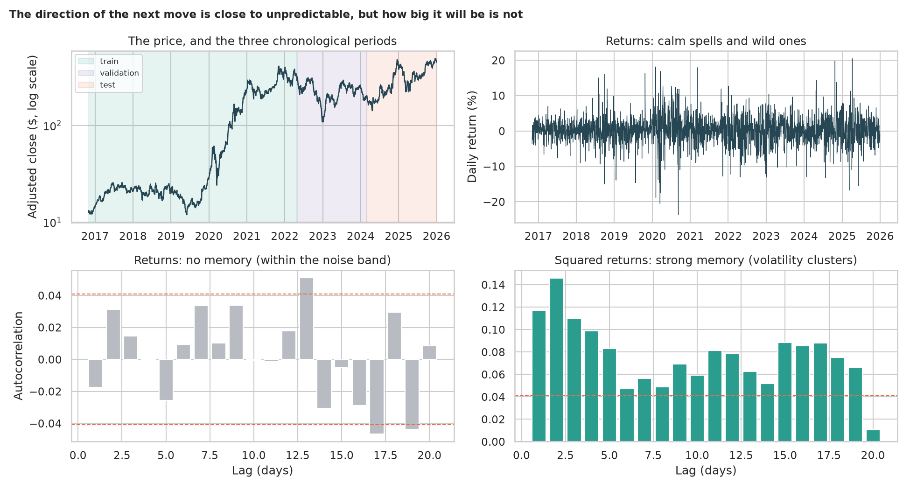
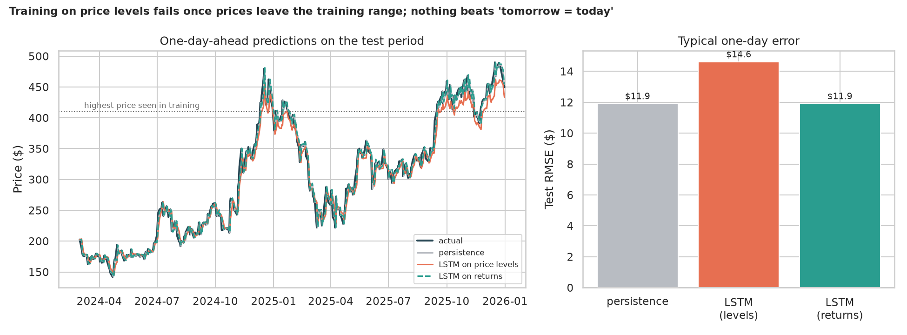
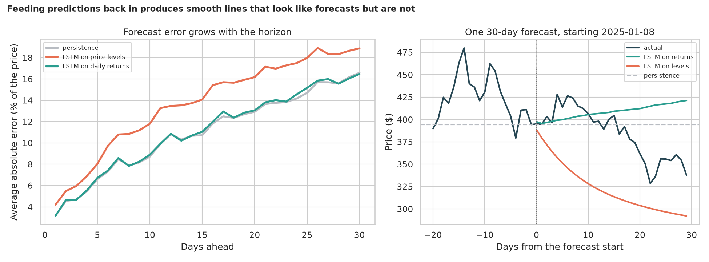

# Stock Price Prediction with an LSTM: can a network beat "tomorrow will be like today"?

> A stacked LSTM trained on a stock's past prices will draw a line that follows the real price closely. That looks like prediction, but it is exactly what "tomorrow's price = today's price" gives for free. Is the price predictable at all, does the network beat that baseline, can it call the direction, and what happens when it forecasts 30 days ahead? *(Teaching example, not financial advice.)*

## 📓 Start here

**[`stock_price_lstm.ipynb`](stock_price_lstm.ipynb)** is the main lesson: every step has a plain-English explanation, the code, and a "how to read this" note. Prefer a web page? Open the pre-rendered report: **[`docs/dl-stock-price-lstm.html`](../../docs/dl-stock-price-lstm.html)**.

## 💡 The Simple Analogy

A **person stumbling home after a long night**: each step lurches left or right at random. The best guess of where they will be next is *where they are now* (the "random walk", or **persistence** forecast). A model that draws a smooth line through their footsteps looks clever but cannot beat that guess. What you *can* predict is **how wildly** they will lurch: after a big stagger, another is more likely (**volatility clustering**). And a forecaster who learned the path only near the pub is lost once the walker is blocks away.

## 🔬 The Hypothesis & Statistical Question

| # | Question | Method | Result |
|---|---|---|---|
| H1 | Is the price predictable from its own past? | ADF; Ljung-Box and autocorrelation of returns and squared returns | **Direction: no** (ADF on prices p = 0.74; returns Ljung-Box p of 0.38 to 0.42 at lags 1 to 10). **Size of moves: yes** (squared returns p from 1.8e-8 to 4e-53) |
| H2 | Does an LSTM beat "tomorrow = today"? | RMSE over 5 seeds; Diebold-Mariano with HAC errors | **No**: persistence $11.90; LSTM on returns $11.90 (p = 0.84, a tie); LSTM on price levels $14.61 (p = 5.6e-8, worse; 19.5% of test days were above any training price) |
| H3 | Can it call the direction? | Binomial tests, Wilson CI, rank correlation | **No**: 52.7% (CI 48.2% to 57.2%) vs 50.8% for always guessing "up" (p = 0.43); rank correlation +0.06 |
| H4 | Is a 30-day recursive forecast better than staying put? | Wilcoxon over 87 start dates | **No**: persistence is off by 16.6% at 30 days; the levels model by 18.9% (p = 0.039, worse); the returns model ties |

## 📊 Key Data Insights & Annotated Visualizations


The direction of the next move is close to unpredictable, but how big it will be is not.


Training on price levels fails once prices leave the training range; nothing beats "tomorrow = today".


Feeding predictions back in produces smooth lines that look like forecasts but are not.

## ⚙️ How it Works (Under the Hood)

The notebook is fully self-contained: no helper modules, just top-to-bottom cells.

1. **Data:** downloads Tesla's daily split-adjusted closes (2016-10-31 to 2025-12-31, 2,305 days) from Yahoo Finance into `data/` on first run. The range is fixed so results do not change from day to day.
2. **Splits:** in time order: 60% train, 20% validation, 20% test. Scaling is learned from the training days only.
3. **Models:** the persistence baseline, and a 3-layer stacked LSTM (64 units, 80-day window) trained either on scaled prices or on standardised daily returns, with the best validation epoch kept; 5 seeds each.
4. **Statistics:** ADF and Ljung-Box tests; RMSE and a skill score against persistence; Diebold-Mariano with Newey-West errors; binomial tests and Wilson intervals; Wilcoxon over start dates for the 30-day forecasts.

**What changed from the legacy notebook:** it needed a Tiingo API key, scaled using the whole history, computed its RMSE between scaled targets and dollar predictions (so its numbers and its "underfitting" diagnosis were wrong), used the test set as validation and compared nothing to a baseline.

## 🚀 How to Run (One-liner command)

```bash
uv sync --extra dl && uv run jupyter lab DL/stock-price-lstm/stock_price_lstm.ipynb
```

The prices download into `data/` on the first run (no account needed). It uses a GPU if present and takes about 5 minutes on one. Standalone alternative: `pip install -r requirements.txt` and open the notebook in any Jupyter. To rebuild the web report:

```bash
uv run jupyter nbconvert --to html --execute DL/stock-price-lstm/stock_price_lstm.ipynb \
    --output-dir docs --output dl-stock-price-lstm
```

## ⚠️ Limitations & Edge Cases

- **One stock and one period:** Tesla is unusually volatile; other stocks may differ (though a random walk is the usual finding).
- **Only past prices as input:** the claim is that past prices alone do not predict the next day, not that nothing does.
- **Two untuned network designs and one window length.**
- **One test period of 461 days;** a walk-forward evaluation over several periods would be stricter.
- **Direction accuracy ignores the size of moves and trading costs.**
- **Data from an unofficial Yahoo Finance endpoint,** cached in `data/`; the endpoint could change.
- **Not financial advice.**
