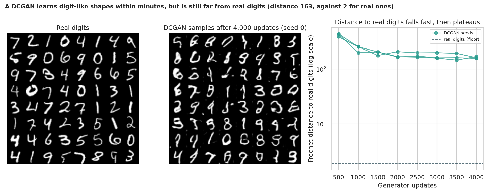
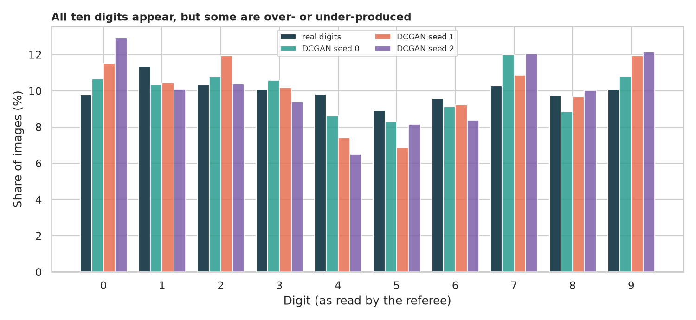
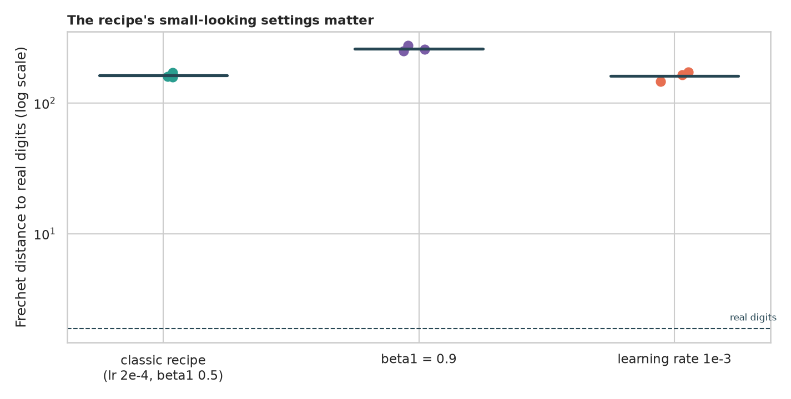
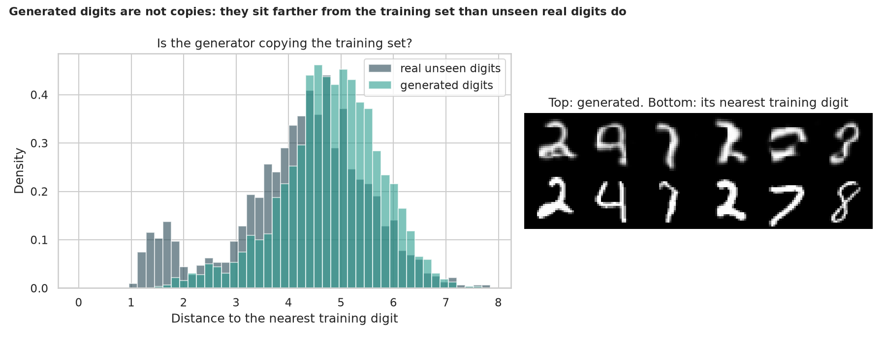

# DCGAN on MNIST: teaching a network to forge handwritten digits

> A GAN trains a *generator* that forges images from noise against a *discriminator* that tries to spot the forgeries. DCGAN made this work with convolutional networks and a handful of settings. How close do the forgeries get to real digits, are all ten digits produced, how fragile is the recipe, and is the generator just copying its training set?

## 📓 Start here

**[`dcgan.ipynb`](dcgan.ipynb)** is the main lesson: every step has a plain-English explanation, the code, and a "how to read this" note. Prefer a web page? Open the pre-rendered report: **[`docs/gan-dcgan.html`](../../docs/gan-dcgan.html)**.

## 💡 The Simple Analogy

A **forger and an art detective** playing a game. The forger starts with random blobs; each round the detective sorts real paintings from fakes, and the forger learns from how the detective was fooled. Success is when the fakes look real, but there are traps: the forger might learn to paint **only one convincing digit** (mode collapse) or just **photocopy** real paintings. So we need an **independent referee**, not the detective who trained alongside the forger.

## 🔬 The Hypothesis & Statistical Question

| # | Question | Method | Result |
|---|---|---|---|
| H1 | Does the trained generator get close to real digits? | Fréchet distance, Inception-style score, 3 seeds | **Mostly**: distance 1,559 (untrained) → 163 (real digits 1.9); referee confident on ~60% of forgeries vs 96.6% of real digits |
| H2 | Does it produce every digit in the right proportion? | Total variation distance, chi-square | **Every digit appears**, but the mix is off by 4% to 7% (4s and 5s under-produced) |
| H3 | Is the recipe robust to its settings? | Adam momentum and learning rate, 3 seeds each | **Momentum 0.9 hurts** (distance 260 vs 163, worse in every run, p = 0.050 at the minimum possible); a 5x larger learning rate makes no clear difference |
| H4 | Is the generator copying its training digits? | Nearest-training-digit distance, Mann-Whitney, Cliff's δ | **No**: forgeries are *farther* from the training set than unseen real digits (δ = +0.26); none is a near-copy |

## 📊 Key Data Insights & Annotated Visualizations


A DCGAN learns digit-like shapes within minutes, but is still far from real digits.


All ten digits appear, but some are over- or under-produced.


The recipe's small-looking settings matter.


Generated digits are not copies: they sit farther from the training set than unseen real digits do.

## ⚙️ How it Works (Under the Hood)

The notebook is fully self-contained: no helper modules, just top-to-bottom cells.

1. **Data:** downloads MNIST into `data/` on first run; digits are padded to 32 x 32 (the legacy scripts used 64 x 64).
2. **Referee:** a small digit classifier trained on real digits gives a Fréchet distance (the digit-sized cousin of FID), an Inception-style score and a confident share. Real digits scored against real digits set the floor.
3. **DCGAN:** a transposed-convolution generator and a strided-convolution discriminator with batch norm, binary cross-entropy, Adam (learning rate 2e-4, momentum 0.5), 4,000 generator updates.
4. **Experiments:** three seeds per setting; momentum and learning-rate variants; a nearest-neighbour memorisation test.
5. **Statistics:** Kruskal-Wallis, Mann-Whitney, Cliff's δ, chi-square and total variation distance.

**What changed from the legacy script:** it measured nothing (only sample grids in TensorBoard), had no seed, trained at 64 x 64 and imported private PyTorch internals.

## 🚀 How to Run (One-liner command)

```bash
uv sync --extra gan && uv run jupyter lab GAN/dcgan/dcgan.ipynb
```

MNIST downloads into `data/` on the first run. It uses a GPU if present and takes about 30 minutes on one. Standalone alternative: `pip install -r requirements.txt` and open the notebook in any Jupyter. To rebuild the web report:

```bash
uv run jupyter nbconvert --to html --execute GAN/dcgan/dcgan.ipynb \
    --output-dir docs --output gan-dcgan
```

## ⚠️ Limitations & Edge Cases

- **The referee is a judge we built:** distances are not comparable with published FID values.
- **A short run and three seeds per setting,** so the sensitivity result needs more runs to be firm.
- **32 x 32 and a shortened DCGAN.**
- **One-at-a-time settings** (momentum, learning rate); other settings were not tested.
- **Pixel distance is a crude test for copying.**
- **No human judgement** of the forged digits.
