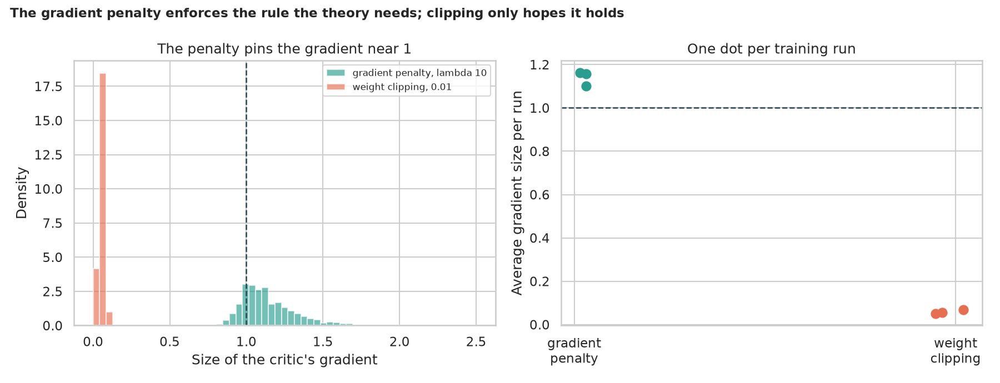
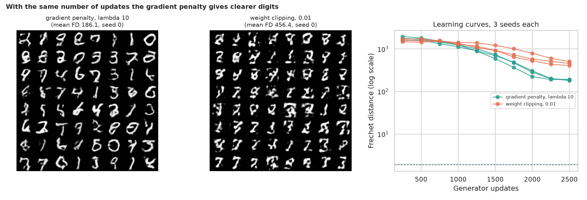
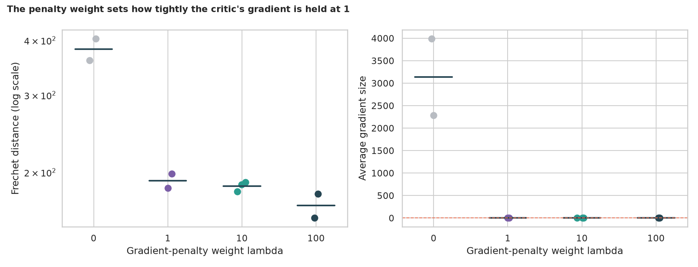

# WGAN-GP on MNIST: a speed limit for the critic that is actually enforced

> The Wasserstein GAN needs a "smooth" critic. Weight clipping enforces that crudely; WGAN-GP fines the critic whenever the size of its gradient strays from 1. Does the penalty really hold the gradient near 1, does it give better digits for the same effort, how much does the penalty weight matter, and why must the critic avoid batch norm?

## 📓 Start here

**[`wgan_gp.ipynb`](wgan_gp.ipynb)** is the main lesson: every step has a plain-English explanation, the code, and a "how to read this" note. Prefer a web page? Open the pre-rendered report: **[`docs/gan-wgan-gp.html`](../../docs/gan-wgan-gp.html)**.

## 💡 The Simple Analogy

A judge who scores paintings must not let his score **jump wildly** between two almost identical paintings. **Weight clipping** bolts his brain into a tiny box so the limit holds by accident (and he barely distinguishes anything). The **gradient penalty** checks the speed directly: pick a spot between a real and a fake painting, see how fast his score changes there, and fine him if it is not about 1. And he may not peek at the other paintings in the batch (batch norm), or the check means nothing.

## 🔬 The Hypothesis & Statistical Question

Quality is judged by an independent referee network (real-digit floor: Fréchet distance 1.89). Main comparisons use 3 seeds; side experiments use 2.

| # | Question | Method | Result |
|---|---|---|---|
| H1 | Does the penalty hold the critic's gradient nearer 1 than clipping? | Mann-Whitney, 3 vs 3 | **Yes**: gradient size 1.14 (penalty) vs 0.059 (clipping), in all runs (p = 0.05, the minimum possible) |
| H2 | Better digits after the same updates? | Mann-Whitney, 3 vs 3 | **Yes**: Fréchet distance 186 vs 456; digit-mix distance 0.04 vs 0.31; better than every clipping run |
| H3 | Does the penalty weight λ matter? | Kruskal-Wallis, 2 to 3 seeds | **No penalty is bad** (382, gradient about 3,100); λ 1 to 100 gives 168 to 191 (p = 0.084) |
| H4 | Does the critic's normalisation matter? | Kruskal-Wallis, 2 to 3 seeds | Instance norm 186, batch norm 434 (gradient 3.5, penalty broken), none 667 and erratic (p = 0.105) |

## 📊 Key Data Insights & Annotated Visualizations


The penalty pins the critic's gradient near 1; clipping leaves it near 0.


With the same number of updates the gradient penalty gives clearer digits.


The penalty weight sets how tightly the gradient is held at 1.

## ⚙️ How it Works (Under the Hood)

1. **Referee:** a small classifier trained on real MNIST gives the Fréchet distance, an Inception-style score, a confident share and the digit-mix distance.
2. **WGAN-GP:** the critic loss adds λ x (gradient size - 1)² at random points between real and fake digits; Adam (1e-4, momentum 0 and 0.9), 5 critic updates per generator update, instance norm.
3. **WGAN with clipping:** weights clamped to ±0.01 after each critic update; RMSprop (5e-5).
4. **Budget:** 2,500 generator updates, batches of 64, 32 x 32 digits.

**What changed from the legacy scripts:** they only wrote sample grids to TensorBoard, with no measurement of quality and no check that the penalty did what the paper says.

## 🚀 How to Run (One-liner command)

```bash
uv sync --extra gan && uv run jupyter lab GAN/wgan-gp/wgan_gp.ipynb
```

MNIST downloads into `data/` on the first run. It uses a GPU if present and takes about an hour on one. Standalone alternative: `pip install -r requirements.txt`.

## ⚠️ Limitations & Edge Cases

- **The referee is a judge we built;** its Fréchet distance is not comparable with published FID values.
- **Two or three seeds per setting:** the main tests sit at their minimum p of 0.05 and the side experiments are not significant at 5%.
- **A short run** (2,500 updates); both recipes were still improving.
- **Different optimisers** (Adam vs RMSprop) follow the two papers, so H2 compares complete recipes.
- **One small architecture and dataset.**
- **The gradient is checked only at interpolated points.**
