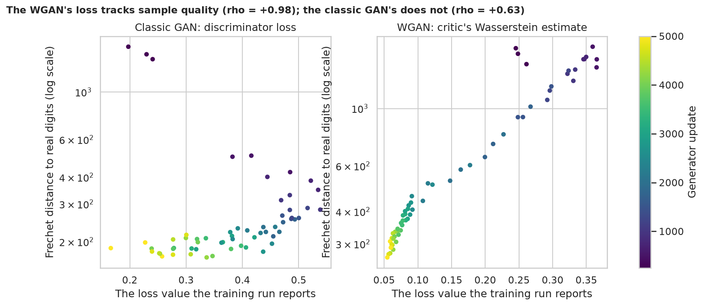
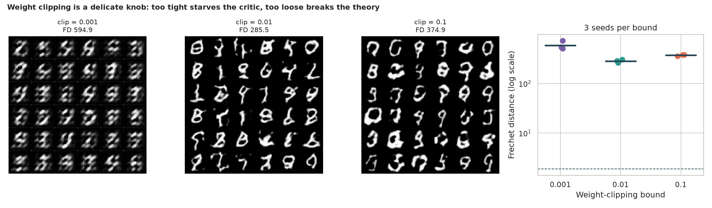

# WGAN on MNIST: a GAN whose loss finally means something

> A classic GAN's discriminator loss is a poor progress bar. The Wasserstein GAN swaps the yes/no discriminator for a critic whose score gap should track image quality, at the price of a crude trick (weight clipping). Does the loss really track quality, how touchy is the clipping bound, and does it beat the classic GAN at the same budget?

## 📓 Start here

**[`wgan.ipynb`](wgan.ipynb)** is the main lesson: every step has a plain-English explanation, the code, and a "how to read this" note. Prefer a web page? Open the pre-rendered report: **[`docs/gan-wgan.html`](../../docs/gan-wgan.html)**.

## 💡 The Simple Analogy

A forger and two kinds of judge. The **classic judge** says only "real" or "fake", which says little once the fakes are decent. The **WGAN judge (critic)** scores every painting, and the gap between real and fake scores says how far apart the piles still are, so it shrinks as the forger improves. To keep the scores honest the judge may not shout, so the original WGAN **clamps every number in the judge's brain** into a narrow band (weight clipping).

## 🔬 The Hypothesis & Statistical Question

Quality is judged by an independent referee network (a digit classifier trained on real digits), with real-digit scores as the floor (Fréchet distance 1.89).

| # | Question | Method | Result |
|---|---|---|---|
| H1 | Does a run's own loss track its sample quality? | Spearman over 20 checkpoints per run, 3 seeds | **WGAN critic: +0.97 to +0.98**; classic discriminator loss: +0.60 to +0.65 |
| H2 | Does the clipping bound matter? | Kruskal-Wallis, 3 seeds per bound | **Yes** (p = 0.027): Fréchet distance 595 / 285 / 375 for clip 0.001 / 0.01 / 0.1 |
| H3 | Does the WGAN beat the classic GAN at this budget? | Mann-Whitney, 3 against 3 | **No**: 285.5 vs 187.8; every WGAN run worse than every classic run (p = 0.10, the minimum possible) |

## 📊 Key Data Insights & Annotated Visualizations


The WGAN's loss signal moves in step with the referee's score; the classic GAN's does not.


Weight clipping is a delicate knob: a tight bound leaves 83% of the critic's weights stuck at the bound.

## ⚙️ How it Works (Under the Hood)

1. **Referee:** a small classifier trained on real MNIST gives the Fréchet distance, an Inception-style score and a confident share.
2. **Classic GAN:** sigmoid discriminator with batch norm, binary cross-entropy, Adam (2e-4, momentum 0.5).
3. **WGAN:** unbounded critic with instance norm, real-minus-fake score, RMSprop (5e-5), 5 critic updates per generator update, weights clipped after every critic update.
4. **Budget:** 5,000 generator updates, batches of 64, 32 x 32 digits, 3 seeds per setting.

**What changed from the legacy scripts:** they only wrote sample grids to TensorBoard, with no measurement of quality, so the paper's claims were never checked.

## 🚀 How to Run (One-liner command)

```bash
uv sync --extra gan && uv run jupyter lab GAN/wgan/wgan.ipynb
```

MNIST downloads into `data/` on the first run. It uses a GPU if present and takes about 40 minutes on one. Standalone alternative: `pip install -r requirements.txt`.

## ⚠️ Limitations & Edge Cases

- **The referee is a judge we built;** its Fréchet distance is not comparable with published FID values.
- **Three seeds per setting,** so the smallest possible Mann-Whitney p-value is 0.10.
- **A short run** (5,000 generator updates); the WGAN may still be improving.
- **Unequal real-data budgets:** per generator update the critic sees 5x more real batches (this favours the WGAN).
- **Learning rates not tuned,** so H3 compares two reasonable recipes, not their best versions.
- **The H1 correlation is within a run over time;** critic values cannot be compared across clipping bounds.
