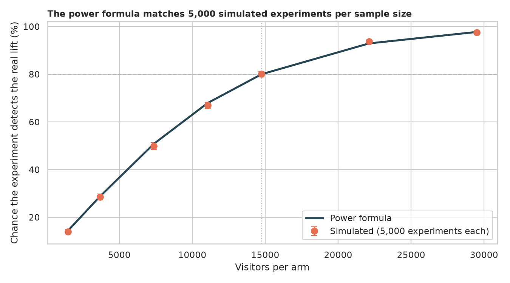
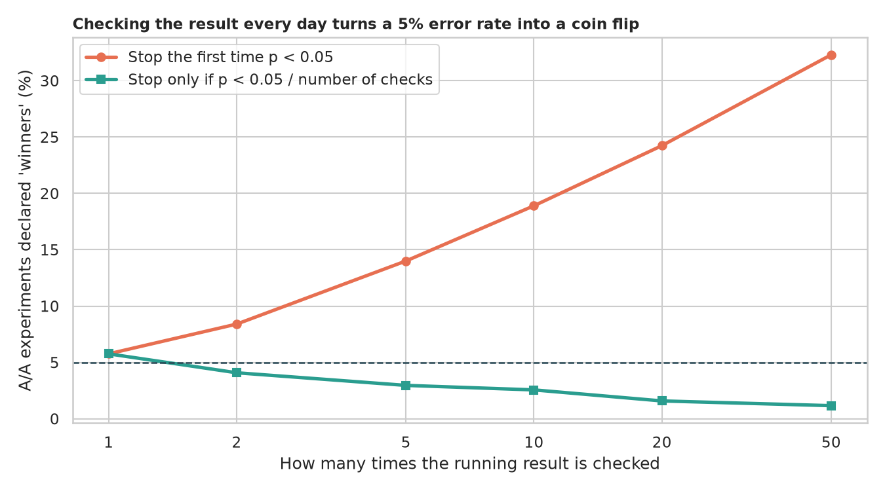
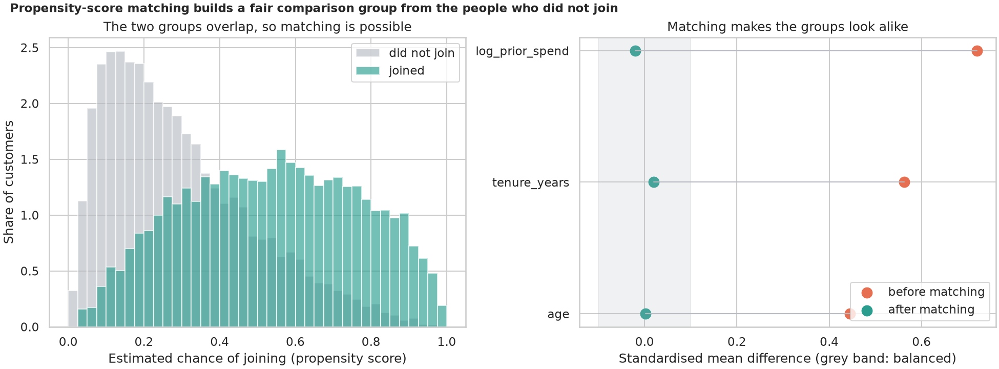
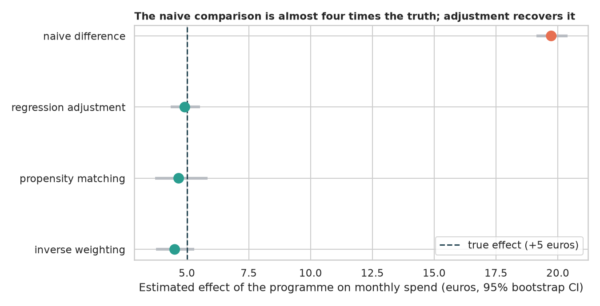
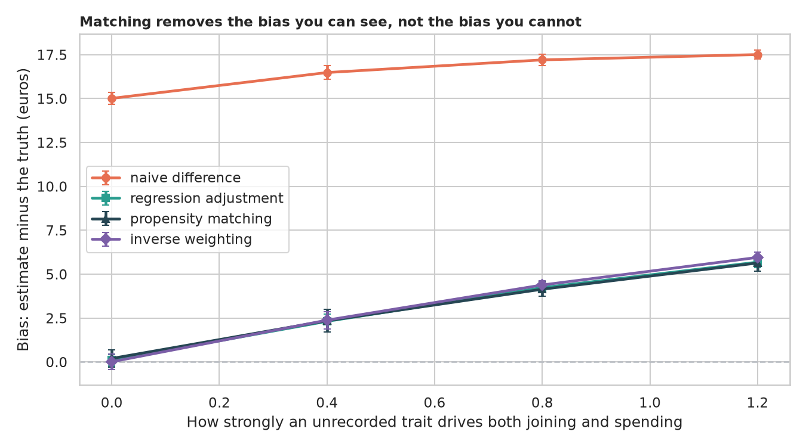

# A/B Testing and Causal Inference: did it really work?

> Two ways to learn whether a change caused an improvement: flip a coin for who gets it (an A/B test), or, when people chose for themselves, adjust for who they are (causal inference). How many visitors does a test need, how does peeking fool us, and when people chose their own treatment, how wrong is the naive comparison, can propensity-score matching rescue it, and what can it not rescue? All data are simulated, so the true answer is known.

## 📓 Start here

**[`ab_testing_causal_inference.ipynb`](ab_testing_causal_inference.ipynb)** is the main lesson: every step has a plain-English explanation, the code, and a "how to read this" note. Prefer a web page? Open the pre-rendered report: **[`docs/ml-ab-testing-causal-inference.html`](../../docs/ml-ab-testing-causal-inference.html)**.

## 💡 The Simple Analogy

A **new fertiliser**. In an A/B test a coin decides which plants get it, so sunny and shady spots land in both groups and any height difference is the fertiliser; the hard part is how many plants you need, and not peeking every morning and stopping the day it looks good. In an observational study the gardener chose, giving it to the healthiest plants in the sunniest spots; **matching** pairs each fertilised plant with an unfertilised twin in a similar spot. But matching cannot remove a secret sense of "this plant feels strong" that was never written down.

## 🔬 The Hypothesis & Statistical Question

| # | Question | Method | Result |
|---|---|---|---|
| H1 | Does an A/A test call a difference 5% of the time? | 5,000 simulated A/A tests; Wilson CI, KS test of p-values | **Yes**: 5.20% (CI 4.62% to 5.85%); p-values uniform (p = 0.38) |
| H2 | Does the power formula match reality, and what do underpowered tests report? | 5,000 experiments per sample size | **Formula right** (80.1% simulated vs 80.0%); at a quarter of the sample only 28.5% find the lift and the winners report **1.8x** the truth |
| H3 | Does peeking keep the 5% error rate? | A/A tests with 1 to 50 looks | **No**: 14.0% with 5 looks, 18.9% with 10, 32.3% with 50; Bonferroni restores it |
| H4 | When people chose, do adjusted estimates recover the true +5 euros? | Bootstrap of the whole pipeline | **Naive +19.7** (3.9x the truth); regression +4.91, matching +4.67, weighting +4.51, all CIs contain +5; age imbalance 0.445 to 0.002 after matching |
| H5 | What if a cause is not recorded? | 10 data sets per strength | **Bias grows**: about +4 euros at strength 0.8 and +5.6 at 1.2, bigger than the effect; unbiased again if the trait is recorded |

## 📊 Key Data Insights & Annotated Visualizations


The power formula matches 5,000 simulated experiments per sample size.


Checking the result every day turns a 5% error rate into a coin flip.


Propensity-score matching builds a fair comparison group from the people who did not join.


The naive comparison is almost four times the truth; adjustment recovers it.


Matching removes the bias you can see, not the bias you cannot.

## ⚙️ How it Works (Under the Hood)

1. **A/B part:** conversions are binomial draws (10% vs 11%); the two-proportion z-test (equal to the chi-square test); power from `statsmodels`; Newcombe intervals; peeking simulated with cumulative batches.
2. **Causal part:** 20,000 customers; joining depends on age, tenure and log past spend (and optionally a hidden trait); spend depends on the same plus a true +5 euro effect.
3. **Estimators:** naive difference, OLS adjustment, 1-to-1 nearest-neighbour propensity matching with a 0.2 SD caliper (effect on joiners), stabilised inverse-probability weighting; balance by standardised mean differences; the whole pipeline is bootstrapped.

## 🚀 How to Run (One-liner command)

```bash
uv sync && uv run jupyter lab ML/ab-testing-causal-inference/ab_testing_causal_inference.ipynb
```

Nothing is downloaded and it takes about 6 minutes on a CPU. Standalone alternative: `pip install -r requirements.txt`.

## ⚠️ Limitations & Edge Cases

- **Everything is simulated,** with cleaner confounding than real data.
- **A constant treatment effect;** with varying effects matching and weighting estimate different things.
- **One metric, two arms:** real tests need multiple-metric corrections and handle novelty effects.
- **Peeking was handled by Bonferroni,** which is conservative; sequential designs are more efficient.
- **The propensity model is correct by construction;** real ones can be misspecified.
- **Overlap was good;** with poor overlap matching and weighting become unstable.
- **Ten data sets per hidden-confounder setting** carry some noise.
