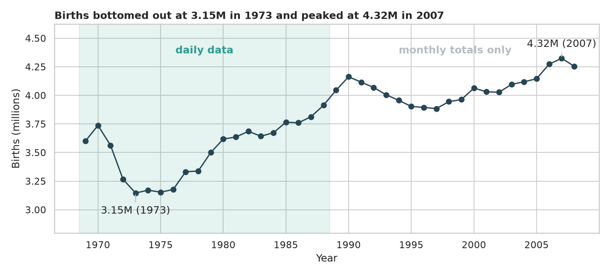
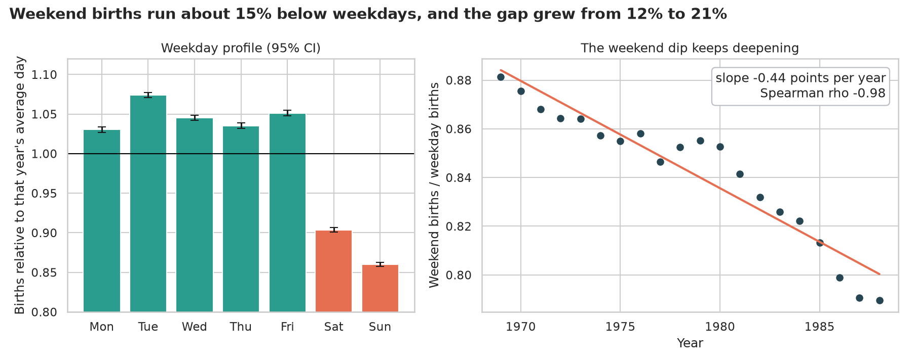
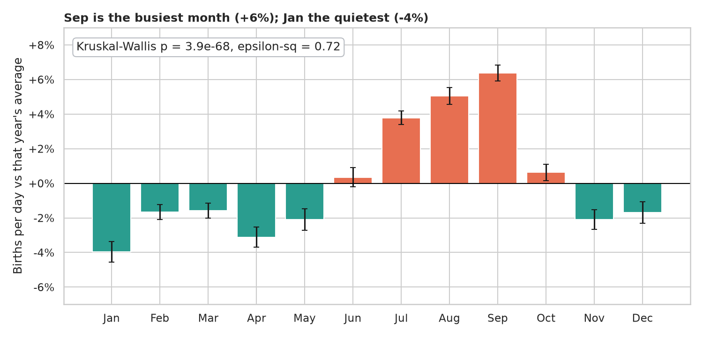
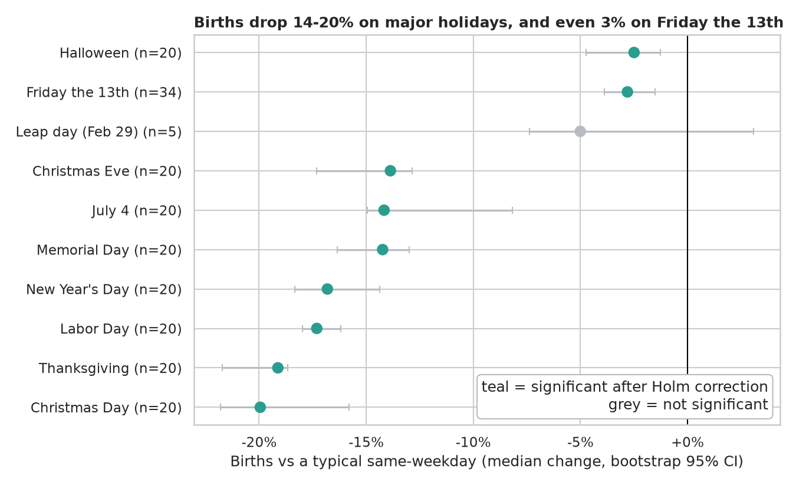
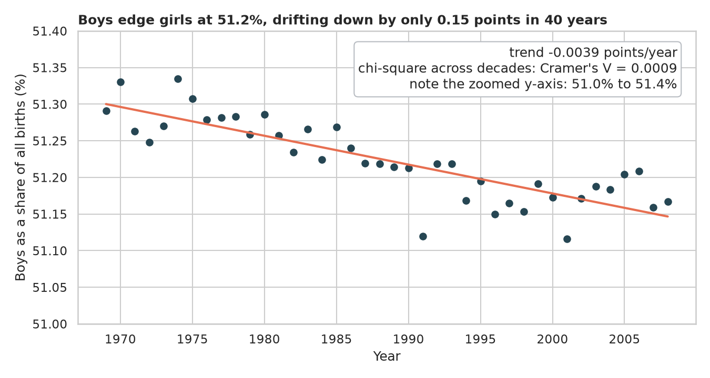
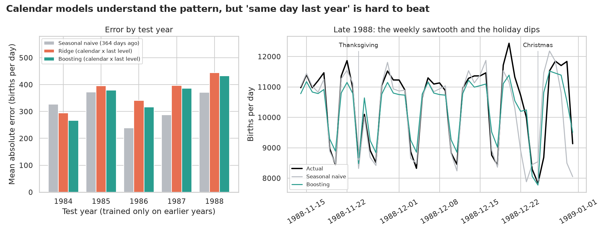

# Birth Rate Analysis: does the calendar steer when babies are born?

> About 152 million U.S. births between 1969 and 2008. Are babies spread evenly across the week and the year, or does the calendar leave fingerprints on the data? And can we forecast a day's births?

## 📓 Start here

**[`birth_rate_analysis.ipynb`](birth_rate_analysis.ipynb)** is the main lesson: every step has a plain-English explanation, the code, and a "how to read this" note. Prefer a web page? Open the pre-rendered report: **[`docs/ml-birth-rate-analysis.html`](../../docs/ml-birth-rate-analysis.html)**.

## 💡 The Simple Analogy

Think of a **bakery**. Some customers wander in whenever they like (the cakes nobody planned), but many cakes are **pre-ordered**, and pre-orders only get picked up when the shop is open: weekdays, not Sunday, not Christmas.

Hospitals work a little like that. Many babies arrive on their own schedule, but a growing share of births are *scheduled* (induced labour, planned C-sections), and scheduled births follow the business calendar. If that's true, we should see fewer births on weekends and holidays, and a weekend gap that **grows** over the years. The notebook tests those ideas with real statistics.

## 🔬 The Hypothesis & Statistical Question

| # | Question | H₀ | Test | Result |
|---|---|---|---|---|
| H1 | Are weekends quieter, and is the gap growing? | Weekend = weekday; no trend over time | Paired Wilcoxon on 1,042 weeks; Spearman and OLS slope on 20 yearly ratios | Weekend days run at **84.5%** of weekdays (CI 84.3 to 84.7%), lower in **every** week; gap grew from 12% to 21% (slope −0.0044/yr, ρ = −0.98) |
| H2 | Do births depend on the month? | Same births per day in all months | Kruskal-Wallis, plus Sep vs Jan with Cliff's δ | H = 349, **ε² = 0.72**; Sep +6%, Jan −4%, δ = +1.00 |
| H3 | Are holidays, Friday the 13th and leap day unusual? | Typical for the weekday and season | Wilcoxon vs a local same-weekday baseline, Holm over 10 days | Major holidays **−14% to −20%**, Friday the 13th **−2.8%** (CI −3.9 to −1.5), leap day not detectable (n = 5, p = 0.19) |
| H4 | Do boys and girls arrive 50/50, and is the split stable? | P(boy) = 0.5; same share every decade | z-test, chi-square across decades, Cramér's V | **51.2% boys** (p < 1e-300), but drift is only 0.15 points over 40 years (V = 0.0009) |

"Fail to reject" means the sample can't see an effect, not that none exists. And with samples this big, effect sizes matter more than p-values.

## 📊 Key Data Insights & Annotated Visualizations


The file is two datasets in one: **daily rows for 1969-1988** and **monthly totals only for 1989-2008**. Births bottomed out at 3.15M in 1973 and peaked at 4.32M in 2007.


Sunday is the quietest day (about 14% below average). The weekend dip deepened almost in a straight line, from 12% in 1969 to 21% in 1988.


Births peak in late summer (September +6%) and bottom out in January (−4%).


Births drop 14-20% on major holidays, about 3% on Friday the 13th and about 2.5% on Halloween. Leap day has only 5 observations, so the test can't say.


Boys are 51.2% of births, with a statistically significant but tiny downward drift (note the zoomed axis).


Rolling-origin forecasts for 1984-1988: calendar models learn the weekly sawtooth and the holiday dips, but "same weekday last year" (MAE about 319 births/day) is hard to beat. With a perfect "oracle" yearly level, boosting matches it, so the limiting factor is the year-to-year level, not the calendar.

## ⚙️ How it Works (Under the Hood)

The notebook is fully self-contained: no helper modules, just top-to-bottom cells.

1. **Data audit:** downloads the CDC births file (republished by Jake VanderPlas) into `data/` on the first run, then splits it into the daily era (7,305 valid days) and the monthly-total era. About 0.01% of daily-era births have impossible dates (day 99, Feb 30) and are excluded from daily analysis but kept in monthly totals.
2. **Tests:** paired weekly Wilcoxon with a bootstrap CI; Spearman and OLS slope; Kruskal-Wallis with ε²; Wilcoxon against a local same-weekday median baseline with Holm correction; z-test, chi-square and Cramér's V.
3. **Forecasting:** rolling-origin evaluation (train on earlier years, test on the next, 1984 to 1988), so nothing leaks from the future. Models: seasonal naive, Ridge and gradient boosting on calendar features times last year's level, plus an "oracle level" diagnostic. Model gaps get a month-block bootstrap CI.

**What changed from the legacy notebook:** it filled missing days with `0` (turning monthly totals into fake "day 0" rows), relied on an outlier filter to drop them by accident, called the removed `pd.datetime`, and contained no statistics at all.

## 🚀 How to Run (One-liner command)

```bash
uv sync && uv run jupyter lab ML/birth-rate-analysis/birth_rate_analysis.ipynb
```

The notebook saves its figures to `outputs/`. Standalone alternative: `pip install -r requirements.txt` and open the notebook in any Jupyter. To rebuild the web report:

```bash
uv run jupyter nbconvert --to html --execute ML/birth-rate-analysis/birth_rate_analysis.ipynb \
    --output-dir docs --output ml-birth-rate-analysis
```

## ⚠️ Limitations & Edge Cases

- **Two data eras.** Daily analysis covers 1969-1988 only; weekday and holiday patterns may differ in later decades.
- **Association, not cause.** The data does not say which births were induced or scheduled, so the "bakery" explanation is a hypothesis that fits, not a measured fact.
- **Choice of baseline.** The special-day baseline (median of the six surrounding same weekdays) can be biased where holidays cluster, such as late December. The direction is robust; exact percentages are not.
- **Small n for rare days.** Leap day has 5 observations and Friday the 13th 34. Holm corrects for the 10 days we chose, not for every date one could examine.
- **Pooled sex ratio.** 152 million births pooled across the country and four decades say nothing about any one hospital or region.
- **A simple forecaster.** Only last year's level is used, no outside information, and only five test years.
- **Autocorrelation.** Neighbouring days are correlated; weekly pairing and month-block bootstrapping reduce but do not eliminate that.
