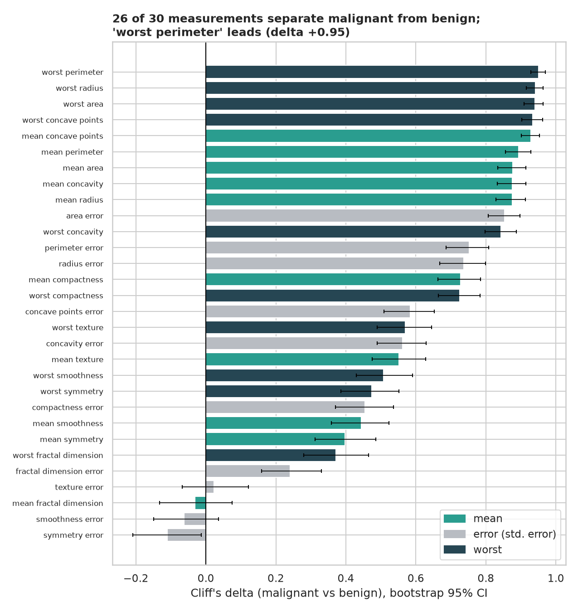
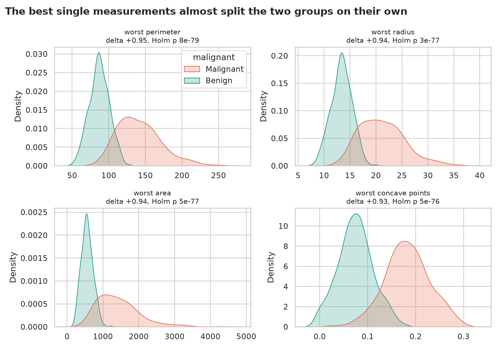
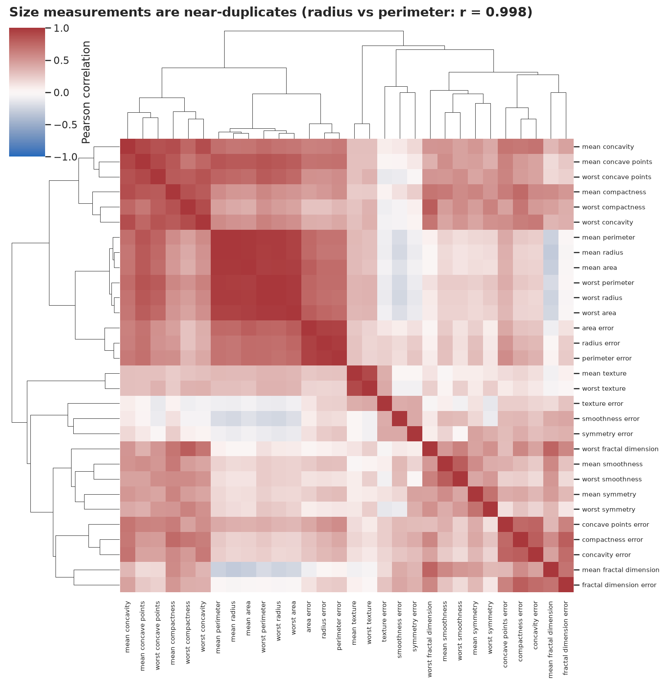
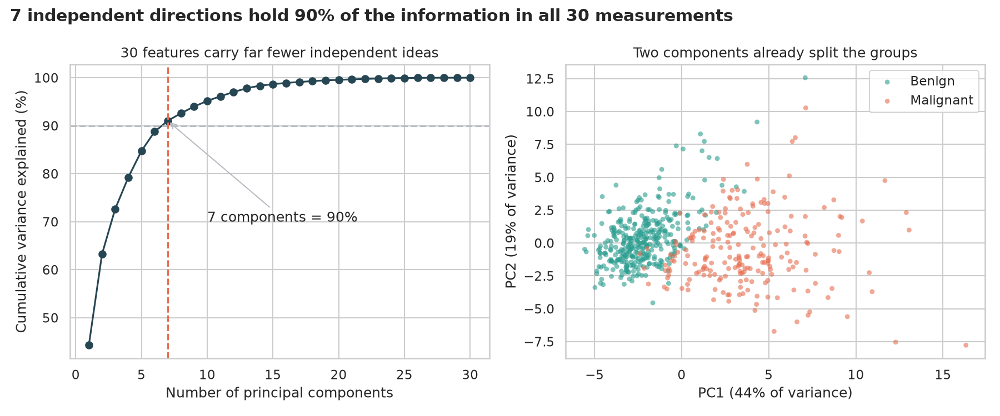
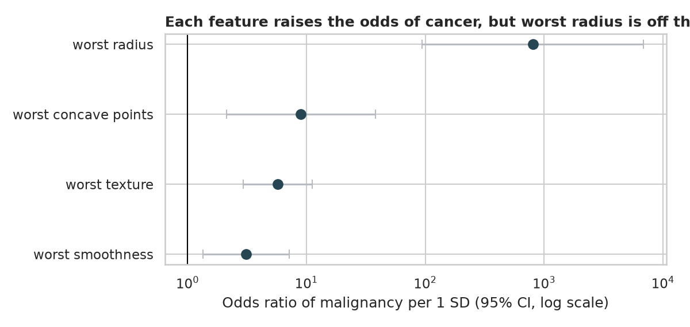
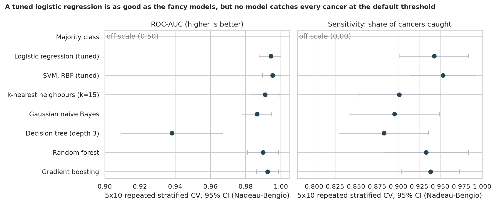
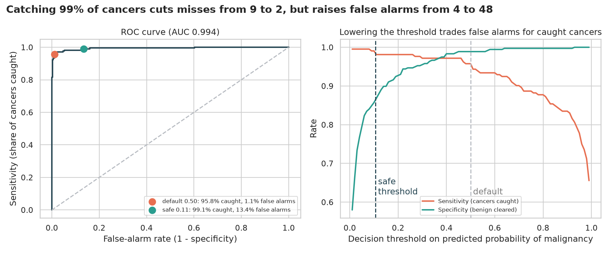

# Breast Cancer Wisconsin: which tumour measurements separate malignant from benign?

> 569 patients, 30 measurements of cell nuclei taken from a lump, and a confirmed diagnosis. Which measurements separate cancer from benign tumours, which ones are copies of each other, and how good (and how *safe*) can a screening model be?

## 📓 Start here

**[`01_breast_cancer.ipynb`](01_breast_cancer.ipynb)** is the main lesson: every step has a plain-English explanation, the code, and a "how to read this" note. Prefer a web page? Open the pre-rendered report: **[`docs/ml-breast-cancer-wisconsin.html`](../../docs/ml-breast-cancer-wisconsin.html)**.

> This notebook merges three older ones (an "original" 699-sample logistic-regression notebook, a 24 MB EDA notebook and a modelling notebook) into one story on the 569-patient *Diagnostic* dataset that ships inside scikit-learn. No download is needed.

## 💡 The Simple Analogy

Think of a **smoke alarm**. One that never rings is useless, and a missed fire is a disaster. One that rings for toast is annoying, but a false alarm costs little. A cancer-screening model is a smoke alarm for tumours, and the two mistakes are *not* equally bad: **missing a cancer is far worse than calling a benign lump back for a second look.** So we judge the model by **sensitivity** (share of cancers caught) and **specificity** (share of benign lumps correctly cleared), not just accuracy.

## 🔬 The Hypothesis & Statistical Question

| # | Question | H₀ | Method | Result |
|---|---|---|---|---|
| H1 | Does each measurement differ between malignant and benign? | Same distribution | Mann-Whitney U, Cliff's δ with bootstrap CI, Holm over 30 tests | **26 of 30 significant**; `worst perimeter` δ = +0.95 (single-feature AUC 0.975) |
| H2 | Are the measurements independent? | (descriptive) | Correlation clusters, VIF, PCA | `mean radius` vs `mean perimeter` r = 0.998; **23 of 30 features have VIF > 10**; 7 components hold 90% of the variance |
| H3 | Is a simple, transparent model as good as complex ones? | AUC difference = 0 | Nested, leak-free 5×10 stratified CV with paired Nadeau-Bengio tests | Tuned logistic regression AUC **0.994**, accuracy 97.5%; no paired test separates it from SVM, forests or boosting |
| H4 | Can we reach 99% sensitivity, and at what cost? | (decision analysis) | ROC / threshold analysis on out-of-fold predictions | Misses fall **9 → 2**, false alarms rise **4 → 48** |

"Fail to reject" means the sample can't see an effect, not that none exists.

## 📊 Key Data Insights & Annotated Visualizations


All 30 effect sizes with bootstrap CIs. The "worst" size and shape measures separate the groups best; four features (texture error, mean fractal dimension, smoothness error, symmetry error) show no detectable difference after correction.


The best single measurements almost split malignant from benign on their own.


Radius, perimeter and area are essentially the same number measured three ways.


Seven independent directions hold 90% of the information in all 30 measurements, and the first two already pull the classes apart.


A short, readable model: all four features raise the odds of malignancy, but `worst radius` gives OR ≈ 800 (CI 94 to 6,800), a sign of near-perfect separation, so trust the direction and not the size.


A tuned logistic regression matches the fancy models, but none reliably reaches 99% sensitivity at the default threshold.


Lowering the decision threshold from 0.50 to about 0.11 catches 99.1% of cancers (2 missed instead of 9) at the price of 48 false alarms instead of 4: roughly 6 extra false alarms per cancer rescued.

## ⚙️ How it Works (Under the Hood)

The notebook is fully self-contained: no helper modules, just top-to-bottom cells.

1. **Data:** `load_breast_cancer` from scikit-learn. The target is **flipped so that 1 = malignant** (scikit-learn stores the opposite), so "positive" and "sensitivity" mean what they should.
2. **Tests:** Mann-Whitney U with Cliff's δ and a bootstrap CI per feature, Holm-corrected; VIF and PCA for redundancy; `statsmodels` logistic regression for odds ratios on four non-redundant features.
3. **Modelling:** a ladder of majority class, tuned logistic regression, tuned SVM, kNN, naive Bayes, a depth-3 tree, random forest and gradient boosting. Scaling and hyper-parameter tuning live **inside** each `Pipeline` (nested CV), so nothing leaks from the test fold. Scores use stratified 5×10 CV with Nadeau-Bengio confidence intervals.
4. **Safety analysis:** out-of-fold probabilities from `cross_val_predict` give an ROC curve, a default and a "99% sensitivity" operating point, and confusion tables for each.

**What changed from the legacy notebooks:** the old EDA notebook carried 24 MB of embedded Plotly output, the original-dataset notebook depended on a CSV that was no longer in the repo, and none of the three tested hypotheses, corrected for multiple testing, or kept tuning inside the cross-validation loop.

## 🚀 How to Run (One-liner command)

```bash
uv sync && uv run jupyter lab ML/breast-cancer-wisconsin/01_breast_cancer.ipynb
```

The notebook saves its figures to `outputs/` and takes about a minute to run. Standalone alternative: `pip install -r requirements.txt` and open the notebook in any Jupyter. To rebuild the web report:

```bash
uv run jupyter nbconvert --to html --execute ML/breast-cancer-wisconsin/01_breast_cancer.ipynb \
    --output-dir docs --output ml-breast-cancer-wisconsin
```

## ⚠️ Limitations & Edge Cases

- **A decision aid, not a diagnosis.** The measurements come from lumps that were already being examined; this is not a general screening test.
- **Small, single-source data.** 569 patients from one 1990s study, with no demographics or imaging-equipment details. Performance on other hospitals' images is unknown.
- **Few malignant cases.** 212 malignant tumours give sensitivity estimates with intervals of about ±4 points.
- **Threshold chosen on the same out-of-fold data.** The 99%-sensitivity point and its specificity are slightly optimistic; a real deployment needs the threshold fixed on one data set and confirmed on another.
- **Correlated features.** "26 of 30 significant" really means several *families* of measurement are significant.
- **Odds ratios under near-separation.** `worst radius` shows how an odds ratio can explode when a feature almost separates the classes.
- **Modest tuning.** Tuned models search a small grid; forests and boosting use sensible defaults. We found no sign that heavy tuning would change the conclusions.
- **Label noise.** Ground-truth labels come from clinical diagnosis, which is not perfect either.
