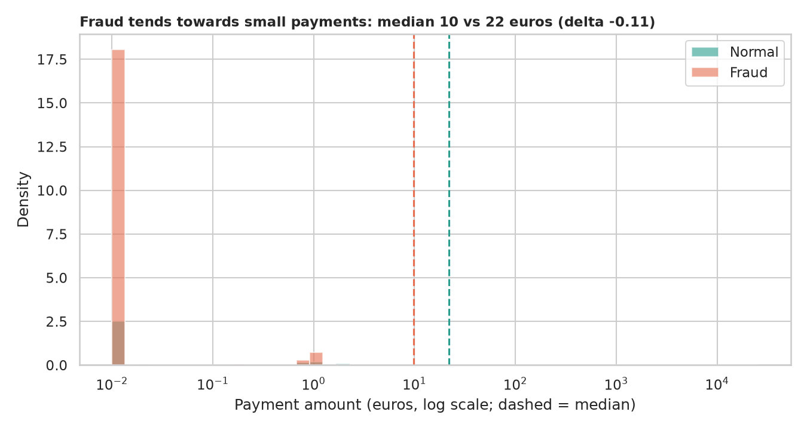
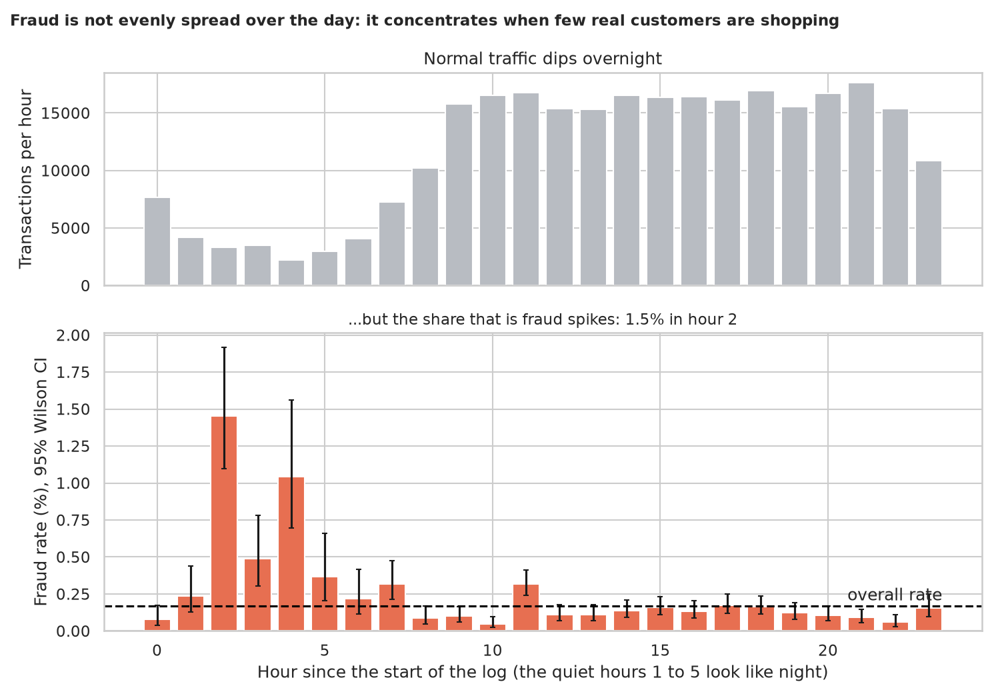
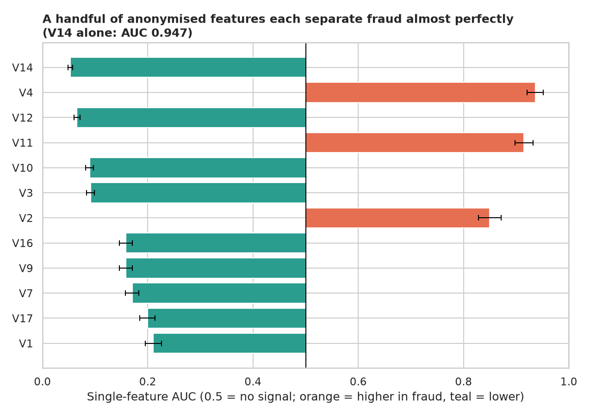
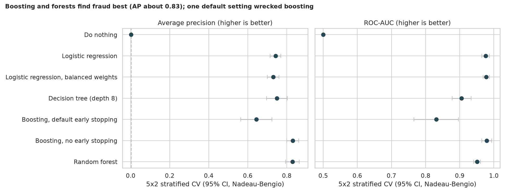
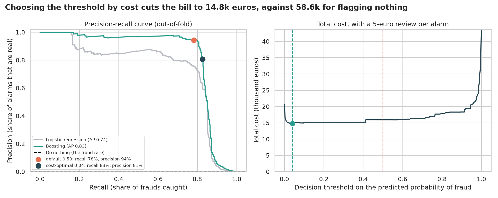
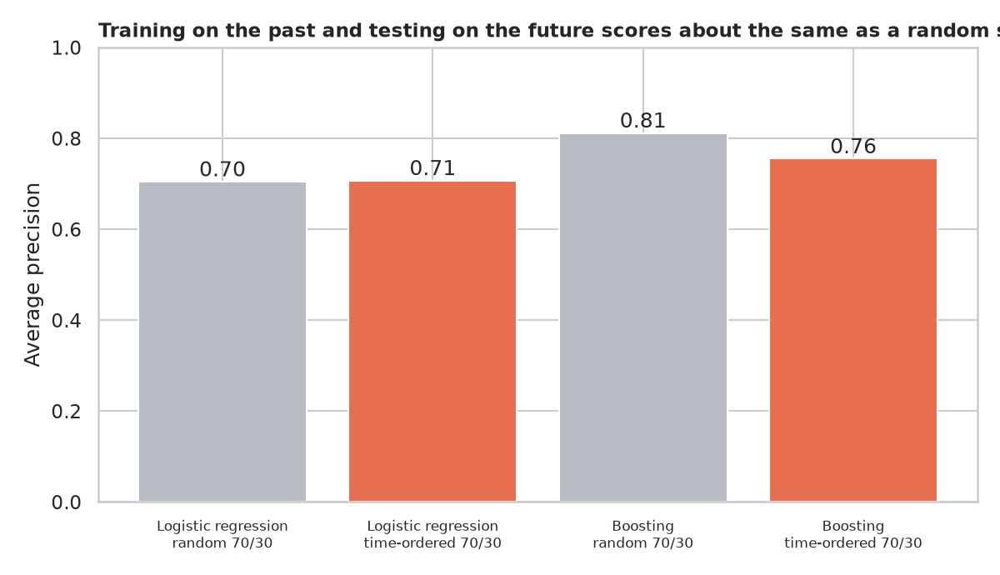

# Credit Card Fraud Detection: finding 473 needles in 283,000 transactions

> Two days of European card payments contain 284,807 transactions and only 492 frauds (0.17%). What separates fraud from normal payments, how do you even *measure* a detector when 99.8% of cases are normal, and when should the alarm ring?

## 📓 Start here

**[`credit_card_fraud_detection.ipynb`](credit_card_fraud_detection.ipynb)** is the main lesson: every step has a plain-English explanation, the code, and a "how to read this" note. Prefer a web page? Open the pre-rendered report: **[`docs/ml-credit-card-fraud-detection.html`](../../docs/ml-credit-card-fraud-detection.html)**.

## 💡 The Simple Analogy

Imagine a **stadium of 600 people with exactly one ticket forger**. A guard who says "everyone here is honest" is right about 599 times in 600, which is **99.8% accurate**, and has caught nobody. With rare events, accuracy flatters a do-nothing detector, so we score only the rare cases: **recall** (of the real forgers, how many did we catch?), **precision** (of the people we pulled aside, how many were forgers?) and **average precision** (the trade-off between the two across every alarm setting).

## 🔬 The Hypothesis & Statistical Question

| # | Question | H₀ | Method | Result |
|---|---|---|---|---|
| H1 | Do fraudulent payments have different amounts? | Same distribution | Mann-Whitney U, Cliff's δ | **Yes, small**: median 9.82 vs 22.00 euros, δ = −0.11; 14% of frauds are under 1 euro vs 5.9% of normal payments |
| H2 | Does fraud depend on the time of day? | Same fraud rate every hour | Chi-square, Cramér's V, Wilson CIs | **Yes**: χ²(23) = 548, p ≈ 3e-101; fraud rate peaks at **1.45% in hour 2, 8.7x the overall rate** |
| H3 | Which anonymised features separate fraud? | Same distribution | Mann-Whitney, single-feature AUC with Hanley-McNeil CI, Holm over 29 tests | **25 of 29** significant; `V14` alone has AUC **0.947** |
| H4 | Do complex models beat logistic regression? | AP difference = 0 | Leak-free stratified 5×2 CV, paired Nadeau-Bengio tests | **Yes**: boosting and random forest AP ≈ **0.83** vs 0.74; the two are indistinguishable (p = 0.86) |
| H5 | Do "common-sense defaults" help? | No change | Same CV | Balanced weights only trade precision for recall (recall 91%, precision 6%); **default early stopping cut boosting from AP 0.83 to 0.64** |
| H6 | What threshold minimises total cost? | (decision analysis) | Cost curve on out-of-fold probabilities | Threshold **0.04** costs **14.8k** euros vs 15.9k at 0.5 and 58.6k for flagging nothing |
| H7 | Does a time-ordered test differ from a random split? | Same score | Train on first 70% of time, test on the rest | Logistic regression unchanged; boosting AP 0.81 → 0.76 (only 107 test frauds, can't separate drift from luck) |

"Fail to reject" means the sample can't see an effect, not that none exists.

## 📊 Key Data Insights & Annotated Visualizations


Fraud skews towards small payments (median 9.82 vs 22.00 euros), consistent with criminals testing a stolen card.


Normal traffic collapses overnight but fraud does not, so the fraud *rate* spikes to 1.45% in hour 2.


A handful of anonymised features each separate fraud almost perfectly on their own.


Boosting and random forests reach AP ≈ 0.83. One default setting (automatic early stopping) wrecked boosting on this rare-event data.


Precision-recall curves and the cost curve: choosing the alarm threshold by cost cuts the bill to 14.8k euros against 58.6k for flagging nothing.


Training on the past and testing on the future: logistic regression is unchanged, boosting drops by about 0.06 AP (noisy).

## ⚙️ How it Works (Under the Hood)

The notebook is fully self-contained: no helper modules, just top-to-bottom cells.

1. **Data:** downloads the 150 MB ULB credit-card file from the public TensorFlow bucket into `data/` on first run (about 15 seconds). It removes **1,081 exact duplicate rows** (19 of them fraud) because duplicates leak across cross-validation folds, and keeps `Time` out of the model (two days can't teach a time pattern that generalises).
2. **Tests:** Mann-Whitney with Cliff's δ; chi-square with Cramér's V and Wilson CIs; single-feature AUC with Hanley-McNeil intervals and Holm correction.
3. **Modelling:** do-nothing, logistic regression (plain and balanced), a pruned tree, boosting (with and without early stopping) and a random forest. Scaling lives inside each `Pipeline`; folds are stratified and repeated; intervals use the Nadeau-Bengio correction; headline metric is average precision.
4. **Decisions:** out-of-fold probabilities give a precision-recall curve and a cost curve (a missed fraud costs its amount, a review costs an assumed 5 euros), plus a time-ordered holdout.

**What changed from the legacy notebook:** it scored accuracy (99.92%) as its headline and mislabelled its other metrics (its "specificity" was precision, its "sensitivity" was negative predictive value), used a non-stratified random split with duplicates left in, an unpruned tree and no confidence intervals or tests.

## 🚀 How to Run (One-liner command)

```bash
uv sync && uv run jupyter lab ML/credit-card-fraud-detection/credit_card_fraud_detection.ipynb
```

The data downloads into `data/` on the first run and the notebook saves its figures to `outputs/`. It takes about 5 minutes (the forest and tree are the slow parts). Standalone alternative: `pip install -r requirements.txt` and open the notebook in any Jupyter. To rebuild the web report:

```bash
uv run jupyter nbconvert --to html --execute ML/credit-card-fraud-detection/credit_card_fraud_detection.ipynb \
    --output-dir docs --output ml-credit-card-fraud-detection
```

## ⚠️ Limitations & Edge Cases

- **Two days, one set of cardholders.** Nothing here speaks to seasonality, new fraud tactics or other countries.
- **Anonymised features.** `V1` to `V28` are PCA outputs with no readable meaning: we can rank them but not explain why `V14` signals fraud.
- **Few frauds.** 473 cases make every fraud-specific estimate noisy; the intervals reflect that.
- **The cost model is an assumption.** The 5-euro review cost and "a missed fraud costs its amount" are illustrative.
- **Threshold chosen on the same out-of-fold data**, so its saving is slightly optimistic.
- **Labels may be incomplete.** "Normal" only means not reported as fraud.
- **Modest tuning.** The tree ensembles use sensible settings, not a full search.
- **Not a production system.** No concept-drift handling, latency limits, explanations or adaptive adversaries.
