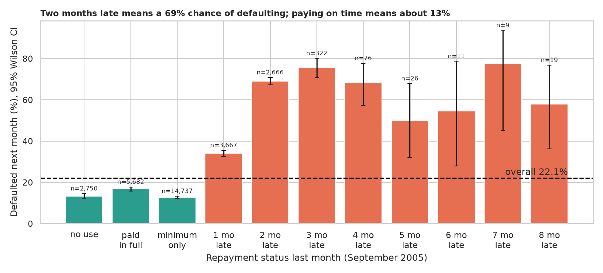
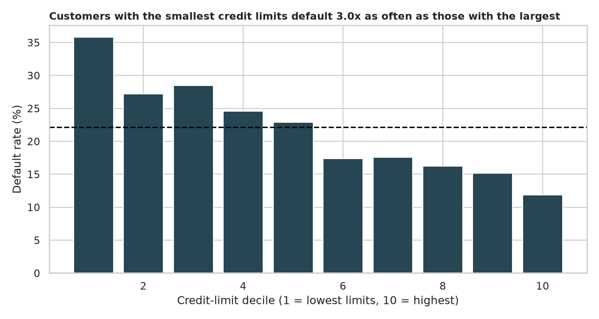
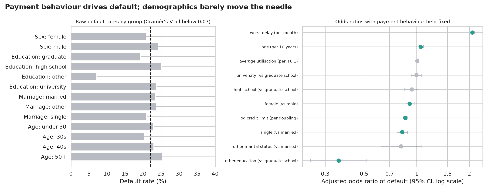
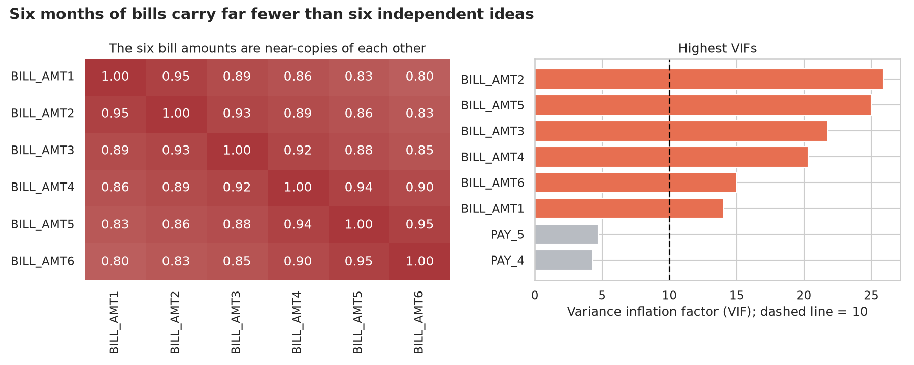
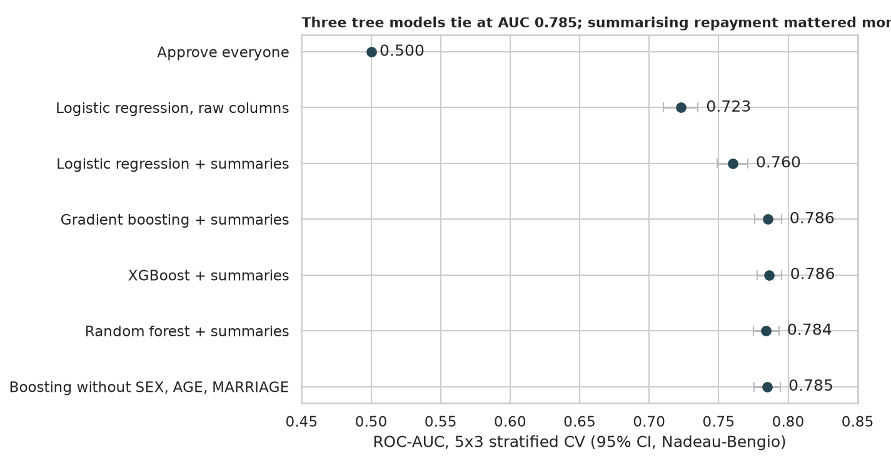
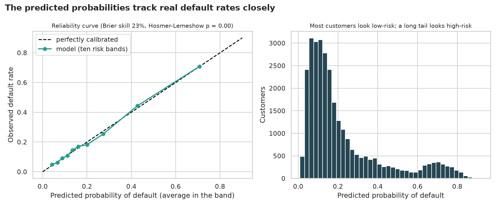
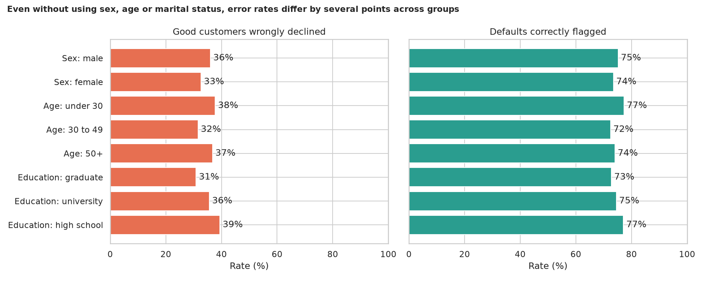

# Credit Risk Analysis: who is likely to miss next month's payment?

> 30,000 Taiwanese credit-card customers (2005): credit limit, a few demographics, six months of repayment status, bills and payments, and whether each customer defaulted the following month. Which facts predict default, how well can a model rank risk, can we trust its probabilities, and is the model fair to different groups?

## 📓 Start here

**[`credit_risk_analysis.ipynb`](credit_risk_analysis.ipynb)** is the main lesson: every step has a plain-English explanation, the code, and a "how to read this" note. Prefer a web page? Open the pre-rendered report: **[`docs/ml-credit-risk-analysis.html`](../../docs/ml-credit-risk-analysis.html)**.

## 💡 The Simple Analogy

A teacher guessing **who will hand in next week's homework late** bets on the student who has been **late for the last three weeks**: recent behaviour is the strongest clue. A student's age, family or gender *shouldn't* matter, and betting on them would be unfair. A good predictor shouldn't need them. Credit risk is the same game with money, except a bank's guesses affect real people, so besides *accuracy* we also check **honesty** (are the predicted probabilities right?) and **fairness** (are groups treated similarly?).

## 🔬 The Hypothesis & Statistical Question

| # | Question | H₀ | Method | Result |
|---|---|---|---|---|
| H1 | Does last month's repayment status relate to default? | Same default rate for every status | Chi-square, Cramér's V, Wilson CIs | **Yes, large**: V = 0.42; default rate 13% on time, **34%** one month late, **69%** two months late |
| H2 | Do defaulters have different credit limits? | Same distribution | Mann-Whitney U, Cliff's δ | **Yes**: median 90,000 vs 150,000, δ = −0.24; lowest-limit decile defaults ~3x as often as the highest |
| H3 | Do demographics matter, and still matter after payment behaviour? | OR = 1 | Chi-square with Cramér's V; adjusted logistic odds ratios | Raw effects tiny (V ≤ 0.07); adjusted: worst delay **OR 2.08 per month**, credit limit **0.86 per doubling**, women **0.91**, utilisation not significant |
| H4 | Are the six bill columns independent? | (descriptive) | Correlations, VIF | Bills correlate 0.80 to 0.95; all six have **VIF 14 to 26** |
| H5 | Do complex models beat logistic regression, and do we need `SEX`/`AGE`/`MARRIAGE`? | AUC difference = 0 | Leak-free stratified 5×3 CV, paired Nadeau-Bengio tests | Boosting, XGBoost and forest tie at **AUC 0.785** (logistic 0.72, or 0.76 with behaviour summaries); dropping the protected columns costs **−0.0008** (p = 0.13) |
| H6 | Are the predicted probabilities honest? | Predicted = observed in every risk band | Calibration curve, Brier score, Hosmer-Lemeshow | Brier skill **22%**; H-L formally rejects (p ≈ 0.003) but gaps are **≤ 2 points** (3,000 customers per band) |
| H7 | Does the model treat groups similarly? | Same false-positive rate | Cost-based threshold; two-proportion z-test on out-of-fold decisions | Threshold **0.167** halves the cost vs approving everyone; women are wrongly declined **3.4 points less often** than men (p < 0.001); false declines rise **31% → 39%** from graduate-school to high-school customers |

"Fail to reject" means the sample can't see an effect, not that none exists.

## 📊 Key Data Insights & Annotated Visualizations


Two months late means a 69% chance of defaulting; paying on time means about 13%.


The smallest credit limits default about three times as often as the largest.


Payment behaviour drives default; demographics barely move the needle.


Six months of bills carry far fewer than six independent ideas.


Three tree models tie at AUC 0.785; summarising repayment history mattered more than the algorithm.


The predicted probabilities track real default rates closely (largest gap about 2 points).


Even without using sex, age or marital status, error rates differ by several points across groups.

## ⚙️ How it Works (Under the Hood)

The notebook is fully self-contained: no helper modules, just top-to-bottom cells.

1. **Data:** downloads the UCI "Default of Credit Card Clients" zip into `data/` on first run (needs the `xlrd` package, included in the `ml` extra). The `PAY_x` codes mix "paid in full / minimum / no use" (−2, −1, 0) with months late (1, 2, ...), so they are summarised rather than treated as a plain number. The undocumented `EDUCATION` (0, 5, 6) and `MARRIAGE` (0) codes are folded into "other" (about 1.3% of customers), and 35 duplicate rows are removed.
2. **Tests:** chi-square with Cramér's V and Wilson CIs; Mann-Whitney with Cliff's δ; `statsmodels` logistic regression for adjusted odds ratios; VIF.
3. **Modelling:** a ladder of "approve everyone", logistic regression (raw and with four behaviour summaries), gradient boosting, XGBoost and a random forest, plus an ablation without the protected columns. Scaling lives inside each `Pipeline` (the legacy script fitted the scaler on all data first), folds are stratified, and intervals use the Nadeau-Bengio correction.
4. **Decisions:** out-of-fold probabilities feed a calibration check (Hosmer-Lemeshow, Brier), a cost-based threshold (a missed default costs 5, a lost good customer 1; an assumption) and a fairness audit of false- and true-positive rates by sex, age and education.

**What changed from the legacy script:** it scaled the data before cross-validating (leakage), ran `RandomizedSearchCV` with `n_iter=1` (one random trial, not a search), used deprecated XGBoost arguments, reported only accuracy, and had no tests, calibration or fairness check.

## 🚀 How to Run (One-liner command)

```bash
uv sync --extra ml && uv run jupyter lab ML/credit-risk-analysis/credit_risk_analysis.ipynb
```

The data downloads into `data/` on the first run and the notebook saves its figures to `outputs/`. Standalone alternative: `pip install -r requirements.txt` and open the notebook in any Jupyter. To rebuild the web report:

```bash
uv run jupyter nbconvert --to html --execute ML/credit-risk-analysis/credit_risk_analysis.ipynb \
    --output-dir docs --output ml-credit-risk-analysis
```

## ⚠️ Limitations & Edge Cases

- **One bank, one country, 2005.** Patterns may not transfer to other banks, countries or today.
- **Six months of history and one-month-ahead default.** Longer-horizon defaults are not captured.
- **The 5:1 cost ratio is an assumption.** At that ratio the rule declines about 43% of customers, wrongly declining about one in three good customers.
- **Selection bias.** Only approved customers appear, so nothing is known about declined applicants.
- **Limited fairness audit.** Three characteristics, one threshold, no causal analysis and no intersections.
- **Undocumented codes** were folded into "other", hiding whatever they really mean.
- **Association, not cause.** Paying late predicts default; the data can't say it causes it.
- **Hosmer-Lemeshow rejects perfect calibration** (gaps up to about 2 points), so treat the probabilities as close, not exact.
