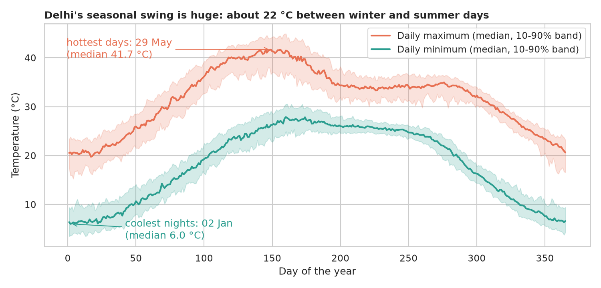
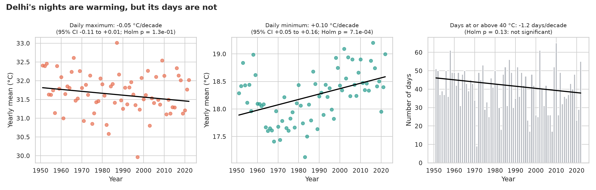
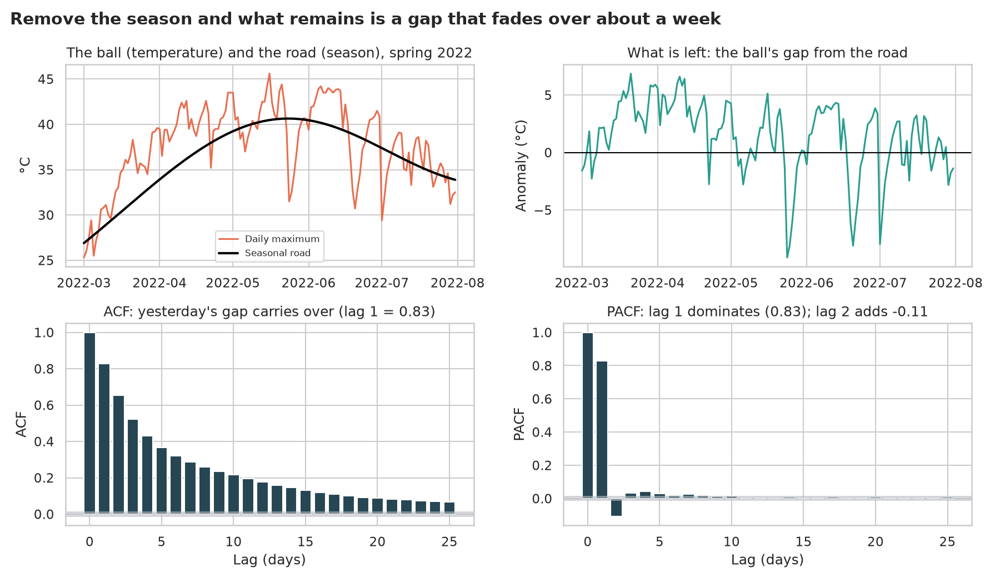
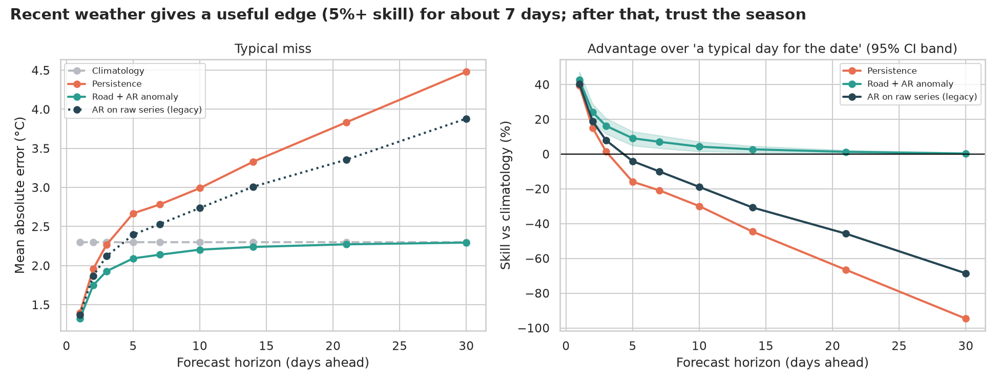
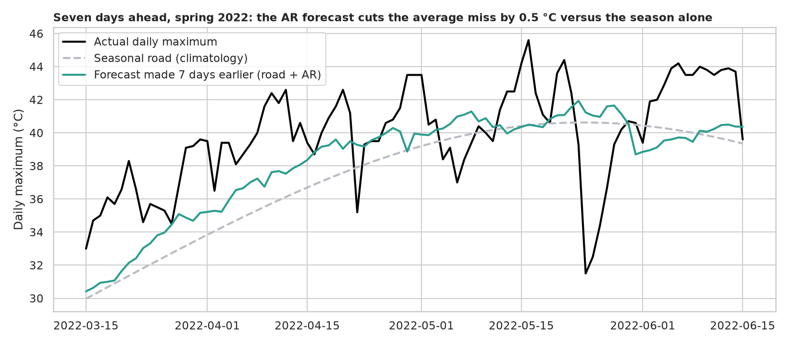

# Delhi Temperature: trends, seasons and how far ahead can we forecast?

> 74 years of Delhi's daily maximum and minimum temperature. Is Delhi getting warmer? Are the days warming, or the nights, or both? And how many days ahead can a statistical model beat the simple answer "it'll be a typical day for this time of year"?

## 📓 Start here

**[`delhi_weather_arima.ipynb`](delhi_weather_arima.ipynb)** is the main lesson: every step has a plain-English explanation, the code, and a "how to read this" note. Prefer a web page? Open the pre-rendered report: **[`docs/ml-delhi-weather-arima.html`](../../docs/ml-delhi-weather-arima.html)**.

> **About the data.** The legacy version used a Kaggle download of *hourly* weather records that needs a login and contains sentinel values such as `-9999`. This notebook uses the open, public-domain **OpenCity "Delhi Daily Temperature Data 1951 to 2024"** (daily maximum, minimum and rain), which downloads itself and covers more than three times as many years.

## 💡 The Simple Analogy

Picture a **ball rolling along a wavy road**. The *road* is the season: up to a hot summer peak, down to a cool winter valley, the same every year. The *ball* is the actual temperature: a hot spell lifts it above the road for a few days, a cool front pushes it below, but it gets **pulled back** towards the road.

So tomorrow's temperature is *the road plus most of today's gap*, next week's is *the road plus a little of today's gap*, and a month ahead the gap is forgotten and *only the road is left*. The question is how fast the gap fades, because that is how far ahead we have any skill beyond "typical weather for the date".

## 🔬 The Hypothesis & Statistical Question

| # | Question | H₀ | Method | Result |
|---|---|---|---|---|
| H1 | Has the yearly average daily max / min changed over 72 years? | No monotonic trend | Mann-Kendall, Theil-Sen slope, Holm over 3 tests | **Max: no detectable trend** (−0.05 °C/decade, CI −0.11 to +0.01). **Min: +0.098 °C/decade** (CI +0.05 to +0.16, Holm p = 7e-4) |
| H2 | Are nights warming faster than days? | Same slope | Bootstrap CI for the slope of (min − max) | **Yes**: +0.13 °C/decade (CI +0.08 to +0.19); the day-night range is shrinking |
| H3 | Are days at or above 40 °C becoming more common? | No trend | Mann-Kendall | **No** (−1.2 days/decade, Holm p = 0.13) |
| H4 | Is the series stationary, and does that need fixing? | ADF: unit root; KPSS: stationary | ADF and KPSS before and after removing the season | Both tests call the **raw** series stationary despite a 20 °C annual swing: they don't detect seasonality |
| H5 | Does a model beat "a typical day for the date", and for how many days? | MAE difference = 0 | Rolling-origin evaluation (2019-2023), month-block bootstrap | Road + AR beats climatology by **43% at 1 day, 7% at 7 days, 2.7% at 14 days**, about 0 by 30 days |
| H6 | Are our 95% forecast intervals honest? | Coverage = 95% | Empirical coverage on held-out years | **No**: they are over-confident (88% to 92% real coverage) |

"Fail to reject" means the sample can't see an effect, not that none exists.

## 📊 Key Data Insights & Annotated Visualizations


Delhi's seasonal swing is huge: median daily highs go from about 20 °C in January to about 42 °C around 29 May.


The nights are warming (+0.10 °C per decade) but the days are not, and there is no significant trend in scorching days.


Remove the season and what is left is a gap that fades over one to two weeks: an AR(1)-like signature (ACF 0.83 at lag 1).


The "road + AR" forecast has a useful edge (5%+ skill) for about a week; persistence is *worse* than climatology after 3 days; and the legacy "ARIMA on the raw series" approach is worse at every horizon.


Seven-day-ahead forecasts for spring 2022: the AR model follows the sustained warm spells but cannot see a sudden turn coming.

## ⚙️ How it Works (Under the Hood)

The notebook is fully self-contained: no helper modules, just top-to-bottom cells.

1. **Data audit:** the date column is day-month-year, three dates are stored as Excel serial numbers (repaired, not dropped), and **2 December 2023 to 22 February 2024 is empty**. So yearly analyses use the 72 complete years 1951 to 2022, and gaps of up to 3 days are filled by interpolation.
2. **Trends:** Mann-Kendall and Theil-Sen (robust to odd years), Holm correction over the three tests, a bootstrap CI for the day-night range.
3. **The season:** a linear trend plus 3 sine/cosine pairs fitted by least squares removes 86% of the variation; the remainder (anomalies) is stationary and AR-like.
4. **Forecasting:** for each test year 2019 to 2023 everything (the season, the AR order by AIC, the coefficients) is fitted on **earlier years only**, then every day of the test year is forecast 1 to 30 days ahead. Models: climatology, persistence, road + AR anomaly, and AR on the raw series (the legacy approach). Skill is bootstrapped by resampling whole months.

**What changed from the legacy notebook:** it imported `statsmodels.tsa.arima_model.ARIMA` (removed from modern statsmodels), crashed on an undefined `test_df`, fitted ARIMA(2, 0, 2) straight to a seasonal hourly series, forecast just 16 steps, removed outliers with hand-picked cut-offs, and tested no hypotheses.

## 🚀 How to Run (One-liner command)

```bash
uv sync && uv run jupyter lab ML/delhi-weather-arima/delhi_weather_arima.ipynb
```

The data downloads into `data/` on the first run and the notebook saves its figures to `outputs/`. Standalone alternative: `pip install -r requirements.txt` and open the notebook in any Jupyter. To rebuild the web report:

```bash
uv run jupyter nbconvert --to html --execute ML/delhi-weather-arima/delhi_weather_arima.ipynb \
    --output-dir docs --output ml-delhi-weather-arima
```

## ⚠️ Limitations & Edge Cases

- **Unknown measurement homogeneity.** The many-decimal values suggest a gridded or modelled product, and the source notes a change of provider for recent years. Trends in a stitched-together series can be artefacts, so the results describe *this file*, not a certified single-thermometer record.
- **Yearly means are not independent**, which Mann-Kendall assumes away, so trend p-values may be somewhat optimistic.
- **One city, one variable.** Daily maximum temperature in Delhi only. Humidity, wind, rain and the "feels like" heat index are not modelled.
- **Linear AR forecasts are limited.** They cannot predict sudden regime changes (monsoon onset, a western disturbance).
- **Over-confident intervals.** Built from in-sample training errors with one width for the whole year, they under-cover (88% to 92% instead of 95%); a season-specific recalibration is the obvious next step.
- **Five test years** (2019 to 2023); a different period could change the exact skill numbers.
- **Gaps.** An 83-day hole (Dec 2023 to Feb 2024) means 2023 and 2024 are excluded from trend tests.
