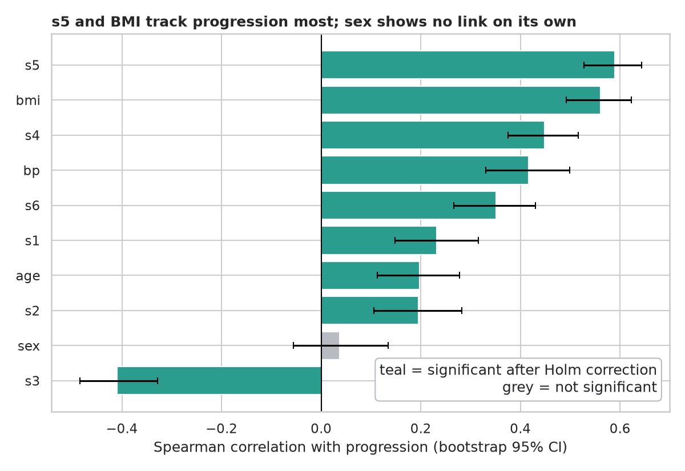
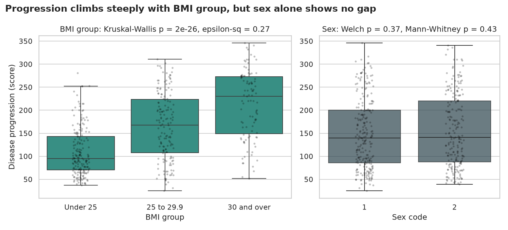
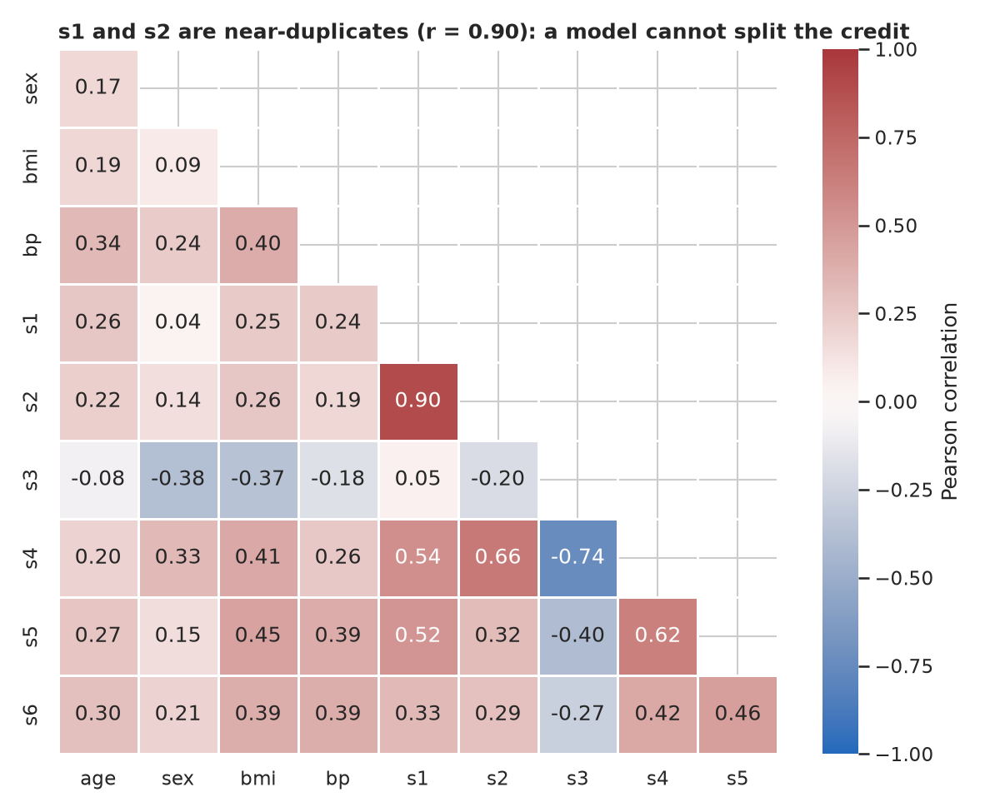
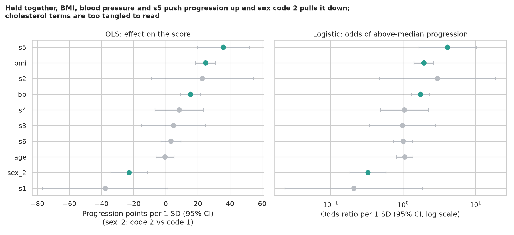
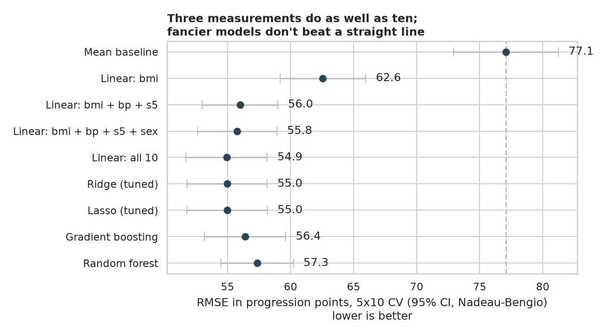
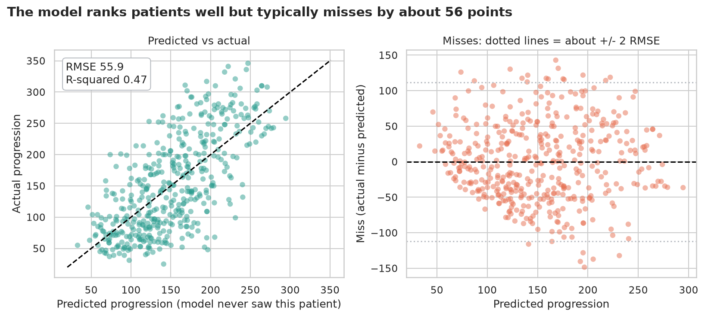

# Diabetes Risk: which measurements forecast how a patient does next year?

> 442 patients living with diabetes, ten baseline measurements, and a score for how much their disease progressed one year later. Which measurements matter, which ones are secretly copies of each other, and how well can we forecast the score?

## 📓 Start here

**[`diabetes_risk.ipynb`](diabetes_risk.ipynb)** is the main lesson: every step has a plain-English explanation, the code, and a "how to read this" note. Prefer a web page? Open the pre-rendered report: **[`docs/ml-diabetes-risk.html`](../../docs/ml-diabetes-risk.html)**.

> **What this dataset is *not*:** everyone here already has diabetes. The target is *how much worse things got* (a score from 25 to 346), not a diagnosis, so this is a **regression** problem, not a "high risk / low risk" classifier.

## 💡 The Simple Analogy

Think of a **weather forecaster**. Today's gauges (temperature, pressure, humidity) don't *cause* tomorrow's storm, but some are much better storm signals than others, and a forecaster who watches the right two or three gauges can do almost as well as one who watches twenty.

Here the gauges are BMI, blood pressure, cholesterol and friends, and the storm is next year's disease progression. The notebook finds the gauges worth watching, spots the ones that are just copies of each other, and checks how good a forecast is possible, honestly, on patients the model has never seen.

## 🔬 The Hypothesis & Statistical Question

Each question has a null (H₀, "nothing is going on") and an alternative (Hₐ):

| # | Question | H₀ | Test | Result |
|---|---|---|---|---|
| 1 | Does each measurement move with progression? | Spearman ρ = 0 | Spearman + bootstrap CI, Holm-corrected | 9 of 10 significant; s5 ρ = +0.59, BMI +0.56; **sex ρ = +0.04 (p = 0.43)** |
| 2 | Does progression differ across BMI groups? | Same distribution in all 3 groups | Kruskal-Wallis, then pairwise Mann-Whitney (Holm) | Medians 95 → 168 → 230; H = 118, p = 2e-26, ε² = 0.27 (large) |
| 3 | Does progression differ by sex? | No difference | Welch t-test and Mann-Whitney U | p = 0.37 / 0.43, Cohen's d = −0.09: fail to reject |
| 4 | Do obese patients have higher odds of above-median progression? | OR = 1 | Fisher's exact test | **OR = 5.6** (95% CI 3.3 to 9.6), p = 1e-11 |

Non-parametric tests are used because progression is right-skewed (Shapiro-Wilk p ≈ 3e-11). "Fail to reject" means this sample can't see an effect, not that none exists.

## 📊 Key Data Insights & Annotated Visualizations


`s5` (probably log triglycerides) and BMI track progression most. `s3` ("good" HDL cholesterol) is protective. Sex shows no link on its own.


Median progression climbs from 95 to 168 to 230 across the three WHO BMI bands, while the two sex codes look identical.


`s1` and `s2` correlate at 0.90 (VIF 59 and 39). The cholesterol family is, in effect, one gauge measured five ways.


With everything held fixed, BMI, blood pressure and s5 push progression up (+25, +15 and +36 points per SD) and **sex code 2 pulls it down by about 23 points**, an effect hidden in the raw comparison because that group also carries higher blood pressure and s5. The cholesterol coefficients are too tangled to interpret (huge, opposite-signed intervals).


Three measurements (BMI, blood pressure, s5) forecast almost as well as all ten: RMSE 56.0 vs 54.9 (paired p = 0.23). Ridge, Lasso, gradient boosting and random forests add nothing.


The model ranks patients sensibly but typically misses by about 56 points (R² ≈ 0.47).

The rest of the figures (the target distribution and so on) are in the notebook.

## ⚙️ How it Works (Under the Hood)

The notebook is fully self-contained: no helper modules, just top-to-bottom cells.

1. **Data:** `load_diabetes(scaled=False)` from scikit-learn gives the original clinical units. The default version is squashed so each column sums to 1, which makes results unreadable. No download is needed.
2. **Tests:** Spearman with bootstrap CIs and Holm correction; Kruskal-Wallis with ε²; Welch t-test beside Mann-Whitney with Cohen's d; Fisher's exact test with an odds ratio.
3. **Collinearity:** a correlation heat-map and variance inflation factors, then OLS and logistic regression in `statsmodels` for adjusted effects (per 1 SD) and odds ratios.
4. **Forecasting:** a ladder from the mean baseline up to boosting and forests, scored by RMSE and R² with 5-fold × 10-repeat cross-validation. All scaling and Ridge/Lasso tuning live **inside** each scikit-learn `Pipeline`, so nothing leaks from the test fold. Confidence intervals and paired model comparisons use the Nadeau-Bengio correction.

**What changed from the legacy notebook:** it scored every model on one unseeded random split, printed RMSE under the label "MSE", over-penalised Ridge/Lasso/ElasticNet (`alpha=50`, scores of 79 to 80 against 58.6 for plain linear regression) and let k-nearest-neighbours memorise the data (`k=1`).

## 🚀 How to Run (One-liner command)

```bash
uv sync && uv run jupyter lab ML/diabetes-risk/diabetes_risk.ipynb
```

The notebook saves its figures to `outputs/`. Standalone alternative: `pip install -r requirements.txt` and open the notebook in any Jupyter. To rebuild the web report:

```bash
uv run jupyter nbconvert --to html --execute ML/diabetes-risk/diabetes_risk.ipynb \
    --output-dir docs --output ml-diabetes-risk
```

## ⚠️ Limitations & Edge Cases

- **Association, not causation.** These are baseline snapshots; diet, medication and how long someone has had diabetes aren't measured, and could drive both the readings and the outcome.
- **Small and old.** 442 patients from a 2004 methods paper, with no information on when or where they were recruited.
- **A forecast, but not a precise one.** Typical misses of about 56 points mean the model is good for ranking patients, not for predicting an exact score.
- **Sex coding is undocumented.** Findings are about "code 2 vs code 1", nothing more.
- **Median split for odds ratios.** Cutting progression at the median is arbitrary and discards information; it's used here to teach odds ratios, and the regressions keep the full numbers.
- **Collinearity.** The cholesterol coefficients can't be read one at a time. Prediction is fine; explanation is not.
- **Statistically significant is not the same as useful.** Sex is clearly significant after adjustment but improves the forecast by only about 0.2 RMSE points (p = 0.54).
- **No external validation.** All performance numbers come from cross-validation inside the same 442 patients.
