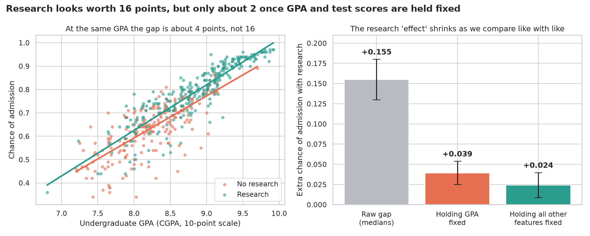
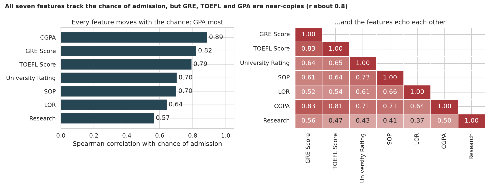
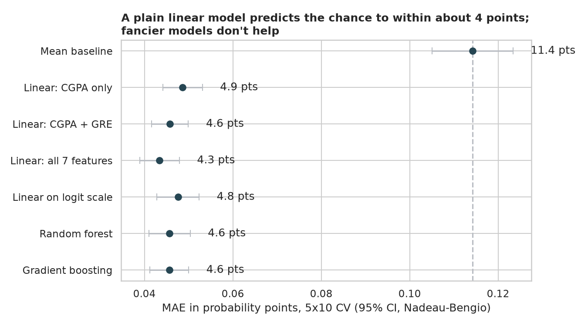
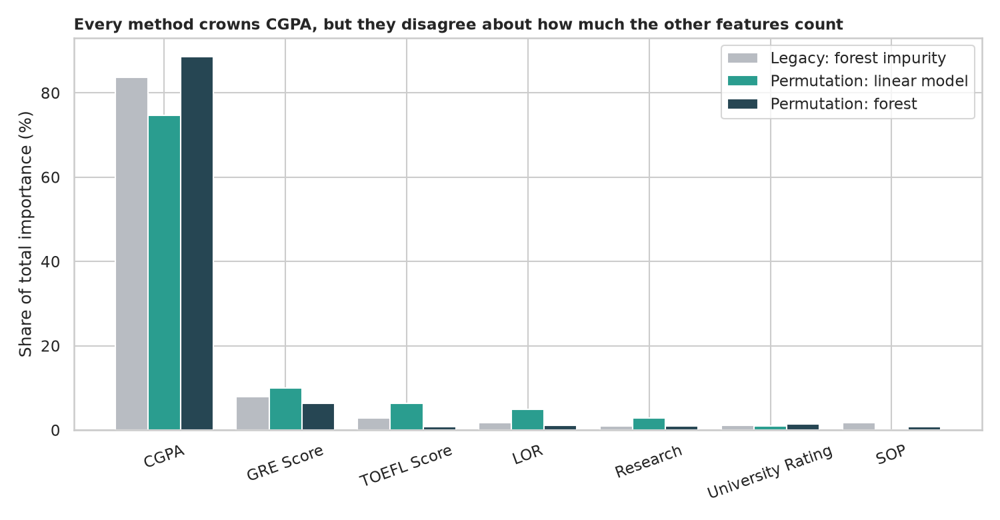
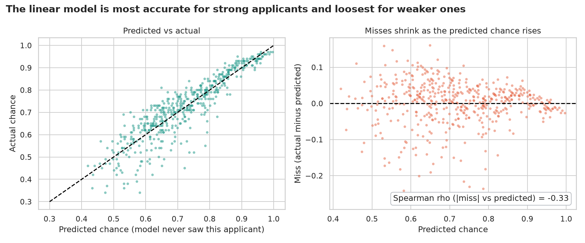

# Graduate Admission: what drives a student's chance of admission?

> 500 applicants, seven facts about each (GRE, TOEFL, university rating, SOP and LOR scores, GPA, research experience) and an estimated "chance of admission". Which facts matter, which ones merely echo each other, and how well can a model predict the chance?

## 📓 Start here

**[`graduate_admission.ipynb`](graduate_admission.ipynb)** is the main lesson: every step has a plain-English explanation, the code, and a "how to read this" note. Prefer a web page? Open the pre-rendered report: **[`docs/ml-graduate-admission.html`](../../docs/ml-graduate-admission.html)**.

> **One manual step.** The data lives on Kaggle, which needs a free login. Download `Admission_Predict_Ver1.1.csv` from [Graduate Admissions](https://www.kaggle.com/datasets/mohansacharya/graduate-admissions) and save it as `data/Admission_Predict_Ver1.1.csv` in this folder. The notebook's loader tells you the same if the file is missing.

## 💡 The Simple Analogy

Imagine a **talent show with several judges** watching the same performance. The GRE judge, the TOEFL judge and the GPA judge mostly agree, so asking "which judge predicts the winner?" gets blurry because they are **copying each other** (collinearity). And students with research experience *also* tend to have higher GPAs and test scores, a **hidden helper** (confounding): compare research and non-research students naively and you credit "research" with the effect of "being a strong student".

## 🔬 The Hypothesis & Statistical Question

| # | Question | H₀ | Method | Result |
|---|---|---|---|---|
| H1 | Does research experience change the chance, and is that gap really due to research? | No gap (raw); no effect once other features are held fixed (adjusted) | Mann-Whitney, Cliff's δ, bootstrap CI; OLS with robust (HC3) errors | Raw gap **+15.5 points** (δ = +0.66) → **+3.9** holding GPA fixed → **+2.4** (CI +0.9 to +4.0) holding everything fixed: **84% of the gap disappears** |
| H2 | Does each feature move with the chance? | Spearman ρ = 0 | Spearman with Holm, plus VIF | **7 of 7** significant; `CGPA` ρ = +0.89; but GRE, TOEFL and CGPA correlate about 0.8 with each other |
| H3 | Do University Rating and SOP add anything once the rest are known? | Both coefficients = 0 | Partial F-test | **Fail to reject**: F(2, 492) = 1.7, p = 0.18 (R² 0.822 vs 0.821) |
| H4 | Does a flexible model beat a linear one? | MAE difference = 0 | Leak-free repeated CV with paired Nadeau-Bengio tests | Linear on all 7 features wins: **MAE 4.3 points, R² 0.81**; the forest and boosting are no better (p ≈ 0.06) |
| H5 | Do importance methods agree? | (descriptive) | Impurity vs held-out permutation importance | All name `CGPA` first (75% to 89% of the credit) but split the rest differently |

"Fail to reject" means the sample can't see an effect, not that none exists.

## 📊 Key Data Insights & Annotated Visualizations


Research looks worth 16 points, but about 75% of that is explained by GPA alone and 84% once all other features are held fixed.


Every feature tracks the chance of admission, but GRE, TOEFL and GPA are near-copies of each other (r about 0.8).


A plain linear model predicts the chance to within about 4 points; the logit link, random forest and gradient boosting do no better.


Every method crowns `CGPA`, but they disagree about the other features: the legacy forest impurity importance is not a reliable guide when features echo each other.


Misses shrink from about 6 points for weaker applicants to about 1.6 points above a predicted chance of 0.90 (ρ = −0.33): the ceiling effect.

## ⚙️ How it Works (Under the Hood)

The notebook is fully self-contained: no helper modules, just top-to-bottom cells.

1. **Data:** loads the CSV (see the manual-download note above), strips the trailing spaces from the column names (`'LOR '`, `'Chance of Admit '`) and drops the index column. The target is an *estimated* chance between 0 and 1, **not** a record of real admission decisions.
2. **Tests:** Mann-Whitney with Cliff's δ and a bootstrap CI; OLS with HC3 robust standard errors; Spearman with Holm correction; VIF; a partial F-test.
3. **Modelling:** a ladder from the mean baseline through CGPA-only and all-feature linear regressions, a logit-scale model, a random forest and gradient boosting. Scaling lives inside each `Pipeline`, and scores use repeated 5-fold CV with Nadeau-Bengio confidence intervals and paired tests.
4. **Importance and errors:** permutation importance on held-out folds vs the legacy impurity importance, and out-of-fold residuals to check where the model misses.

**What changed from the legacy notebook:** it scored every model on one random 75/25 split with a single seed, labelled a regression "classification", reported only MAE, ended with random-forest impurity importance (unreliable for correlated features) and tested no hypotheses.

## 🚀 How to Run (One-liner command)

```bash
uv sync && uv run jupyter lab ML/graduate-admission/graduate_admission.ipynb
```

(After placing the CSV in `data/`, see above.) The notebook saves its figures to `outputs/` and takes about a minute. Standalone alternative: `pip install -r requirements.txt` and open the notebook in any Jupyter. To rebuild the web report:

```bash
uv run jupyter nbconvert --to html --execute ML/graduate-admission/graduate_admission.ipynb \
    --output-dir docs --output ml-graduate-admission
```

## ⚠️ Limitations & Edge Cases

- **The target is not a real admission decision.** "Chance of Admit" is an estimated number in a teaching dataset, so models learn that number's recipe, not what real committees do. These results are not advice about getting into a real programme.
- **Association, not cause.** Even the adjusted research effect is an association; the quality or field of the research could be at work.
- **Small data.** 500 applicants and seven features; small real effects (SOP, University Rating) could be invisible here.
- **Ceiling effects.** The chance cannot exceed 1, so errors are larger for weaker applicants than for strong ones.
- **Ordinal scores treated as numbers.** SOP, LOR and University Rating are 1 to 5 ratings used as if they were measured quantities.
- **Manual download.** The Kaggle login means the notebook cannot fetch its data automatically.
