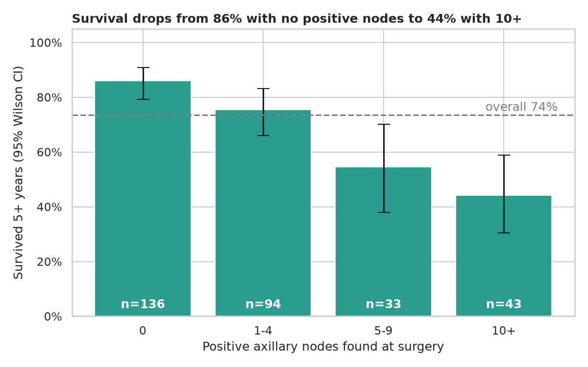
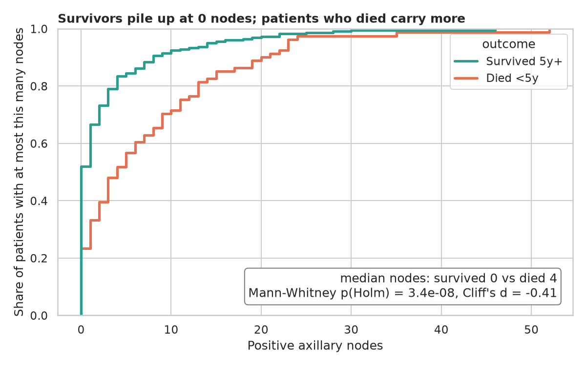
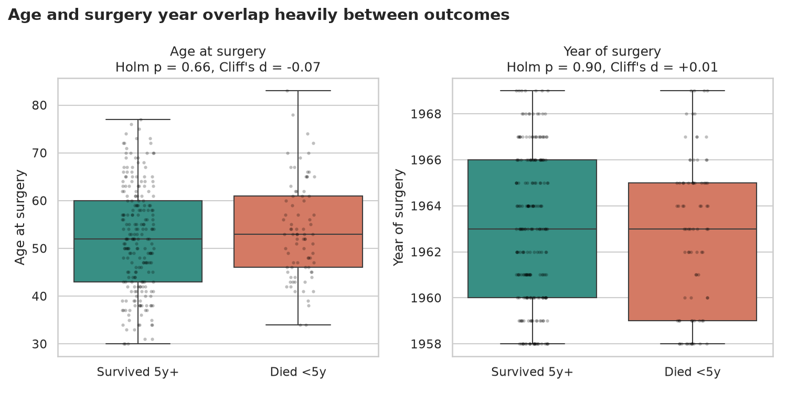
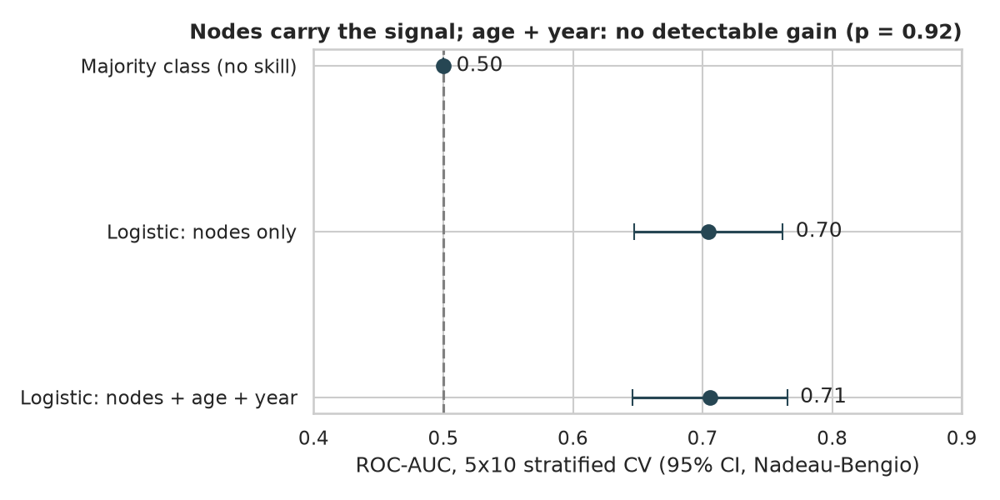

# Haberman's Survival: what does the lymph-node count tell us?

> 306 breast-cancer surgeries at the University of Chicago's Billings Hospital (1958-1970). Which facts known on the day of surgery separate patients who lived 5+ years from those who didn't?

## 📓 Start here

**[`haberman_survival.ipynb`](haberman_survival.ipynb)** is the main lesson: every step has a plain-English explanation, the code, and a "how to read this" note. Prefer a web page? Open the pre-rendered report: **[`docs/ml-haberman.html`](../../docs/ml-haberman.html)**.

## 💡 The Simple Analogy

Your armpit has small filters called lymph nodes. Think of them as **security checkpoints on a road out of town**. If a surgeon finds cancer cells stuck at many checkpoints, those cells were already travelling, so the cancer had a head start. If no checkpoint caught anything, the cancer probably hadn't left home.

The question is whether that checkpoint count predicts who is alive five years later, and whether the patient's age or the year of the operation tells us anything extra.

## 🔬 The Hypothesis & Statistical Question

For each feature (age, operation year, positive nodes), compared between patients who survived 5+ years and those who died within 5 years:

- **H₀:** the feature has the same distribution in both groups.
- **Hₐ:** the distributions differ.

Mann-Whitney U is used because node counts are heavily right-skewed. P-values are Holm-adjusted for the three comparisons. Effect size is Cliff's δ, and the median difference gets a 10,000-sample bootstrap 95% CI.

A second test, chi-square, asks whether survival depends on node bin (0, 1-4, 5-9, 10+). Finally, a predictive question: **does a model beat "everyone survives" once we guard against leakage?**

| Result | Value |
|---|---|
| Nodes vs survival (Mann-Whitney, Holm) | p = 3.4e-08, Cliff's δ = -0.41, median 0 vs 4 nodes (diff CI [-6, -2]) |
| Age vs survival | p = 0.66, δ = -0.07 |
| Operation year vs survival | p = 0.90, δ = +0.01 |
| Node bin × survival (chi-square) | χ²(3) = 36.2, p = 6.6e-08, Cramér's V = 0.34 |

Reject H₀ for nodes only. For age and year we **fail to reject**: that is not proof of no effect, only that this sample can't see one.

## 📊 Key Data Insights & Annotated Visualizations


Survival falls from 86% with no positive nodes to 44% with 10 or more. The error bars are Wilson 95% CIs, and the 5-9 and 10+ bins are small (n = 33 and 43), so their intervals are wide.


About half of survivors had zero nodes, against 23% of those who died. The curves separate early and stay apart.


Age and surgery year overlap almost completely between outcomes.


Nodes-only logistic regression reaches ROC-AUC 0.70 [0.65, 0.76]. Adding age and year gives 0.71, a difference with paired p = 0.92.

**Data fix worth knowing:** the raw file has no header row. The original notebook read it with pandas defaults, which turned the first patient into column names and silently dropped them (305 rows instead of 306).

## ⚙️ How it Works (Under the Hood)

The notebook walks through these steps in order (data inspection → hypotheses → tests → visuals → baseline → iteration → takeaways). `main.py` is an optional headless runner with the same logic, as a small pipeline of typed, documented functions:

1. `load_data`: downloads the UCI file into `data/` (gitignored), supplies column names, validates shape and nulls.
2. `feature_tests`: Mann-Whitney U, Cliff's δ, bootstrap median-difference CI, Holm correction.
3. `node_bin_table` / `chi_square_nodes`: survival rate with Wilson CIs, and a chi-square test with Cramér's V. The smallest expected cell count is 8.7, so the approximation is fine.
4. `evaluate_models`: a ladder of majority class → logistic regression on `log1p(nodes)` → plus standardised age and year. It uses 5-fold × 10-repeat stratified CV. Transforms live **inside** the sklearn `Pipeline`, so they're fitted on training folds only (no leakage). CIs and the paired model comparison use the Nadeau-Bengio correction, because CV folds share training data and a naive standard error is too small.
5. Four plots and `metrics.json` are written to `outputs/`.

## 🚀 How to Run (One-liner command)

```bash
uv sync && uv run jupyter lab ML/haberman-survival/haberman_survival.ipynb
```

The data downloads into `data/` on the first run, and the notebook saves its figures to `outputs/`. Standalone alternative: `pip install -r requirements.txt` and open the notebook in any Jupyter.

Optional extras:

```bash
# headless run (also refreshes the figures used by this README)
uv run python ML/haberman-survival/main.py --publish-docs

# rebuild the web report
uv run jupyter nbconvert --to html --execute ML/haberman-survival/haberman_survival.ipynb \
    --output-dir docs --output ml-haberman
```

## ⚠️ Limitations & Edge Cases

- **Association, not causation.** Node count is a proxy for how advanced the cancer was, not something that causes death by itself.
- **A modest predictor.** ROC-AUC 0.70 is useful for ranking, but cross-validated accuracy is 74.5% [71.1, 77.9] against 73.5% for always guessing "survived". It beats the baseline on AUC, not on accuracy.
- **Small and old.** 306 patients from one hospital, treated in 1958-1970. Treatment and screening have changed a great deal since.
- **Binary outcome.** The dataset only records "5+ years or not", with no follow-up times, so a proper survival analysis (Kaplan-Meier, Cox) isn't possible.
- **17 duplicate rows** (identical age, year, nodes and outcome). They could be different patients, but when one copy lands in a test fold and another in training, CV scores are slightly optimistic.
- **Not calibrated.** The model was not checked for whether its predicted probabilities match observed rates, so don't read them as individual risk.
- **Three tests, one dataset.** Holm adjusts for these three, not for every exploratory look I could have taken.
