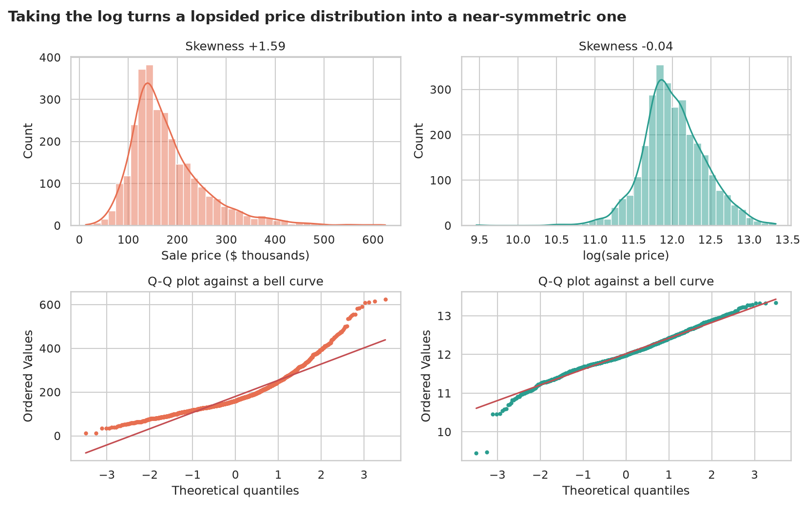
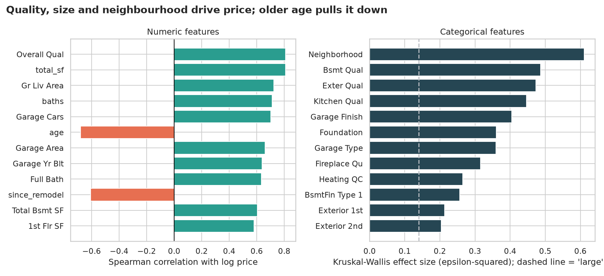
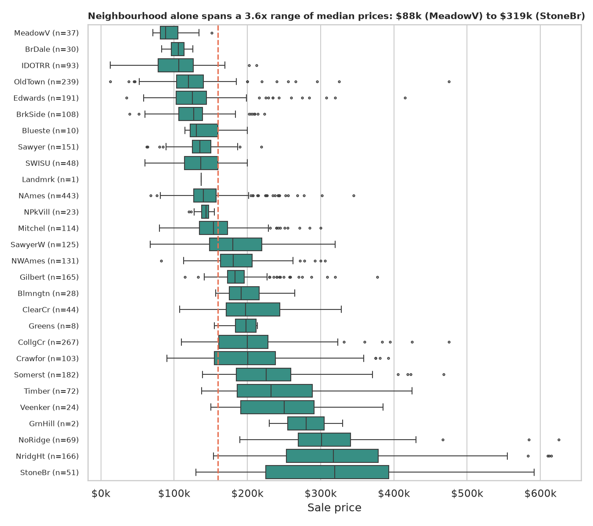
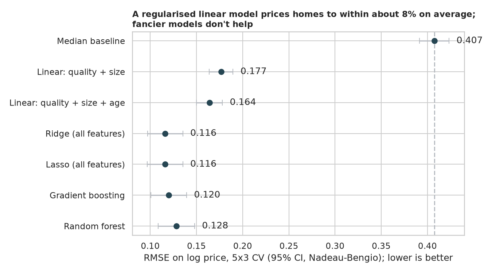
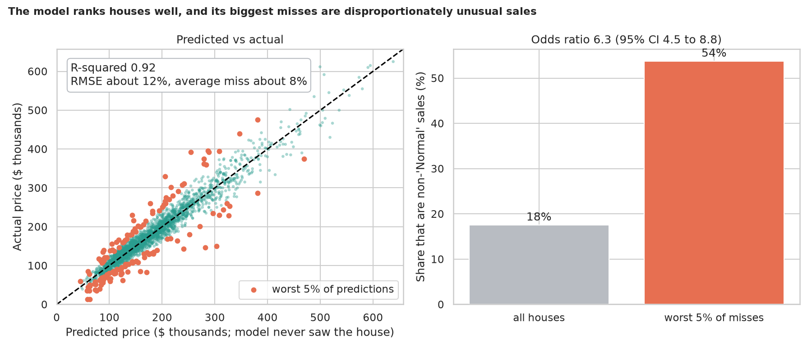

# Housing Price Prediction: what is a house worth?

> 2,930 homes sold in Ames, Iowa between 2006 and 2010, with 80 recorded facts each. Which facts drive the price, does *where* a house is matter beyond how big and nice it is, and how accurately can a model price a house it has never seen?

## 📓 Start here

**[`housing_price_prediction.ipynb`](housing_price_prediction.ipynb)** is the main lesson: every step has a plain-English explanation, the code, and a "how to read this" note. Prefer a web page? Open the pre-rendered report: **[`docs/ml-housing-price-prediction.html`](../../docs/ml-housing-price-prediction.html)**.

## 💡 The Simple Analogy

Pricing a house is like pricing a **pizza**. Size and the quality of the ingredients set most of the price, toppings (a fireplace, a garage) nudge it, and, like a pizzeria in a fancy part of town, **location** changes what people will pay for the same pizza.

Prices also work in **percentages, not dollars**: a $20,000 kitchen upgrade matters on a $100,000 house and is a rounding error on a $700,000 one. So the notebook works with the **logarithm** of the price, where "10% more" is the same step for every house and a model's error reads directly as a percentage.

## 🔬 The Hypothesis & Statistical Question

| # | Question | H₀ | Method | Result |
|---|---|---|---|---|
| H1 | Is a log transform needed? | Price is already symmetric | Skewness, Q-Q plots | Skew **+1.59 → −0.04** after the log |
| H2 | Does each numeric feature move with price? | Spearman ρ = 0 | Spearman, Holm over 37 features | **32 of 37** significant; quality and total sq ft ρ = **+0.81**, age ρ = **−0.68** |
| H3 | Does each categorical feature split prices? | Same distribution in all groups | Kruskal-Wallis with ε²; Mann-Whitney for Central Air | **39 of 39** significant; `Neighborhood` ε² = **0.61**; central air δ = +0.76 ($166k vs $98k median) |
| H4 | Does neighbourhood matter *beyond* size, quality, age, baths? | It adds nothing | Partial F-test on nested OLS | **Yes**: F = 17.6, p ≈ 1e-76, but R² rises only **0.838 → 0.861** |
| H5 | Did the legacy cleaning (dropping "mostly empty" columns) cost accuracy? | Same CV error | Paired Nadeau-Bengio test | **Fail to reject**: Δ RMSE = +0.0002, p = 0.82 |
| H6 | Do complex models beat a regularised linear model? | RMSE difference = 0 | Leak-free repeated CV, paired tests | Ridge RMSE **0.116** (R² 0.92); boosting and forests are not better |
| H7 | Are the biggest misses unusual sales? | Odds ratio = 1 | Fisher's exact on the worst 5% | **OR = 6.3** (95% CI 4.5 to 8.8), p ≈ 1e-24 |

"Fail to reject" means the sample can't see an effect, not that none exists.

## 📊 Key Data Insights & Annotated Visualizations


Raw prices are strongly right-skewed (+1.59); the log makes them near-symmetric (−0.04).


Quality, size and neighbourhood drive price; age pulls it down.


Median prices span a 3.6x range across neighbourhoods ($88k to $319k).


A regularised linear model prices homes to within about 8% on average (RMSE 12%); gradient boosting and random forests don't beat it.


Predicted vs actual for homes the model never saw. Non-"Normal" sales (17.5% of houses) make up 53.7% of the worst 5% of predictions.

**Two findings worth highlighting:**

1. **Location is big on its own but modest once you control for what is being sold.** `Neighborhood` has ε² = 0.61, yet after holding size, quality, age and bathrooms fixed it adds only about 2 points of R². (One quality point goes with about +12% in price, a doubling of square footage with about +46%.)
2. **"NA" is an answer.** The dataset uses `NA` and `None` to mean "no pool", "no fireplace", "no garage". A default pandas read turns them into missing values and makes 12 columns look unusable. Dropping them cost no measurable accuracy here (because other features carry the same information), but the practice is still wrong in principle.

## ⚙️ How it Works (Under the Hood)

The notebook is fully self-contained: no helper modules, just top-to-bottom cells.

1. **Data:** downloads the original 2,930-row Ames file from the Journal of Statistics Education into `data/` on the first run, reading it with `keep_default_na=False` so `NA` and `None` stay as real categories. Five atypical homes above 4,000 sq ft are dropped (the author's own advice), and sale-description columns are kept out of the model (leakage guard).
2. **Tests:** skewness and Q-Q plots; Spearman with Holm correction; Kruskal-Wallis with ε²; a partial F-test for neighbourhood with `statsmodels`; a paired Nadeau-Bengio test for the legacy-cleaning cost; Fisher's exact test and an odds ratio for the biggest misses.
3. **Modelling:** a ladder from the median baseline through two- and three-feature regressions to Ridge, Lasso, gradient boosting and a random forest. Gap-filling, scaling and penalty tuning live **inside** each `Pipeline`, so nothing leaks from the test fold. Scores use repeated 5-fold CV on log price with Nadeau-Bengio confidence intervals.

**What changed from the legacy notebook:** it dropped 18 informative columns because pandas read `NA` as missing, selected features by correlation on all the data before testing, split train and test by row position, modelled raw price, and had no statistics. (Measuring those problems showed some mattered less than expected, for instance the dropped columns cost no accuracy, which the notebook reports honestly.)

## 🚀 How to Run (One-liner command)

```bash
uv sync && uv run jupyter lab ML/housing-price-prediction/housing_price_prediction.ipynb
```

The data downloads into `data/` on the first run, the notebook saves its figures to `outputs/`, and it takes about a minute. Standalone alternative: `pip install -r requirements.txt` and open the notebook in any Jupyter. To rebuild the web report:

```bash
uv run jupyter nbconvert --to html --execute ML/housing-price-prediction/housing_price_prediction.ipynb \
    --output-dir docs --output ml-housing-price-prediction
```

## ⚠️ Limitations & Edge Cases

- **One small town, one short window.** 2,925 homes from Ames, 2006 to 2010, a period spanning the housing crash. Nothing here transfers to other markets or later years.
- **Association, not cause.** "An extra quality point goes with about 12% higher price" is not "renovating raises the price by 12%".
- **Shuffled cross-validation.** Houses sold in the same year appear on both sides of a split. That suits "estimate the value of a house like these" but would overstate a model forecasting *future* prices.
- **Outlier removal is a judgement.** Dropping five homes above 4,000 sq ft follows the dataset author's advice; keeping them would change the fit.
- **Features the model can't see.** Condition, renovations, curb appeal and the exact lot are not in the data, which caps accuracy.
- **Tuning scope.** Ridge and Lasso tune one penalty; the tree models use sensible defaults, so a heavily tuned ensemble might close some of the gap.
- **Small neighbourhoods.** A few have 1 to 10 sales, so their boxes are not reliable.
