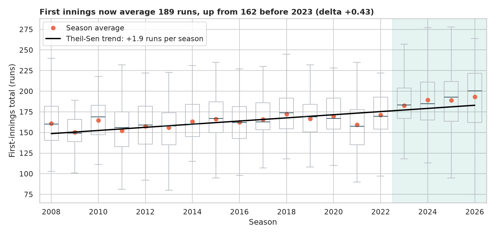
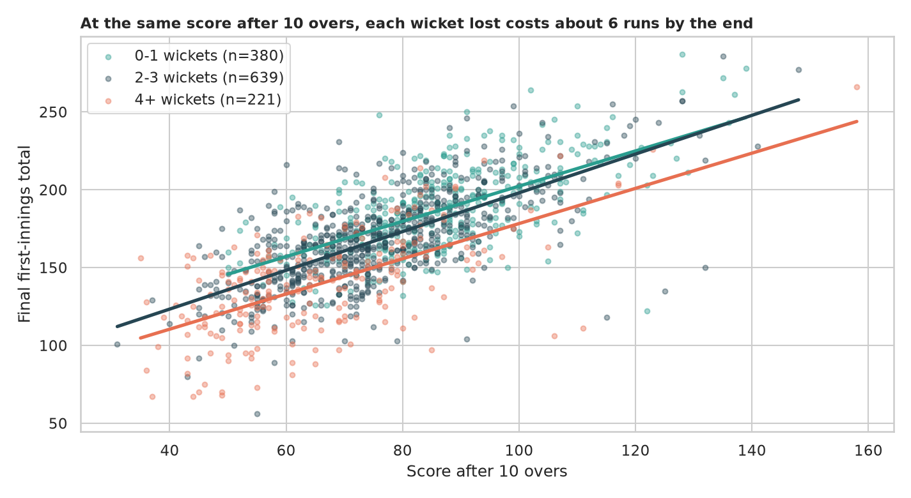
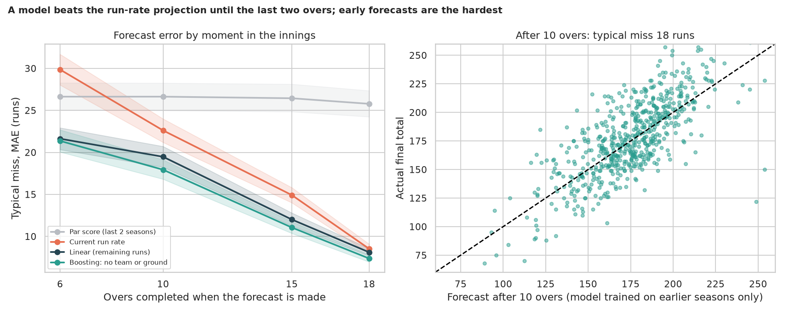
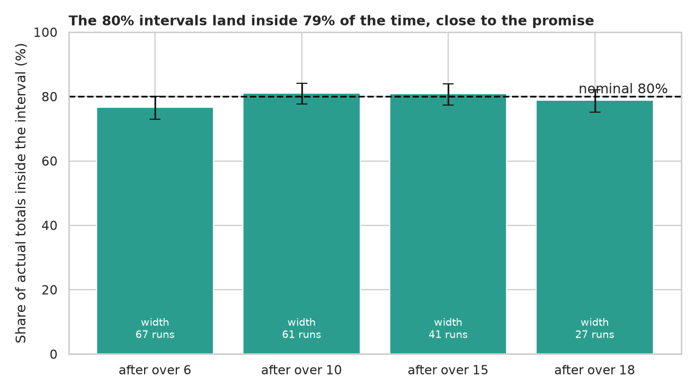

# IPL Score Prediction: how many runs will this innings make?

> After 10 of 20 overs a team is 82 for 3. What will the final score be, and how far should you trust that guess? Ball-by-ball records of every IPL match since 2008 answer that, after first asking whether the game itself has changed.

## 📓 Start here

**[`ipl_score_prediction.ipynb`](ipl_score_prediction.ipynb)** is the main lesson: every step has a plain-English explanation, the code, and a "how to read this" note. Prefer a web page? Open the pre-rendered report: **[`docs/ml-ipl-score-prediction.html`](../../docs/ml-ipl-score-prediction.html)**.

> **A fatal error in the legacy notebook.** It tried to predict `total_runs`, but in a ball-by-ball file that column is the runs from **one delivery** (0 to 6), not the match score, and it used post-match columns (`winner`, `result`). We rebuilt the task as forecasting the **first-innings final total** from the state of the innings.

## 💡 The Simple Analogy

A **road trip**: after two hours you guess your arrival time from your average speed so far (the commentator's *current run rate*). A smart driver adjusts: the last stretch is a sprint (the final overs), a flat tyre (lost wickets) stops you speeding up, and if speed limits keep rising year after year (scoring is up about 26 runs) a forecast built on old traffic is too slow. The notebook measures whether each of those ingredients really helps.

## 🔬 The Hypothesis & Statistical Question

| # | Question | H₀ | Method | Result |
|---|---|---|---|---|
| H1 | Have first-innings totals changed over the seasons? | No trend | Mann-Kendall, Theil-Sen slope, Mann-Whitney U | **Yes**: τ = +0.70, **+1.9 runs/season** (CI +1.3 to +2.6); 162 runs in 2008-2022 vs **189** in 2023+ (δ = +0.43) |
| H2 | Does the toss, or chasing, help win? | P(win) = 0.5 | Binomial test, Wilson CIs | Toss winner wins **51.6%** (p = 0.29, no edge); chasing side wins **54.7%** (p = 0.001) |
| H3 | At the same score, does losing wickets lower the final total? | Coefficient = 0 | OLS with robust (HC3) errors | **Yes**: each wicket costs **about 6.5 runs** (CI −7.6 to −5.3) |
| H4 | Does a model beat the current-run-rate forecast? | MAE difference = 0 | Rolling-origin by season (2018-2026), cluster bootstrap by match | **Yes early**: −8 runs after over 6, −3 to −4 after over 10, −3 after over 15; **no gain after over 18** |
| H5 | Do team, ground and league level help? | MAE difference = 0 | Same evaluation, ingredients removed | Team and ground names **hurt** (removing them improves MAE by about 1 run); league level adds nothing |
| H6 | Are the 80% prediction intervals honest? | Coverage = 80% | Intervals calibrated on earlier seasons | **79.4%** overall (CI 76.7% to 81.1% by checkpoint); width 67 runs after over 6 down to 27 after over 18 |

"Fail to reject" means the sample can't see an effect, not that none exists.

## 📊 Key Data Insights & Annotated Visualizations


First innings now average 189 runs, up from 162 before 2023: the game itself drifts, so forecasts must be tested train-on-past, predict-the-future.


At the same score after 10 overs, each wicket lost costs about 6 runs by the end.


A model beats the run-rate projection by 7 to 8 runs after over 6, but the advantage disappears by over 18. Typical misses fall from about 21 runs (over 6) to about 7 (over 18).


Intervals calibrated on earlier seasons cover about 80% of actual totals, and shrink from 67 runs wide (over 6) to 27 (over 18).

**A cautionary result:** adding team and ground names made forecasts *worse* by about a run. With about 15 teams and 42 grounds the model overfits identities, while the state of the innings (score, wickets, recent form) already carries the signal.

## ⚙️ How it Works (Under the Hood)

The notebook is fully self-contained: no helper modules, just top-to-bottom cells.

1. **Data:** downloads open IPL ball-by-ball records from [Cricsheet](https://cricsheet.org) (ODC Attribution License; credit Cricsheet.org) into `data/` on the first run (about 7 MB). It builds one **snapshot per match and completed over** of the first innings, with score, wickets, legal balls, recent form (last 5 overs), tidied team and ground names, and a `league_level` (the previous two seasons' average total, known before the season starts).
2. **Tests:** Mann-Kendall with Theil-Sen; Mann-Whitney with Cliff's δ; binomial tests with Wilson CIs; OLS with HC3 standard errors.
3. **Forecasting:** par score, current run rate, a linear model and gradient boosting, all predicting the *remaining* runs. **Rolling-origin evaluation by season** (train on earlier seasons only, test on the next, 2018 to 2026) avoids leakage across the 19 snapshots of a match and across seasons. Errors get a **cluster bootstrap by match**.
4. **Intervals:** an 80% interval from the errors of earlier test seasons, checked on the following season.

**What changed from the legacy notebook:** it predicted the runs of a single ball, used `winner` and `result` (post-match information), computed "RMSE" as the square root of the MAE, had mismatched train and test rows and saved models with `pickle`.

## 🚀 How to Run (One-liner command)

```bash
uv sync && uv run jupyter lab ML/ipl-score-prediction/ipl_score_prediction.ipynb
```

The data downloads into `data/` on the first run and the notebook saves its figures to `outputs/`. It takes about a minute. Standalone alternative: `pip install -r requirements.txt` and open the notebook in any Jupyter. To rebuild the web report:

```bash
uv run jupyter nbconvert --to html --execute ML/ipl-score-prediction/ipl_score_prediction.ipynb \
    --output-dir docs --output ml-ipl-score-prediction
```

## ⚠️ Limitations & Edge Cases

- **First innings only.** A chase has a target, which changes how teams bat; it is not modelled.
- **Era drift is only partly handled.** The `league_level` feature adds nothing detectable, so a sudden rule change (such as the 2023 impact-player substitute) can still shift scoring faster than the model adapts.
- **No player information.** Who is batting or bowling obviously matters; batter-level strength would be the natural next step.
- **Rain-shortened and collapsed innings** are kept (the total is what it is) but are unusual.
- **Intervals are calibrated on earlier test seasons only,** so the first test season has none, and early ones rest on few matches.
- **Association, not cause.** "A wicket costs 6 runs" is a statistical regularity at a given score, not a promise about any one match.
- **Exact numbers will move** as new seasons arrive (the data is refreshed continuously).
