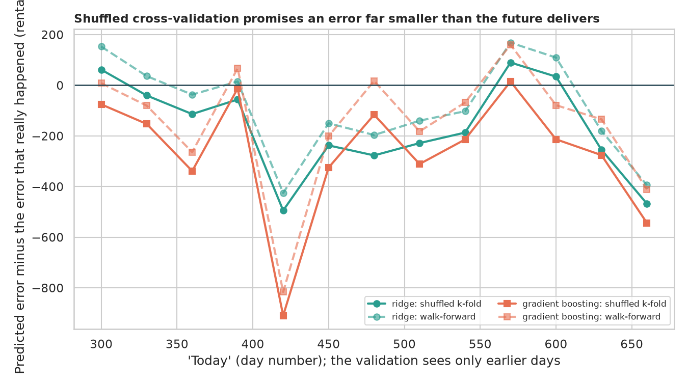
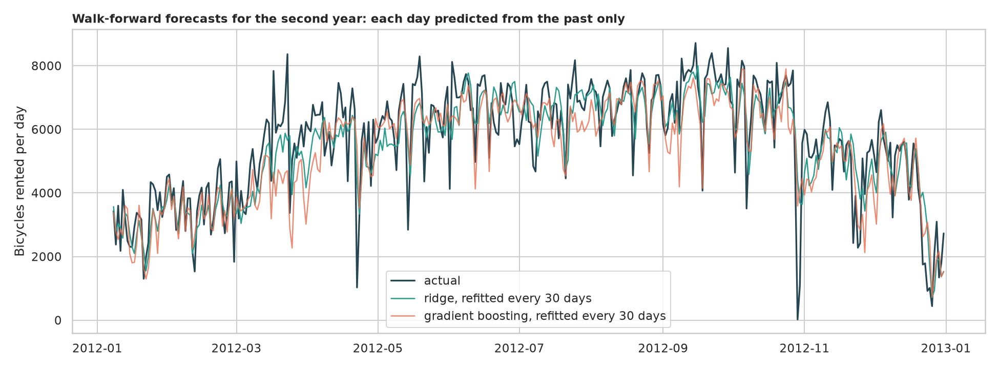
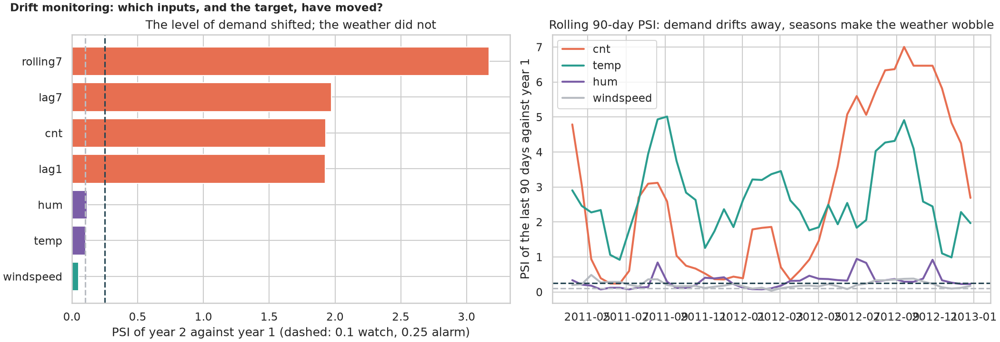
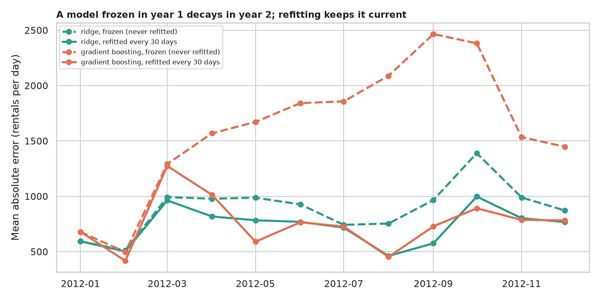
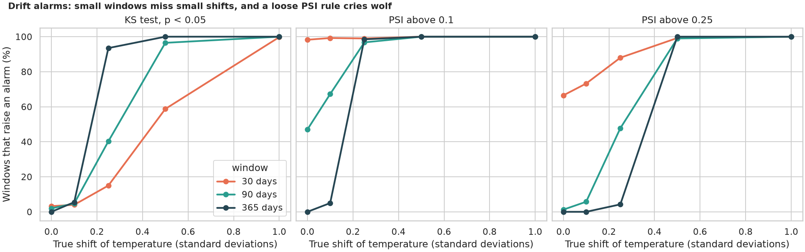

# Time-Series Backtesting and Drift: will the model still work next month?

> A forecasting model is trained on the past and used on the future, so the only honest test never lets the future leak into the past, and even an honestly tested model decays when the world drifts. How badly does shuffled cross-validation fool us, does machine learning beat "same as last week" when tested honestly, has the data drifted, how fast does a model frozen in year 1 decay in year 2, and can the drift alarms (KS test, PSI) be trusted? Two years of daily bike-share rentals (demand grew 64% in year 2).

## 📓 Start here

**[`time_series_backtesting_drift.ipynb`](time_series_backtesting_drift.ipynb)** is the main lesson: every step has a plain-English explanation, the code, and a "how to read this" note. Prefer a web page? Open the pre-rendered report: **[`docs/ml-time-series-backtesting-drift.html`](../../docs/ml-time-series-backtesting-drift.html)**.

## 💡 The Simple Analogy

A **weather forecaster graded on yesterday's answers**. Shuffled cross-validation is a test with the answer key in the room (the forecaster has already seen days 99 and 101 when asked about day 100); walk-forward backtesting stands at day 365, predicts the next 30 days from the past only, then moves on. Drift is the world changing under the forecaster's feet: a shop that learned from 3,400 customers a day keeps guessing 3,400 when the street brings 5,600, unless the notes are refreshed monthly. Drift alarms are smoke detectors: useful, but a toaster (the seasons) can set them off.

## 🔬 The Hypothesis & Statistical Question

Data: UCI Bike Sharing (daily, 2011-2012). Features: lag 1, lag 7, a shifted 7-day mean, weather and calendar. Models: two baselines, ridge and gradient boosting.

| # | Question | Method | Result |
|---|---|---|---|
| H1 | Does shuffled k-fold predict the future error as well as walk-forward? | 13 "today" dates; promised vs realised error; t-test, Wilcoxon | **No**: boosting promised 439, 707 followed (bias -267, CI -415 to -119); walk-forward -153 |
| H2 | Do the models beat trivial forecasts, honestly tested? | Walk-forward, Diebold-Mariano, week-block bootstrap | **Yes**: ridge MAE 733 vs 879 (yesterday, p = 3e-4) and 1,112 (last week); boosting ties ridge (p = 0.47) |
| H3 | Has the data drifted? | KS test, chi-square, PSI | **Demand yes** (mean 3,437 to 5,651, PSI 1.93); weather no significant change (PSI 0.10 to 0.12 is noise) |
| H4 | Does a frozen model decay; does refitting help? | Diebold-Mariano, Spearman | **Yes**: boosting 1,632 frozen vs 762 refitted (p = 1e-18), under-predicts on 91% of days; ridge 899 vs 733 |
| H5 | Can the alarms be trusted? | Simulated shifts in windows of 30/90/365 days; the seasonal check | **KS false alarms 0 to 3%** but needs a year to see a 0.25 sd shift; **PSI > 0.1 cries wolf in 98%** of 30-day windows; every month of year 1 looks "drifted" |

## 📊 Key Data Insights & Annotated Visualizations


Shuffled cross-validation promises an error far smaller than the future delivers.


Walk-forward forecasts for the second year: each day predicted from the past only.


The level of demand shifted; the weather did not.


A model frozen in year 1 decays in year 2; refitting keeps it current.


Small windows miss small shifts, and a loose PSI rule cries wolf.

## ⚙️ How it Works (Under the Hood)

1. **Features:** lags and a shifted rolling mean, asserted to line up with the dates, so no day sees itself.
2. **Validation:** `forecast(name, train, test)` can only see `train`; `walk_forward` refits every 30 days on an expanding window; shuffled 5-fold is the comparison.
3. **Tests:** Diebold-Mariano with Newey-West errors, week-block bootstrap, KS test, chi-square, PSI (10 reference-quantile bins).
4. **Drift study:** year 1 is the reference; a frozen model (fitted once) vs a refitted one; simulated shifts for the alarm power.

## 🚀 How to Run (One-liner command)

```bash
uv sync && uv run jupyter lab ML/time-series-backtesting-drift/time_series_backtesting_drift.ipynb
```

The small dataset downloads into `data/` on the first run; it takes about 3 minutes on a CPU. Standalone alternative: `pip install -r requirements.txt`.

## ⚠️ Limitations & Edge Cases

- **One series, one city, two years;** the drift is an unusually clean growth.
- **Observed, not forecast, weather,** which flatters every model.
- **One walk-forward design** (expanding window, 30-day refit).
- **Only 13 cut-offs in H1,** so the ridge result is not significant on its own.
- **No tuning,** and no sequence models.
- **H5's windows come from the reference itself,** so the KS false alarm rate is below 5%.
- **PSI depends on bins and window size;** 0.1 and 0.25 are conventions.
- **Seasonality was not removed in the drift checks.**
