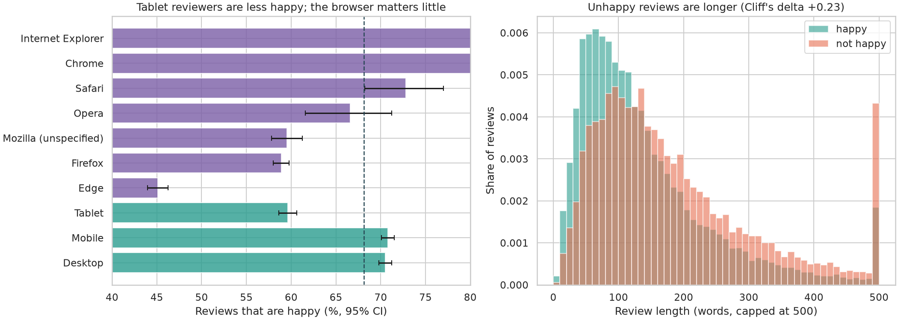
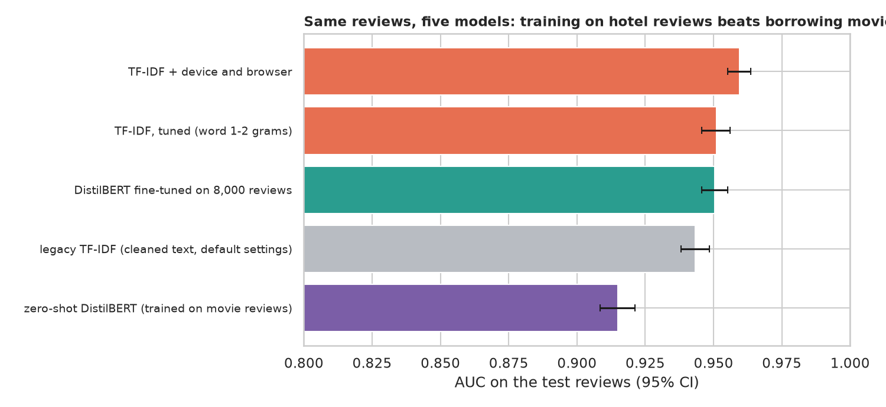
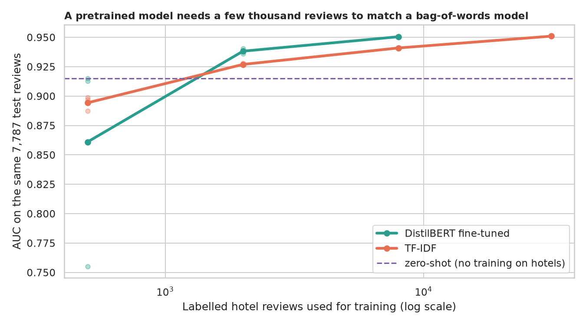

# Hotel Review Sentiment: what is the label hiding, and does a language model help?

> The legacy notebook took 38,932 hotel reviews labelled happy or not happy, threw away the browser and device columns, fitted TF-IDF + logistic regression and reported about 88% with a precision score computed with swapped arguments. What do the dropped columns say, how much better can a careful bag-of-words model do, does DistilBERT help (as is, or fine-tuned), and what can no model get right?

## 📓 Start here

**[`hotel_review_sentiment.ipynb`](hotel_review_sentiment.ipynb)** is the main lesson: every step has a plain-English explanation, the code, and a "how to read this" note. Prefer a web page? Open the pre-rendered report: **[`docs/nlp-hotel-review-sentiment.html`](../../docs/nlp-hotel-review-sentiment.html)**.

## 💡 The Simple Analogy

Sorting **guest comment cards** into happy and not happy. The **word-counting clerk** knows the words unhappy guests use. The **well-read clerk (DistilBERT)** has read millions of texts, but if his only training is movie reviews he does not know why hotel guests are unhappy. The cards also carry a **stamp** (browser, device) that should say nothing about happiness: we check. And some cards cannot be sorted by anyone.

## 🔬 The Hypothesis & Statistical Question

Everything is scored on the same 7,787 held-out reviews (stratified 80/20 split; the file has no duplicates).

| # | Question | Method | Result |
|---|---|---|---|
| H1 | Are device and browser unrelated to happiness? | Chi-square, Cramér's V, Wilson CIs | **No**: tablet 59.6% happy vs 70.5% desktop (V = 0.10); Edge **45.1%** vs Chrome 86.1% and Internet Explorer 86.6% (V = 0.35), most likely a data artefact, not a cause |
| H2 | Are unhappy reviews as long as happy ones? | Mann-Whitney, Cliff's δ | **No**: median 151 vs 111 words (δ = +0.23) |
| H3 | Does better tuning, then the metadata, beat the legacy model? | Exact McNemar, bootstrap AUC difference | **Yes**: 88.5% legacy, 89.7% tuned (p = 1e-7), 90.5% with device and browser (p = 0.003) |
| H4 | Does a movie-review sentiment model work out of the box? | Exact McNemar | **No**: 85.5% accuracy, AUC 0.915 vs 0.951 for trained TF-IDF (p = 4e-26) |
| H5 | How many labels does a fine-tuned DistilBERT need? | Learning curve (500, 2,000, 8,000) | **About a quarter of them to tie**: AUC 0.9505 with 8,000 reviews vs 0.951 for TF-IDF on all 31,145 (p = 0.19); with 500 reviews it can fail to train (one seed AUC 0.755) |

The legacy "precision" came from `precision_score(predictions, y_test)` with swapped arguments: it printed 0.8918, the real weighted precision is 0.8838, and the "not happy" class has recall 0.76. About 6% of test reviews are wrong for every model, often with text and label in conflict.

## 📊 Key Data Insights & Annotated Visualizations


Tablet reviewers are less happy, the browser matters a lot (in this file), and unhappy reviews are longer.


Same reviews, five models: training on hotel reviews beats borrowing movie reviews.


A pretrained model needs a few thousand reviews to match a bag-of-words model.

## ⚙️ How it Works (Under the Hood)

1. **Data:** Kaggle "Hotel Review" training file (38,932 labelled reviews); browser spellings merged into 7 browsers.
2. **Models:** legacy TF-IDF replica; tuned word 1-2-gram TF-IDF with regularisation chosen by 3-fold validation (with and without device and browser); zero-shot SST-2 DistilBERT; DistilBERT fine-tuned on hotel reviews (2 passes, first 256 word-pieces).
3. **Statistics:** Wilson intervals, chi-square with Cramér's V, Mann-Whitney with Cliff's δ, exact McNemar, bootstrap CIs for accuracy and AUC.

**What changed from the legacy notebook:** the dropped columns are examined, the swapped precision arguments are shown and corrected, the evaluation uses a fixed test set with intervals, and a pretrained model is compared fairly.

## 🚀 How to Run (One-liner command)

```bash
uv sync --extra nlp && uv run jupyter lab NLP/hotel-review-sentiment/hotel_review_sentiment.ipynb
```

The data need a Kaggle login: download the [Hotel Review](https://www.kaggle.com/anu0012/hotel-review) files and save `train.csv` and `test.csv` into `data/` as `hotel_review_train.csv` and `hotel_review_test.csv`. DistilBERT (about 270 MB) downloads itself. It uses a GPU if present and takes about an hour on one. Standalone alternative: `pip install -r requirements.txt`.

## ⚠️ Limitations & Edge Cases

- **One split;** intervals resample the test reviews only.
- **The browser effect is not causal** and would not carry over to other data.
- **Reviews are cut at 256 word-pieces** (15.4% are longer).
- **Few seeds in the learning curve** (3, 3 and 1); DistilBERT is unstable with 500 reviews.
- **DistilBERT settings were not tuned.**
- **Labels may come from a rating rule** and some contradict their text.
- **The unlabelled file was not used.**
