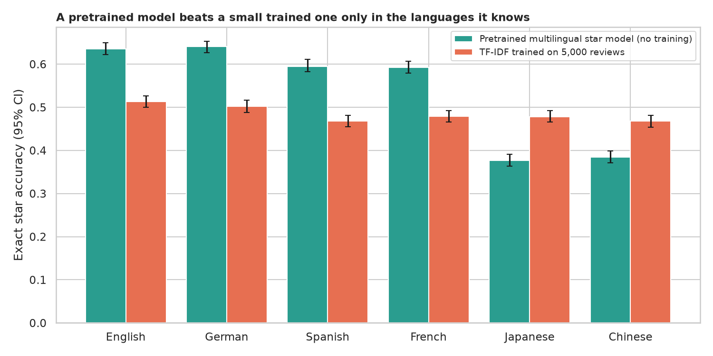
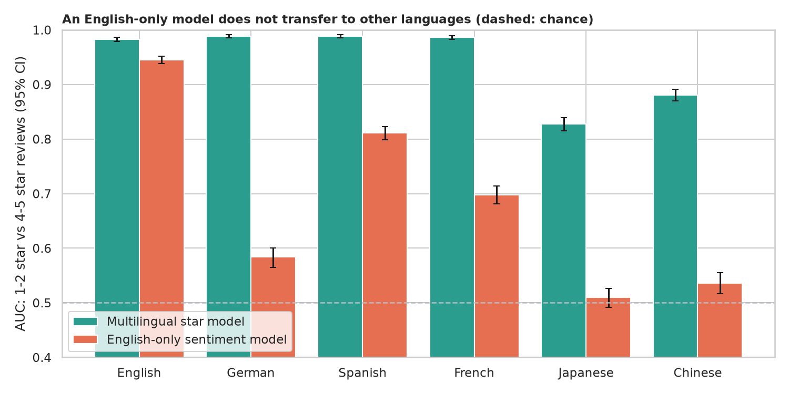
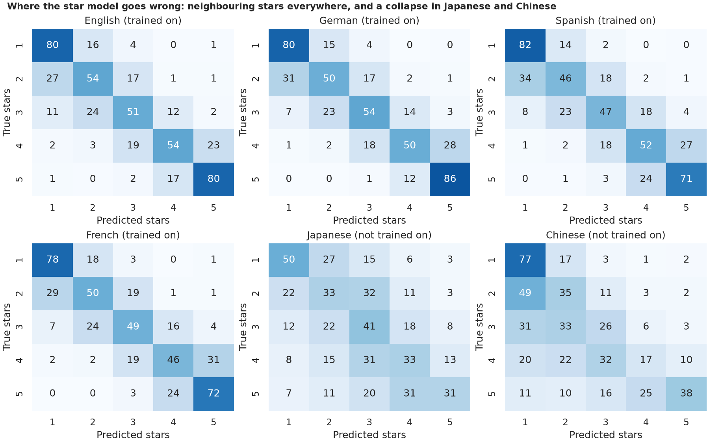

# Multilingual Sentiment: how far does a "multilingual" model really reach?

> The legacy notebook copied the Hugging Face quick tour and claimed a BERT star-rating model "can deal with" six languages, without measuring anything. How accurate is it in each language, does it work in languages it was not trained on (Japanese, Chinese), would an English-only model do, and can a small model trained on 5,000 local reviews beat it? Tested on 30,000 Amazon reviews, 5,000 per language, 1,000 per star.

## 📓 Start here

**[`multilingual_sentiment_bert.ipynb`](multilingual_sentiment_bert.ipynb)** is the main lesson: every step has a plain-English explanation, the code, and a "how to read this" note. Prefer a web page? Open the pre-rendered report: **[`docs/nlp-multilingual-sentiment-bert.html`](../../docs/nlp-multilingual-sentiment-bert.html)**.

## 💡 The Simple Analogy

A **hotel concierge who has read thousands of guest comments in six languages** guesses star ratings. In the languages he studied he is usually right to within a star. Hand him a language he never studied and he recognises a few cheerful or angry words, so he beats guessing, but drifts to the middle. A colleague who reads only English is hopeless on a German comment. And a local trainee who read 5,000 comments in that one language can quietly beat the polyglot where the polyglot has no training.

## 🔬 The Hypothesis & Statistical Question

Models: `nlptown/bert-base-multilingual-uncased-sentiment` (1-5 stars; trained on English, Dutch, German, French, Spanish, Italian), an English-only DistilBERT (SST-2), and a character n-gram TF-IDF baseline trained on 5,000 reviews per language.

| # | Question | Method | Result |
|---|---|---|---|
| H1 | Equally accurate in all six languages? | Exact-star accuracy, bootstrap CIs, chi-square | **No**: 59% to 64% exact in English, German, Spanish and French; **38%** in Japanese and Chinese (difference +23.5 points, CI +22.3 to +24.7) |
| H2 | Does an English-only model transfer? | AUC for 1-2 vs 4-5 stars, paired bootstrap | **No**: AUC 0.945 in English, 0.584 in German, 0.510 in Japanese (chance 0.5); the star model gets 0.98 to 0.99 in known languages |
| H3 | Same kind of mistakes everywhere? | Share one star off, 3+ stars off, confusion matrices | **No**: 85% to 88% of errors are one star off in known languages; 60% to 62% in Japanese and Chinese, where 7% to 9% of reviews are 3+ stars off |
| H4 | Does a small model trained on the language win? | Exact McNemar, AUC | **Only where pretraining did not reach**: star model wins in the four known languages (e.g. 63.6% vs 51.3%), TF-IDF wins in Japanese (47.8% vs 37.7%) and Chinese (46.8% vs 38.5%) |

## 📊 Key Data Insights & Annotated Visualizations


A pretrained model beats a small trained one only in the languages it knows.


An English-only model does not transfer to other languages (dashed: chance).


Neighbouring-star mistakes everywhere, and a collapse toward the middle in Japanese and Chinese.

## ⚙️ How it Works (Under the Hood)

1. **Data:** the Multilingual Amazon Reviews Corpus, test split for all scoring, validation split only to train the small baseline.
2. **Star model:** BERT with a 5-way output, reviews cut at 128 word-pieces; predicted rating = most likely star, expected rating = probability-weighted stars.
3. **English-only model:** DistilBERT fine-tuned on movie sentences; score = probability of positive.
4. **Statistics:** bootstrap CIs, chi-square, paired bootstrap AUC differences, exact McNemar.

**What changed from the legacy notebook:** it was a copy of the library tour (a few invented sentences, a TensorFlow conversion of a PyTorch-only model) and never measured accuracy in any language.

## 🚀 How to Run (One-liner command)

```bash
uv sync --extra nlp && uv run jupyter lab NLP/multilingual-sentiment-bert/multilingual_sentiment_bert.ipynb
```

The reviews (about 15 MB) and the models (about 1 GB) download on the first run. It uses a GPU if present and takes about 10 minutes on one. Standalone alternative: `pip install -r requirements.txt`.

## ⚠️ Limitations & Edge Cases

- **One domain (product reviews),** the star model's home turf.
- **Possible contamination:** the star model's training data are not fully documented.
- **Reviews are cut at 128 word-pieces,** which hurts Japanese most (18% cut).
- **The small baseline is deliberately simple** and untuned.
- **The 23.5-point drop mixes script and training differences.**
- **"Trained on" comes from the model card,** unverified.
- **Stars are a noisy label,** so exact accuracy has a low ceiling.
