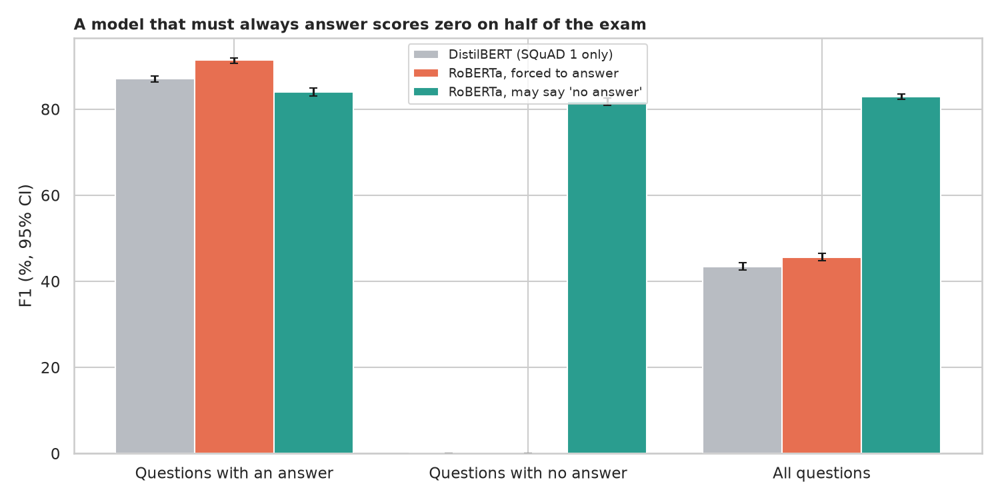
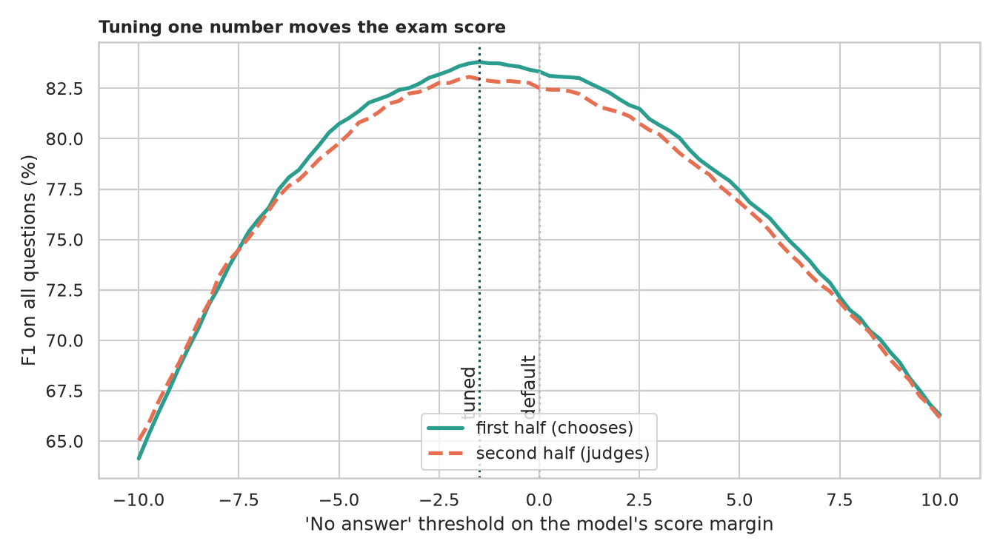
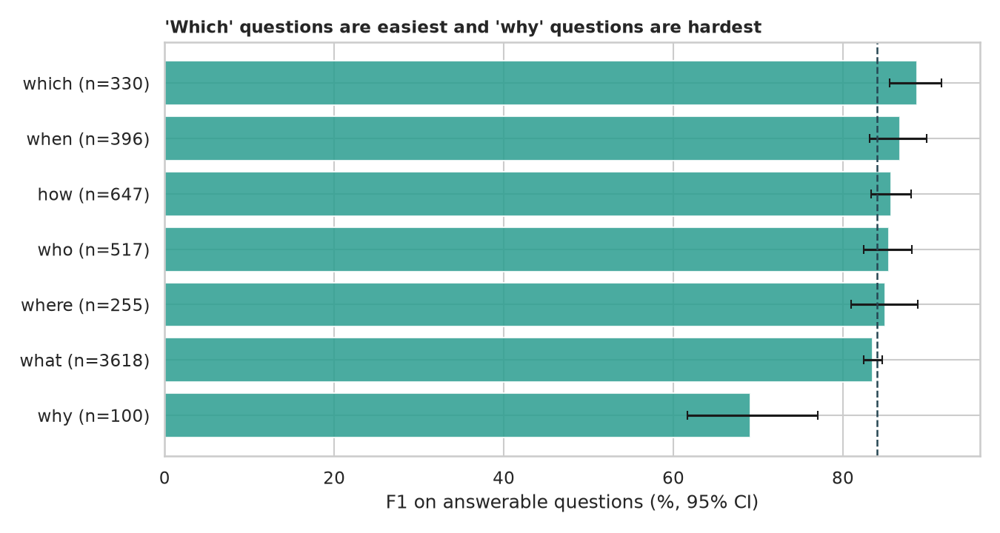

# Question Answering: the questions a model must refuse to answer

> The legacy notebook trained a BERT question-answering model on seven hand-written questions about the Mistborn novels. Seven questions cannot say whether a model is good. How well do pretrained models do on SQuAD 2.0, where half the questions have no answer in the paragraph? What happens to a model never taught to say "I don't know"? Can its refusal threshold be tuned, which questions are hard, and how would the models do on the legacy seven?

## 📓 Start here

**[`question_answering.ipynb`](question_answering.ipynb)** is the main lesson: every step has a plain-English explanation, the code, and a "how to read this" note. Prefer a web page? Open the pre-rendered report: **[`docs/nlp-question-answering.html`](../../docs/nlp-question-answering.html)**. The two small legacy files (`train.json`, `test.json`) are kept: they hold the seven hand-written Mistborn questions used in the last section.

## 💡 The Simple Analogy

An **open-book exam**: underline the answer in a paragraph. A student who has only seen questions *with* answers always underlines something, even when the paragraph is silent ("Who is the main character?" gets "The Hero of Ages", a book title). A student who has also practised unanswerable questions learns to write "not in the text", which on an exam that is half traps is the whole difference. The risk is a student who becomes too cautious; his caution can be adjusted.

## 🔬 The Hypothesis & Statistical Question

SQuAD 2.0 development set: 11,873 questions, 49.9% answerable. Models: `distilbert-base-cased-distilled-squad` (SQuAD 1.1 only, always answers) and `deepset/roberta-base-squad2` (forced to answer, or allowed to say "no answer").

| # | Question | Method | Result |
|---|---|---|---|
| H1 | Does being allowed to say "no answer" matter? | EM and F1 with bootstrap CIs; exact McNemar | **Yes**: forced RoBERTa EM 0.421 (0.000 on unanswerable), allowed 0.799; costs 371 answerable questions (0.843 to 0.780 EM), gains 4,864 unanswerable ones |
| H2 | Can the refusal threshold be tuned? | Tuned on one half, judged on the other | **Barely**: threshold 0 to -1.50, F1 0.8252 to 0.8296, intervals overlap |
| H3 | Equally good on every kind of question and length? | Kruskal-Wallis, Spearman | **Question word matters** (p = 5e-13): "which" F1 0.887, "why" 0.691; paragraph length does not (rho = -0.004); 76.6% of the answerable questions it gets wrong were refusals |
| H4 | The legacy seven questions, replayed | Descriptive | RoBERTa 4 of 7 exact (F1 0.79), DistilBERT 2 of 7 (F1 0.53); DistilBERT answers the unanswerable ones |

## 📊 Key Data Insights & Annotated Visualizations


A model that must always answer scores zero on half of the exam.


Tuning one number moves the exam score only slightly.


"Which" questions are easiest and "why" questions are hardest.

## ⚙️ How it Works (Under the Hood)

1. **Data:** SQuAD 2.0 validation split from the Hugging Face hub (reference answers per question, empty for unanswerable).
2. **Prediction:** each question and paragraph is cut into overlapping 384-piece windows; the best span (up to 30 pieces) over all windows is kept, with the "no answer" margin (its score minus the best span's).
3. **Scoring:** the official SQuAD exact match and F1 (best over the references).
4. **Statistics:** bootstrap CIs, exact McNemar, threshold tuned on a random half and judged on the other, Kruskal-Wallis, Spearman.

**What changed from the legacy notebook:** seven invented questions, the unmaintained `simpletransformers` wrapper, shell commands inside the notebook and no metric, replaced by a proper benchmark, current models and tests.

## 🚀 How to Run (One-liner command)

```bash
uv sync --extra nlp && uv run jupyter lab NLP/question-answering/question_answering.ipynb
```

SQuAD 2.0 and the two models (about 650 MB) download on the first run. It uses a GPU if present and takes about 15 minutes on one. Standalone alternative: `pip install -r requirements.txt`.

## ⚠️ Limitations & Edge Cases

- **Wikipedia paragraphs and crowd-written questions** are not real user questions.
- **SQuAD 2.0's unanswerable questions are adversarial,** so refusal rates are not those of real use.
- **DistilBERT vs RoBERTa mixes architecture and training data;** only forced vs abstaining RoBERTa isolates abstaining.
- **EM and F1 reward wording overlap.**
- **The threshold was tuned once on half the data;** the curve is flat.
- **"Why" has only 100 questions.**
- **The legacy questions are seven and written by one person.**
