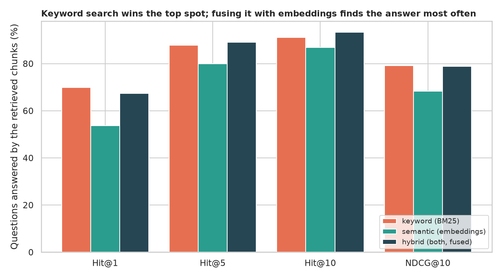
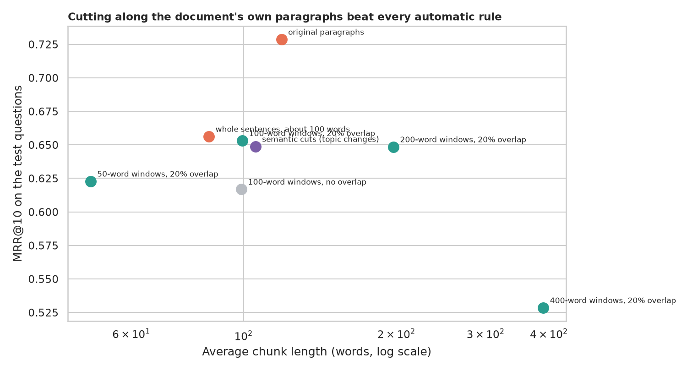
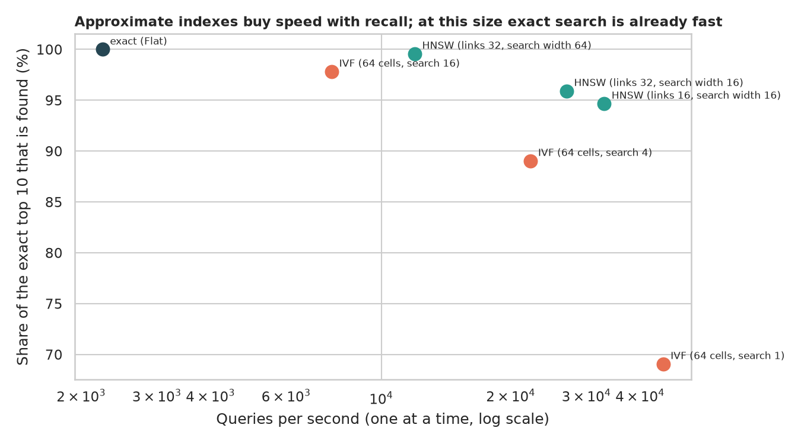
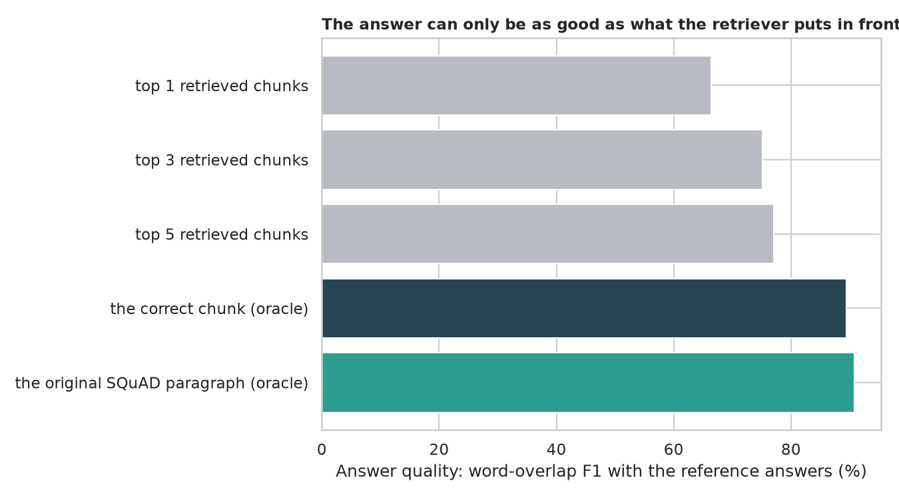

# RAG and Vector Search: finding the right page before answering

> A retrieval-augmented generation (RAG) system first searches a pile of documents for the passages that probably hold the answer, then a model reads them and answers. The search sets the ceiling: a reader never shown the answer cannot give it. Is "search by meaning" really better than keyword search, how should documents be cut into chunks, is semantic chunking worth it, does a fast approximate FAISS index lose answers, and how much does answer quality depend on retrieval? Tested on 135 Wikipedia articles (638,000 words) and 3,000 questions with exactly known answers.

## 📓 Start here

**[`rag_vector_search.ipynb`](rag_vector_search.ipynb)** is the main lesson: every step has a plain-English explanation, the code, and a "how to read this" note. Prefer a web page? Open the pre-rendered report: **[`docs/nlp-rag-vector-search.html`](../../docs/nlp-rag-vector-search.html)**.

## 💡 The Simple Analogy

A **librarian answering a question from 135 books** in two steps. Step 1: the books are torn into pages; a keyword librarian picks pages with the question's rare words, a meaning librarian picks pages whose gist is close, and a team merges both lists. Step 2: someone reads the pages found. How you tear the books matters (50 words cuts sentences, 400 words blurs topics, the chapter's own paragraphs keep one idea per page), a map of neighbouring pages makes a giant library fast but may miss a page, and if the right page is not on the table the reader is guessing.

## 🔬 The Hypothesis & Statistical Question

Library: 35 SQuAD 2.0 development articles plus 100 distractor articles; 3,000 answerable questions (half to choose settings, half to judge); a chunk is relevant if it contains the whole answer text. Embeddings: `all-MiniLM-L6-v2`; reader: RoBERTa SQuAD 2.0.

| # | Question | Method | Result |
|---|---|---|---|
| H1 | Keyword, meaning or both? | MRR@10, Wilcoxon, McNemar | **Keyword wins the top spot**: BM25 MRR 0.777 vs embeddings 0.651 (-0.126, p = 6e-54); hybrid has the best Hit@5 (0.891) and Hit@10 (0.934) |
| H2 | Chunk size and overlap? | Tuned on one half, judged on the other; Friedman | **100 to 200 words**: MRR 0.653 / 0.648 vs 0.623 (50 words) and 0.528 (400 words); overlap +0.036 and keeps 100% of answers whole (97.8% without) |
| H3 | Is semantic chunking worth it? | Paired Wilcoxon, bootstrap | **No**: 0.649 vs 0.651 for fixed windows; the original paragraphs gain +0.070 (a caution: the questions were written about them) |
| H4 | Does an approximate FAISS index lose answers? | Recall of the exact top 10; queries per second | **Yes, as a dial**: HNSW 94.7% recall at 33,000 queries/s, 99.6% at 12,000; exact search 2,200 queries/s and already fast at 8,000 chunks |
| H5 | Does answer quality depend on retrieval? | RoBERTa reader, k = 1, 3, 5, oracles; Mann-Whitney | **Completely**: F1 0.846 when the right chunk is in the top 5, **0.114** when not; top 5 gives 0.771, the correct chunk 0.895 |

## 📊 Key Data Insights & Annotated Visualizations


Keyword search wins the top spot; fusing it with embeddings finds the answer most often.


Cutting along the document's own paragraphs beat every automatic rule.


Approximate indexes buy speed with recall; at this size exact search is already fast.


The answer can only be as good as what the retriever puts in front of the reader.

## ⚙️ How it Works (Under the Hood)

1. **Chunking:** fixed windows (50 to 400 words, with and without overlap), packed sentences, original paragraphs and semantic cuts (cut where adjacent sentence embeddings are least alike).
2. **Search:** BM25 on a sparse matrix; MiniLM embeddings in a FAISS `IndexFlatIP`; hybrid by reciprocal rank fusion (constant 60); HNSW and IVF indexes for the speed comparison.
3. **Scoring:** Hit@1/5/10, MRR@10 and NDCG@10 with binary relevance (the chunk contains the whole answer text); bootstrap CIs over questions, Wilcoxon and McNemar tests, a tuning/test split of the questions.
4. **Reading:** the RoBERTa reader answers from the top k chunks (best span score wins); oracles show the ceiling.

## 🚀 How to Run (One-liner command)

```bash
uv sync --extra nlp && uv run jupyter lab NLP/rag-vector-search/rag_vector_search.ipynb
```

SQuAD 2.0 and two small models (about 600 MB) download on the first run. It uses a GPU if present and takes about 10 minutes on one. Standalone alternative: `pip install -r requirements.txt`.

## ⚠️ Limitations & Edge Cases

- **SQuAD questions were written while reading the paragraph,** which favours BM25 and paragraph chunks.
- **One small embedding model and one reader;** larger or retrieval-trained models and re-rankers would change the ranking.
- **A tiny library (8,000 chunks):** speed results do not predict millions of vectors.
- **Relevance means "contains the whole answer text",** stricter than "helps a reader".
- **No generative step;** hallucination is not measured.
- **Chunking settings were not tuned jointly,** and the tuning and test halves share articles.
