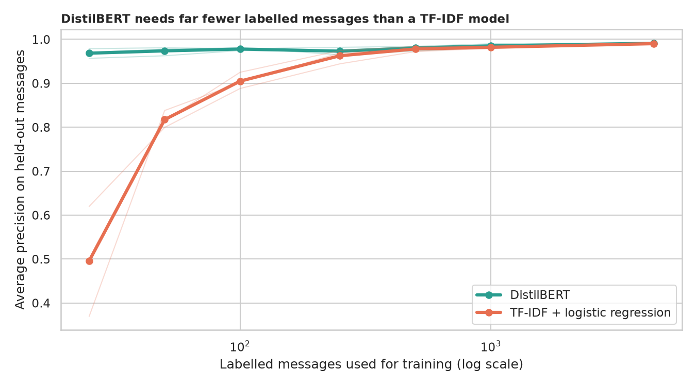
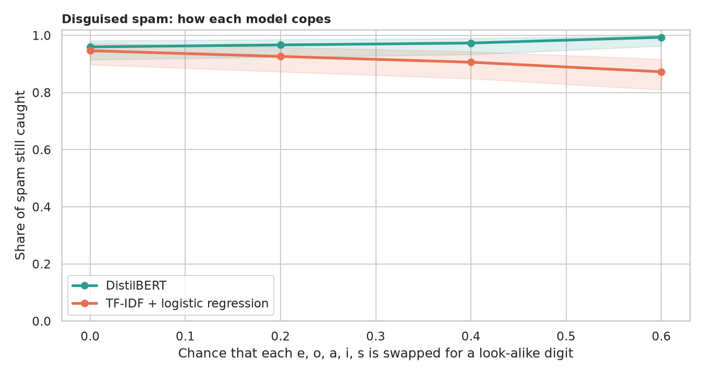
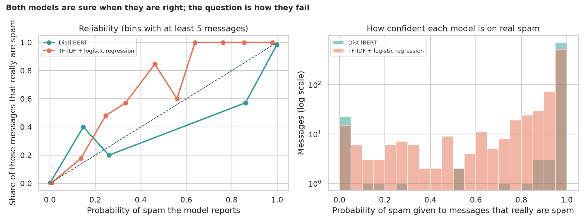

# SMS Spam with DistilBERT: does a pretrained language model earn its keep?

> The legacy notebook fine-tuned DistilBERT on text-message spam and reported about 99% accuracy on a random 20% of the messages. A bag-of-words model scores nearly as high, and the data hold many exact duplicates. How much does DistilBERT really add, where does it help or hurt, can we trust its confidence, and what does a mistake cost?

## 📓 Start here

**[`sms_spam_distilbert.ipynb`](sms_spam_distilbert.ipynb)** is the main lesson: every step has a plain-English explanation, the code, and a "how to read this" note. Prefer a web page? Open the pre-rendered report: **[`docs/nlp-sms-spam-distilbert.html`](../../docs/nlp-sms-spam-distilbert.html)**.

## 💡 The Simple Analogy

Two **mail clerks** sort post into "keep" and "junk". The **word-counting clerk** learns a checklist of junk words quickly but reads letters, not meaning. The **well-read clerk (DistilBERT)** has read millions of pages before day one, so "winner" and "w1nn3r" are cousins to him, and he needs fewer examples, but he is costlier and sometimes too sure of himself. Test them on letters they have already seen and both look brilliant.

## 🔬 The Hypothesis & Statistical Question

Comparison partner: word + character TF-IDF with logistic regression (the best model of the TF-IDF notebook). 5,574 messages, 13.4% spam, 5,159 distinct texts.

| # | Question | Method | Result |
|---|---|---|---|
| H1 | Is DistilBERT better on fair validation? | 5-fold with duplicates grouped; exact McNemar | **Narrowly**: AP 0.9893 vs 0.9887, right-and-other-wrong 39 vs 22 (p = 0.040), ahead in 3 of 5 folds; more spam caught (96.7% vs 92.1%) but 21 vs 4 false alarms |
| H2 | Does it help most when data are scarce? | Learning curve 25 to 4,459 messages, 3 seeds; paired Wilcoxon | **Yes**: AP 0.969 vs 0.496 with 25 messages; gap gone by about 500 (0.991 vs 0.990 at 4,459) |
| H3 | Does it see through disguised spam (e.g. "FR33 pr1z3")? | Recall at 4 disguise levels; exact McNemar | Baseline recall 94.6% to 87.2%; DistilBERT 96.0% to **99.3%** (18 vs 0, p = 8e-6); only spam was disguised, so this may be a digit shortcut |
| H4 | Is its confidence honest, and who is cheaper when a false alarm costs 10x a miss? | ECE with bootstrap CI; cost by threshold | ECE 0.0061 vs 0.0091 (both fine); baseline cheaper: cost **99** vs DistilBERT **125** at its best threshold (235 at 0.5) |

The legacy-style random split replays at 99.37% accuracy, but 11.3% of its test messages have an exact twin in the training set.

## 📊 Key Data Insights & Annotated Visualizations


DistilBERT's advantage is with dozens of labelled messages, not thousands.


Spam recall as letters are swapped for look-alike digits.


Both models are honest to within a point; the cheaper one depends on the price of a false alarm.

## ⚙️ How it Works (Under the Hood)

1. **Data:** UCI SMS Spam Collection (downloaded on first run, read without dropping the 2 messages that contain quote characters).
2. **DistilBERT:** `distilbert-base-uncased` with a 2-way head, AdamW (5e-5), batches of 32, linear schedule with warm-up, 64 word-pieces, deterministic GPU mode.
3. **Baseline:** word (1-2) and character (2-5) TF-IDF + logistic regression.
4. **Validation:** 5-fold stratified, identical texts kept together; exact McNemar, Wilcoxon, bootstrap intervals.

**What changed from the legacy notebook:** a random split with duplicates, accuracy only, no baseline, one run, and TensorFlow's `TFTrainer`, which no longer exists in transformers.

## 🚀 How to Run (One-liner command)

```bash
uv sync --extra nlp && uv run jupyter lab NLP/sms-spam-distilbert/sms_spam_distilbert.ipynb
```

The data and DistilBERT (about 270 MB) download on the first run. It uses a GPU if present and takes about 25 minutes on one. Standalone alternative: `pip install -r requirements.txt`.

## ⚠️ Limitations & Edge Cases

- **One dataset, English, older messages;** modern spam looks different.
- **The H1 edge is narrow** (p = 0.040).
- **The learning curve uses one fold and 3 subsets per size;** its 21 pairs are not independent.
- **Disguise was applied to spam only,** and models were not retrained on disguised text.
- **The 10:1 cost ratio is an example;** thresholds were chosen on the reported predictions.
- **DistilBERT settings were not tuned.**
- **Near-duplicates remain** across folds, which flatters both models slightly.
