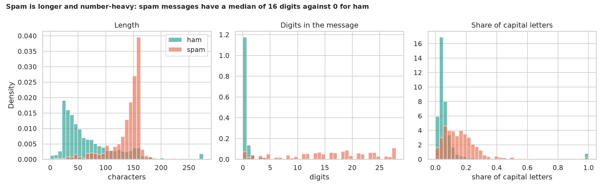
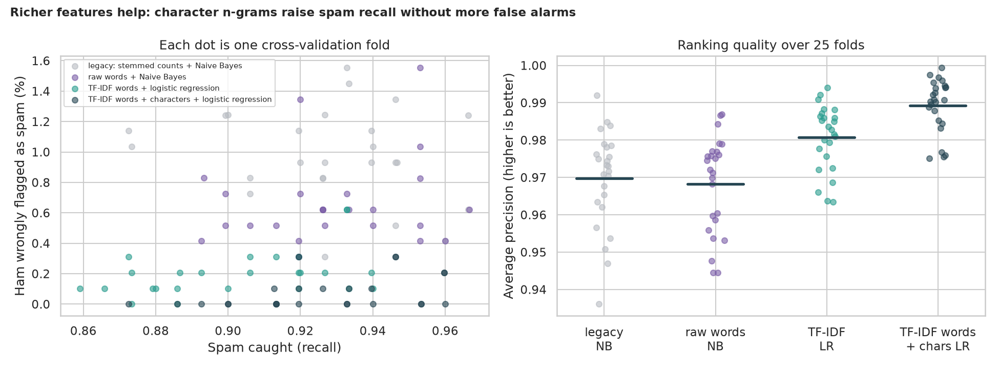
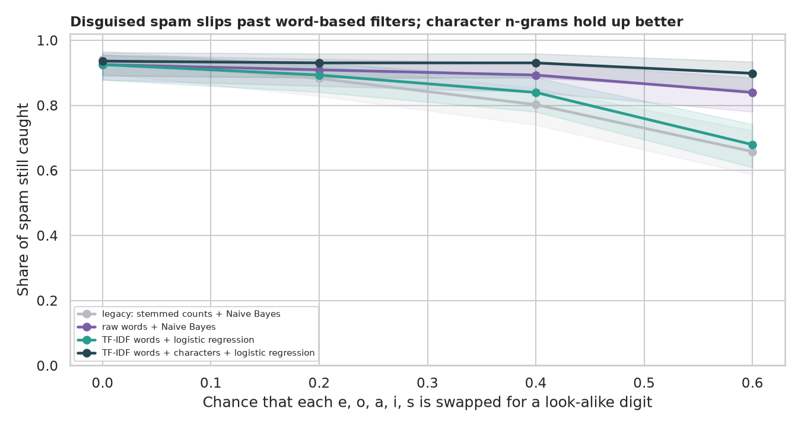

# SMS Spam Detection with TF-IDF: a simple filter, tested properly

> A bag-of-words model sorts text messages into spam and ham with about 98% accuracy, so the headline is not the interesting part. What does spam look like, did the legacy shortcuts (fitting the vocabulary on all data, ignoring duplicate messages) inflate the score, which features really help, and what happens when spammers disguise their words?

## 📓 Start here

**[`spam_detection_tfidf.ipynb`](spam_detection_tfidf.ipynb)** is the main lesson: every step has a plain-English explanation, the code, and a "how to read this" note. Prefer a web page? Open the pre-rendered report: **[`docs/nlp-spam-detection-tfidf.html`](../../docs/nlp-spam-detection-tfidf.html)**.

## 💡 The Simple Analogy

A **mail clerk sorting letters** into "real" and "junk" by their words. A *bag of words* clerk counts words and ignores order. *TF-IDF* tells her that a word found in every letter ("the") means little while a word found mostly in junk ("txt", "claim") means a lot. *Character n-grams* make her read word shapes, so "fr33" still looks like "free". A *leaky test* hands her the exam letters to study first.

## 🔬 The Hypothesis & Statistical Question

| # | Question | Method | Result |
|---|---|---|---|
| H1 | Does spam differ from ham in simple surface features? | Mann-Whitney, Holm, Cliff's δ | **Yes**: digits δ = 0.93 (AUC 0.965; median 16 vs 0), length δ = 0.75 (149 vs 52 characters), capitals δ = 0.65 |
| H2 | Does fitting the vocabulary on all messages inflate accuracy? | 25 paired folds, Wilcoxon | **No**: -0.05 points (p = 0.25) |
| H3 | Do duplicate messages across the split inflate accuracy? | 25 paired folds, Wilcoxon | **No**: +0.09 points (p = 0.33), although 11.1% of test messages had an exact copy in training |
| H4 | Do richer text features beat the legacy model? | 25 grouped folds, Nadeau-Bengio t-test, Holm | **Yes**: average precision 0.989 (words + characters) vs 0.970; false alarms 0.07% vs 0.98%; stemming and stop words added nothing |
| H5 | Does disguising words hurt word-based filters more? | Recall with Wilson CI, exact McNemar | **Yes**: at a disguise level of 0.6 the legacy model catches 65.8% of spam, the character model 89.8% (p = 1.4e-9) |

## 📊 Key Data Insights & Annotated Visualizations


Spam is longer and number-heavy.


Character n-grams raise spam recall without more false alarms.


Disguised spam slips past word-based filters; character n-grams hold up better.

## ⚙️ How it Works (Under the Hood)

The notebook is fully self-contained: no helper modules, just top-to-bottom cells.

1. **Data:** downloads the UCI SMS Spam Collection (5,574 messages) into `data/` on first run. It is read with quoting turned off, because the default reader drops 2 messages.
2. **Pipelines:** each model is a scikit-learn pipeline (vectoriser plus classifier), so the vocabulary is learned from training messages only: legacy stemmed counts + Naive Bayes, raw words + Naive Bayes, TF-IDF words + logistic regression, and TF-IDF words + character n-grams + logistic regression.
3. **Validation:** 5 repeats of 5-fold cross-validation, with copies of the same text always kept in the same fold (`StratifiedGroupKFold`).
4. **Statistics:** Mann-Whitney with Holm and Cliff's δ; Wilcoxon over paired folds; Nadeau-Bengio corrected paired t-test; Wilson intervals and exact McNemar for the disguise test.

**What changed from the legacy script:** it fitted the vocabulary on all data, read the file with the default quoting, reported one accuracy on one split (87% of messages are ham) and described itself as a "fake news" TF-IDF model while using plain counts on SMS data.

## 🚀 How to Run (One-liner command)

```bash
uv sync --extra nlp && uv run jupyter lab NLP/spam-detection-tfidf/spam_detection_tfidf.ipynb
```

The data downloads into `data/` on the first run; it takes about 5 minutes on a CPU. Standalone alternative: `pip install -r requirements.txt` and open the notebook in any Jupyter. To rebuild the web report:

```bash
uv run jupyter nbconvert --to html --execute NLP/spam-detection-tfidf/spam_detection_tfidf.ipynb \
    --output-dir docs --output nlp-spam-detection-tfidf
```

## ⚠️ Limitations & Edge Cases

- **One small, old dataset** (5,574 English messages from around 2006); modern spam, other languages and other channels differ.
- **Exact duplicates only:** near-duplicates were not grouped.
- **The disguise test is synthetic** (five letters swapped for digits).
- **The threshold analysis uses one split and an assumed 10-to-1 cost.**
- **One hold-out for the robustness test** (187 spam messages).
- **No transformer here:** see `sms-spam-distilbert` for a fine-tuned DistilBERT against this baseline.
