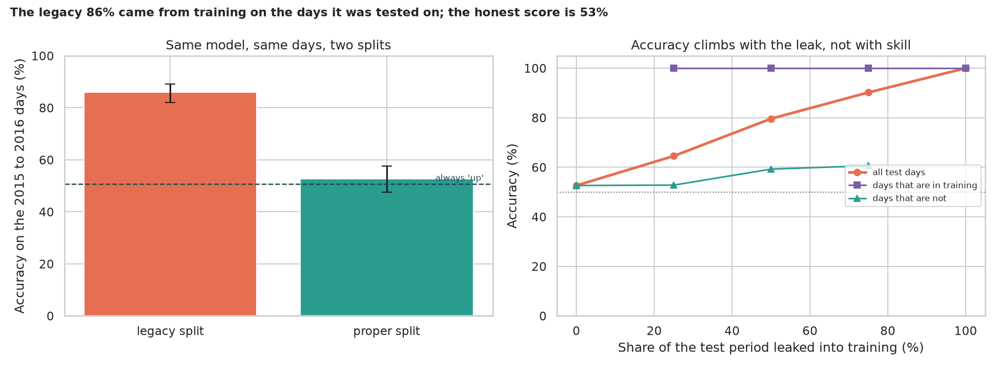
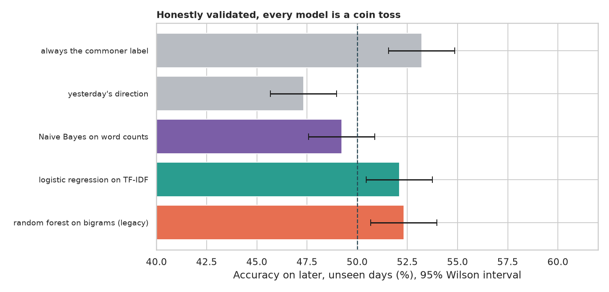

# Can News Headlines Predict the Stock Market? Finding the bug behind an 86% accuracy

> Every day, the 25 most popular world-news headlines on Reddit are paired with whether the Dow Jones index rose or fell. A classic tutorial reports about 86% accuracy with a random forest. Where does that come from, what is the honest score, and can any model beat a coin toss? *(Teaching example about validation, not financial advice. Renamed from `sports-sentiment`: the data has nothing to do with sports.)*

## 📓 Start here

**[`stock_news_direction.ipynb`](stock_news_direction.ipynb)** is the main lesson: every step has a plain-English explanation, the code, and a "how to read this" note. Prefer a web page? Open the pre-rendered report: **[`docs/nlp-stock-news-direction.html`](../../docs/nlp-stock-news-direction.html)**.

## 💡 The Simple Analogy

A **student given last year's exam to practise on, then graded on last year's exam**. If part of the exam is in the practice pack, they score 100% on those questions by remembering, not understanding. A random forest on word pairs is a superb rememberer. An honest test keeps the exam strictly *after* everything studied, and for a coin-toss problem "brilliant" means only a few points above 50%, mostly the market's habit of rising slightly more often than it falls.

## 🔬 The Hypothesis & Statistical Question

| # | Question | Method | Result |
|---|---|---|---|
| (bug) | Why 86%? | Inspect the split | `'2015-12-31' < '20150101'` is `True` (text is compared character by character): all of 2015 landed in training, so **252 of the 378 test days (66.7%) were in the training set** |
| H1 | Does the 86% survive a correct split? | Exact binomial, Wilson CI | **No**: legacy 86.0% (CI 82.1% to 89.1%) vs proper 52.6% (47.6% to 57.6%) on the same test days; vs always "up" (50.8%) p = 0.25 |
| H2 | Where does the accuracy come from? | Split by in/out of training; dose-response | **Memory**: 100% on test days seen in training, 57.9% on the rest; accuracy climbs 52.6% → 64.6% → 79.6% → 90.2% → 100% as more of the test period is added |
| H3 | Can any model beat the base rate on later days? | Expanding window, 3,516 days, binomial | **No**: commoner label 53.2%, legacy forest 52.3%, logistic regression 52.1%, Naive Bayes 49.2%; "yesterday's direction" 47.3% (p = 0.002, below a coin toss) |

## 📊 Key Data Insights & Annotated Visualizations


The legacy 86% came from training on the days it was tested on; the honest score is 53%.


Honestly validated, every model is a coin toss.

## ⚙️ How it Works (Under the Hood)

The notebook is fully self-contained: no helper modules, just top-to-bottom cells.

1. **Data:** the Kaggle DJIA news table (4,101 trading days, 2000 to 2016, 25 headlines per day, label 1 if the index rose or stayed level). Kaggle needs a login, so save it as `data/Data.csv` (or `data/Combined_News_DJIA.csv`); the loader explains this if the file is missing.
2. **The bug:** the legacy string split is reproduced and then replaced by a split on real dates.
3. **Models:** the legacy bigram-count random forest, Naive Bayes, logistic regression on TF-IDF, and two baselines ("always the commoner label", "yesterday's direction").
4. **Validation:** the proper 378-day test; a dose-response leak experiment; expanding-window validation over six later blocks.
5. **Statistics:** exact binomial tests, Wilson intervals, a runs test and autocorrelation of the labels.

**What changed from the legacy script:** the split used text dates, the accuracy was reported with no baseline or interval, and the folder name described the wrong data.

## 🚀 How to Run (One-liner command)

```bash
uv sync --extra nlp && uv run jupyter lab NLP/stock-news-direction/stock_news_direction.ipynb
```

Download the data from Kaggle first (see above). It takes about 3 minutes on a CPU. Standalone alternative: `pip install -r requirements.txt` and open the notebook in any Jupyter. To rebuild the web report:

```bash
uv run jupyter nbconvert --to html --execute NLP/stock-news-direction/stock_news_direction.ipynb \
    --output-dir docs --output nlp-stock-news-direction
```

## ⚠️ Limitations & Edge Cases

- **One news source and one index:** we do not claim that no news predicts any market.
- **Only the up/down label is known,** not the size of moves or whether headlines came before or after the close.
- **Bag-of-words models only.**
- **Pooled intervals treat days as independent,** which is slightly optimistic.
- **Accuracy ignores trading costs and the size of moves.**
- **The data file must be downloaded by hand** (Kaggle login).
- **Not financial advice.**
