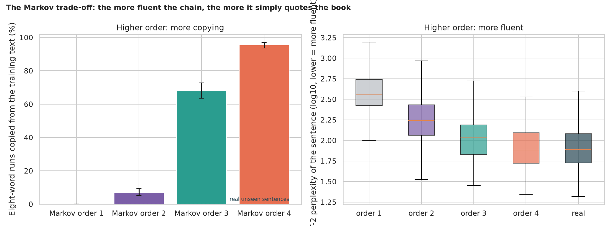
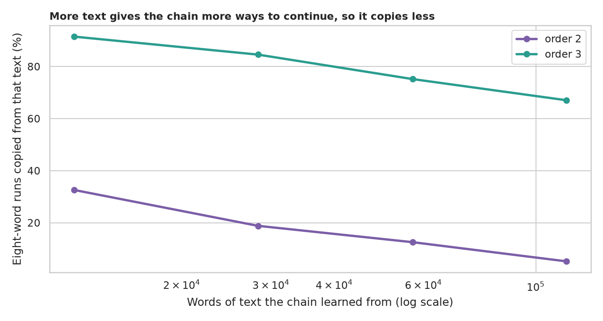
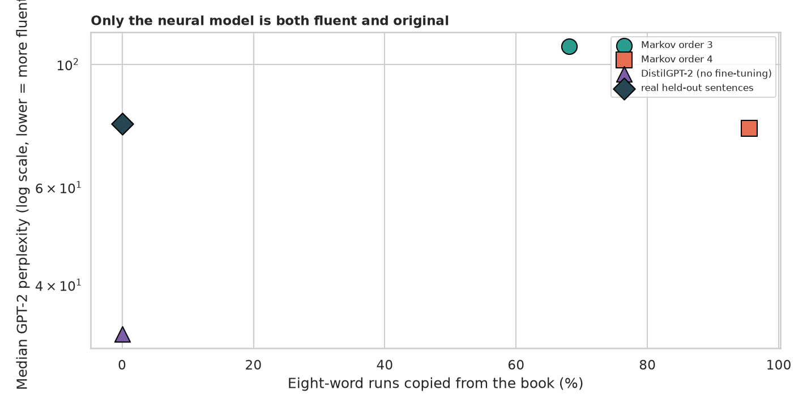

# Text Generation with Markov Chains: fluent, or original, but not both

> A Markov chain writes text by looking at the last few words and picking a next word that followed them somewhere in its training book. With a long memory it produces fluent sentences, but is it writing or quoting? How does the memory trade fluency against originality, how much text does it need, and how does it compare with a neural language model?

## 📓 Start here

**[`text_generation.ipynb`](text_generation.ipynb)** is the main lesson: every step has a plain-English explanation, the code, and a "how to read this" note. Prefer a web page? Open the pre-rendered report: **[`docs/nlp-text-generation.html`](../../docs/nlp-text-generation.html)**.

## 💡 The Simple Analogy

Writing a sentence by **cutting up a novel and gluing snippets together**, like a ransom note. Looking at only the last *one* word, almost anything could come next, so the result is nonsense that is entirely new. Looking at the last *four* words, there is usually only one place in the book where they occurred, so you are forced to copy the sentence already there: it sounds perfect because it *is* the book. A neural language model has learned patterns from billions of words and can write sentences that were never in any book.

## 🔬 The Hypothesis & Statistical Question

| # | Question | Method | Result |
|---|---|---|---|
| H1 | Does a longer memory mean more copying? | Share of eight-word runs copied, bootstrap CIs, Spearman | **Yes**: 0.0% (order 1), 7.1% (2), 68.1% (3), **95.5%** (4); at order 4 **78.5%** of sentences are exact quotes; real unseen sentences 0.0% |
| H2 | Does a longer memory mean more fluent text? | GPT-2 perplexity, Kruskal-Wallis, Cliff's δ | **Yes**: median perplexity 357, 175, 108, **76.7**, against 78.0 for real sentences (δ = 0.01 at order 4) |
| H3 | Does more training text mean less copying? | 10% to 100% of the book | **Yes, slowly**: order 3 falls from 91.5% to 67.1% with ten times more text |
| H4 | Is a neural model both fluent and original? | Mann-Whitney, Cliff's δ | **Yes**: DistilGPT-2 perplexity 32.6, 0.0% copied (δ = -0.55 against order 3), though 27.5% of its words are not in the book |

## 📊 Key Data Insights & Annotated Visualizations


The more fluent the chain, the more it simply quotes the book.


More text gives the chain more ways to continue, so it copies less.


Only the neural model is both fluent and original.

## ⚙️ How it Works (Under the Hood)

The notebook is fully self-contained: no helper modules, just top-to-bottom cells.

1. **Data:** downloads *Pride and Prejudice* (Project Gutenberg, public domain) into `data/`, strips the licence text and chapter headings, and cuts it into 6,467 sentences: the first 90% for training, the last 10% held back as real unseen text.
2. **The chain:** about 30 lines of Python: for each run of *k* words, the list of words that followed it; a sentence is a walk through that table.
3. **Measures:** originality = the share of eight-word runs copied word for word from the training text (with memory *k*, every run of *k + 1* words is a copy by construction, so longer runs are needed); fluency = perplexity under GPT-2.
4. **Neural comparison:** DistilGPT-2 samples from the Hugging Face hub, no fine-tuning.
5. **Statistics:** bootstrap intervals, Spearman correlation, Kruskal-Wallis, Mann-Whitney with Cliff's δ.

**What changed from the legacy script:** it used a private text file, a memory of 4 words (mostly quoting) and no evaluation or seed.

## 🚀 How to Run (One-liner command)

```bash
uv sync --extra nlp && uv run jupyter lab NLP/text-generation/text_generation.ipynb
```

The book and two small models download on the first run; it takes about 3 minutes with a GPU. Standalone alternative: `pip install -r requirements.txt` and open the notebook in any Jupyter. To rebuild the web report:

```bash
uv run jupyter nbconvert --to html --execute NLP/text-generation/text_generation.ipynb \
    --output-dir docs --output nlp-text-generation
```

## ⚠️ Limitations & Edge Cases

- **One book, one author:** another corpus would shift every number, though not the direction of the trade-off.
- **Perplexity under one judge** (GPT-2, which has probably read this book); a proxy for fluency, not a human rating.
- **Eight-word runs catch copying, not close paraphrase.**
- **200 sentences per source and one seed.**
- **The neural sample is unconditioned and writes modern English,** not the book's style.
- **Sentence-level only:** no coherence beyond one sentence is judged.
