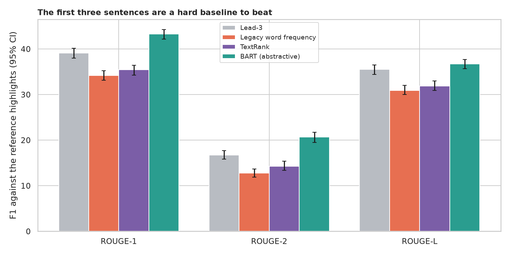
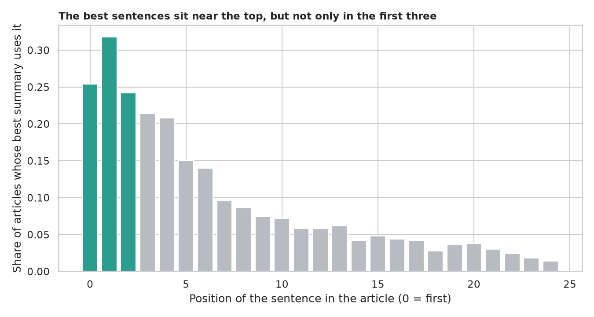

# Text Summarization: how hard is "the first three sentences" to beat?

> The legacy script summarised one live Wikipedia page by counting word frequencies and printing the top five sentences, with no way to tell whether the result was any good. How do we measure a summary, how does the word-count method compare with the first three sentences, does TextRank help, what does an abstractive model (BART) add and invent, and how much better could a three-sentence summary be? Tested on 500 CNN/DailyMail articles with human-written highlights.

## 📓 Start here

**[`text_summarization.ipynb`](text_summarization.ipynb)** is the main lesson: every step has a plain-English explanation, the code, and a "how to read this" note. Prefer a web page? Open the pre-rendered report: **[`docs/nlp-text-summarization.html`](../../docs/nlp-text-summarization.html)**.

## 💡 The Simple Analogy

Summarising a **newspaper story** for a busy friend. The **lazy editor** reads out the first three sentences (news puts the point first). The **word-counting editor** circles the commonest words and reads the sentences with the most circles. The **"who is connected to whom" editor (TextRank)** picks sentences similar to many others. The **writer (BART)** writes new sentences, fluent but sometimes adding a stadium name they once heard. A **strict teacher** compares each with the bullet points a journalist wrote.

## 🔬 The Hypothesis & Statistical Question

Reference: the stories' own bullet-point highlights; score: ROUGE-1, ROUGE-2 and ROUGE-L F1; all systems summarise the same 500 articles, so comparisons are paired (Wilcoxon, bootstrap CIs).

| # | Question | Method | Result |
|---|---|---|---|
| H1 | Is the legacy word-count method better than lead-3? | Paired Wilcoxon | **No, worse**: ROUGE-1 34.2 vs 39.1 (-4.9, CI -6.0 to -3.9) |
| H2 | Does TextRank help? | Same | Beats the legacy method (+1.2), **loses to lead-3** (-3.7) |
| H3 | How much does BART add, and how much is left? | Same; greedy oracle | BART 43.3 / 20.6 / 36.7 vs lead-3 39.1 / 16.7 / 35.5; oracle 55.7 / 32.1 / 51.6; BART wins in 66% / 65% / 53% of articles |
| H4 | Do the best sentences sit at the top? | Oracle positions; Spearman | 31% from the first 3, 69% from the first 10, 31% later; longer articles hurt lead-3 (rho = -0.26) |
| H5 | Does BART invent things? | Novel words; unsupported numbers and names | 1.4% novel words, 11.6% novel pairs; **3.8%** of summaries contain a number or name absent from the article |

## 📊 Key Data Insights & Annotated Visualizations


The first three sentences are a hard baseline to beat.


The best sentences sit near the top, but not only in the first three.

## ⚙️ How it Works (Under the Hood)

1. **Data:** 500 random CNN/DailyMail test articles (about 30 MB download); the highlights are the reference.
2. **Systems:** lead-3; the legacy word-frequency method; TextRank (TF-IDF cosine graph + PageRank); BART (`facebook/bart-large-cnn`, 4 beams, first 1,024 word-pieces).
3. **Scoring:** ROUGE-1/2/L (summary level, with stemming); a greedy oracle picks the best 3 sentences with the reference in view.
4. **Faithfulness check:** novel words and word pairs, and numbers or names missing from the article.

**What changed from the legacy script:** one live Wikipedia page, five sentences in score order, 30-word cut-off and no reference are replaced by a reproducible benchmark with ROUGE, tests and baselines.

## 🚀 How to Run (One-liner command)

```bash
uv sync --extra nlp && uv run jupyter lab NLP/text-summarization/text_summarization.ipynb
```

The articles and BART (about 1.6 GB) download on the first run. It uses a GPU if present and takes about 20 minutes on one. Standalone alternative: `pip install -r requirements.txt`.

## ⚠️ Limitations & Edge Cases

- **News only:** CNN/DailyMail has a strong lead bias, so lead-3 is a hard baseline here and would not be on other text.
- **500 articles;** ROUGE measures word overlap, not meaning or faithfulness.
- **One journalist's bullets** are the reference.
- **BART was fine-tuned on this dataset;** the extractive methods were not tuned.
- **The oracle is greedy and optimistic.**
- **The faithfulness check is crude** and misses subtle errors.
- **The BART timing is rough** (small GPU under memory pressure).
